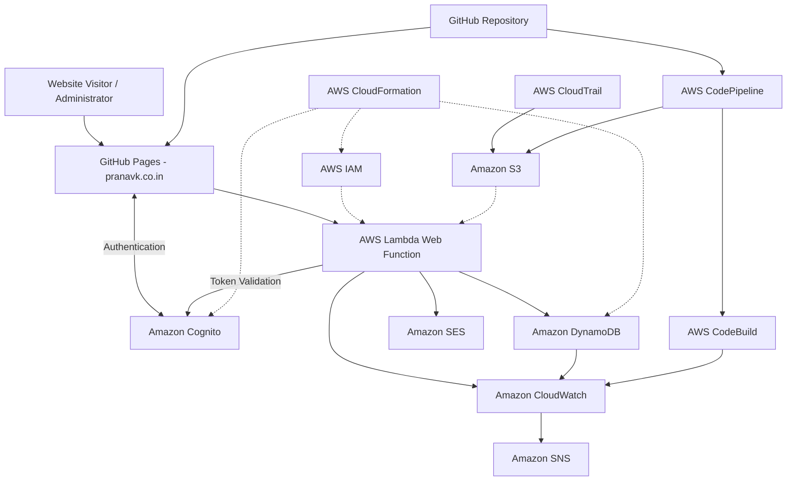
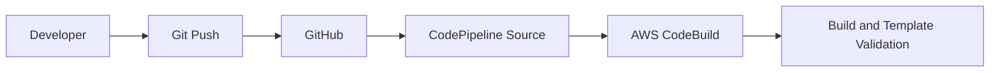

# AWS Serverless Student Portfolio

A secure, full-stack serverless portfolio and blog platform built using 12 AWS services, featuring dynamic content management, administrator authentication, cloud monitoring, infrastructure as code, and automated continuous integration.


## Live Demo

**Visit the portfolio:** [pranavk.co.in](https://pranavk.co.in/)

---

## Project Overview

This project demonstrates the practical implementation of a modern cloud-native web application using AWS serverless technologies.

The public website allows visitors to explore projects, read blog posts, view technical skills, and submit contact messages. A secure administrator dashboard enables dynamic content management without manually modifying frontend code.

## Key Features

- Responsive portfolio with a custom HTTPS domain.
- Dynamic project and blog management.
- Secure administrator authentication using Amazon Cognito.
- Role-based authorization and protected API endpoints.
- Serverless REST-style backend using AWS Lambda Web Functions.
- Amazon DynamoDB database integration.
- Contact form with email delivery and rate limiting.
- CloudWatch monitoring and SNS email alerts.
- CloudTrail auditing and log integrity validation.
- CloudFormation infrastructure management.
- Automated continuous integration using CodePipeline and CodeBuild.

---

## System Architecture



---

## AWS Services Used

| No. | AWS Service | Purpose |
| --- | --- | --- |
| 1 | AWS Lambda Web Functions | Serverless backend and HTTPS API |
| 2 | Amazon DynamoDB | Project, blog, and rate-limit storage |
| 3 | Amazon Cognito | Authentication and authorization |
| 4 | Amazon SES | Contact form email delivery |
| 5 | Amazon S3 | Backend artifacts, pipeline artifacts, and audit logs |
| 6 | AWS IAM | Permissions and access management |
| 7 | Amazon CloudWatch | Monitoring, logs, dashboards, and alarms |
| 8 | Amazon SNS | Operational email notifications |
| 9 | AWS CloudTrail | Cloud activity auditing |
| 10 | AWS CloudFormation | Infrastructure as Code |
| 11 | AWS CodeBuild | Automated build validation |
| 12 | AWS CodePipeline | Continuous integration orchestration |

AWS CodeConnections provides supporting GitHub integration.

GitHub Pages provides frontend hosting and is not included in the AWS service count.

---

## Technology Stack

| Layer | Technologies |
| --- | --- |
| Frontend | HTML5, CSS3, JavaScript |
| Backend | Node.js 24, AWS Lambda Web Functions |
| Database | Amazon DynamoDB |
| Authentication | Amazon Cognito, OAuth 2.0, PKCE, JWT |
| Infrastructure | AWS CloudFormation, AWS IAM |
| Monitoring | CloudWatch, SNS, CloudTrail |
| DevOps | Git, GitHub, CodePipeline, CodeBuild |
| Hosting | GitHub Pages, Custom Domain, HTTPS |

---

## Continuous Integration



Changes pushed to the main branch automatically trigger AWS CodePipeline and CodeBuild.

The pipeline validates frontend files and the CloudFormation reference template.

Frontend deployment is handled by GitHub Pages. Backend revisions are managed through AWS Lambda Web Functions.

The AWS pipeline currently implements continuous integration, not automated production deployment.

---

## Security

- HTTPS communication.
- Cognito administrator authentication.
- Role-based backend authorization.
- JWT access token validation.
- Restricted CORS configuration.
- IAM-controlled service permissions.
- Contact form rate limiting.
- Encrypted cloud storage.
- CloudTrail audit logging.
- Private backend backup excluded from Git.

---

## Project Structure

```text
AWS-Serverless-Student-Portfolio/
|
|-- infrastructure/
|   |-- aws-resource-inventory.md
|   |-- student-portfolio-stack.yaml
|
|-- .gitignore
|-- admin.css
|-- admin.html
|-- admin.js
|-- auth.js
|-- buildspec.yml
|-- CNAME
|-- favicon.svg
|-- index.html
|-- README.md
|-- script.js
|-- style.css
```

The private Lambda Web Function backend backup is intentionally excluded from the public repository.

---

## Technical Documentation

Detailed infrastructure configurations, security controls, resource information, and verification results are available in the following documents.

| Document | Description |
| --- | --- |
| [AWS Resource Inventory](infrastructure/aws-resource-inventory.md) | Complete technical infrastructure documentation |
| [CloudFormation Reference Template](infrastructure/student-portfolio-stack.yaml) | Infrastructure as Code reference with 27 resource definitions |
| [CodeBuild Specification](buildspec.yml) | Automated build and validation configuration |

**Note:** The CloudFormation reference template documents the broader project infrastructure and must not be deployed directly over the existing production stack without review.

---

## Learning Outcomes

This project demonstrates practical experience in:

- AWS cloud architecture and serverless computing.
- Full-stack web application development.
- Cloud authentication and security.
- NoSQL database management.
- Infrastructure as Code.
- Cloud monitoring and auditing.
- DevOps and continuous integration.
- Custom domain and HTTPS configuration.
- Cost-conscious cloud architecture.
- Cloud troubleshooting.

---

## Project Status

| Property | Details |
| --- | --- |
| Application | Live |
| Architecture | Serverless |
| Primary AWS Services | 12 |
| AWS Region | Asia Pacific (Mumbai) |
| Frontend | GitHub Pages |
| Backend | AWS Lambda Web Functions |
| Continuous Integration | CodePipeline and CodeBuild |

---

## Author

### Pranav K

Computer Science Student | Cloud Computing Enthusiast | Aspiring Cloud Solutions Architect

- **Portfolio:** [pranavk.co.in](https://pranavk.co.in/)
- **GitHub:** [santhoshpranavk](https://github.com/santhoshpranavk)

---

Developed to demonstrate practical AWS cloud architecture, serverless application development, infrastructure management, security, monitoring, and DevOps.
