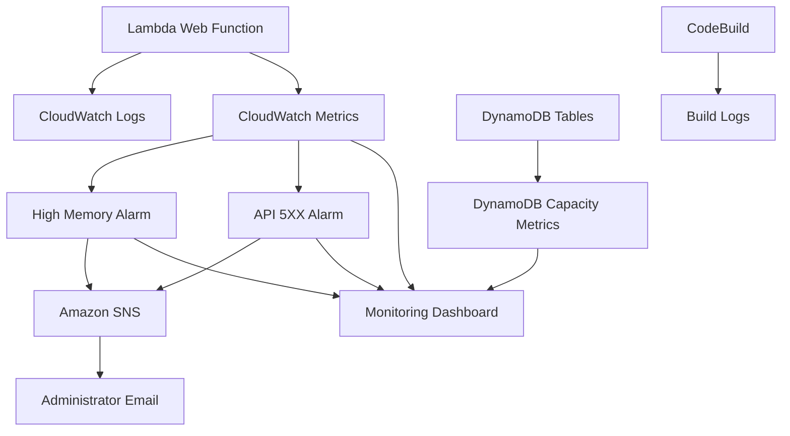
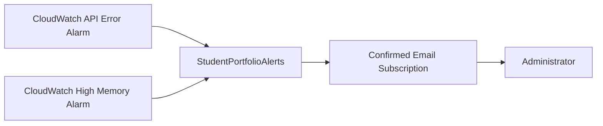
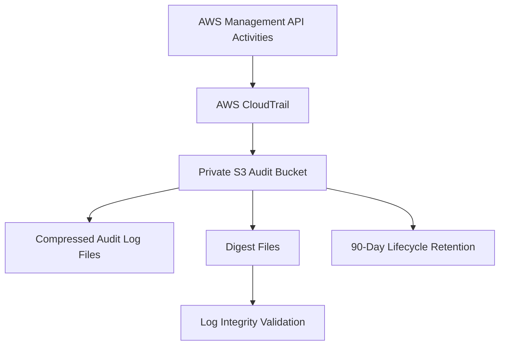
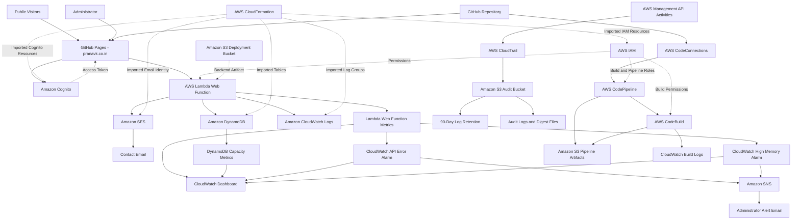
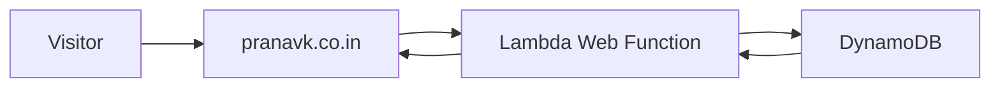
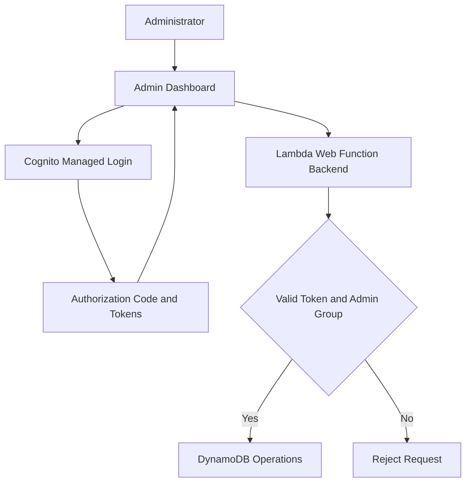
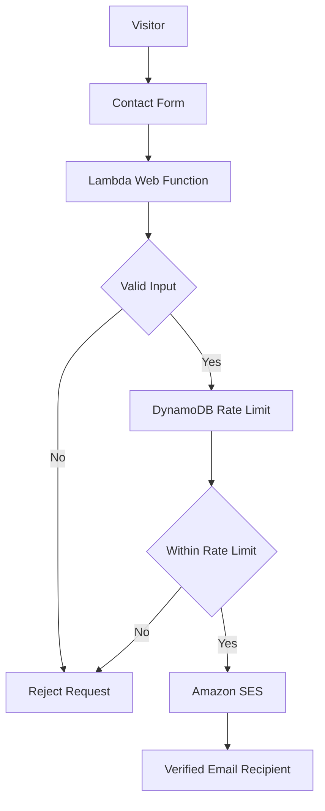
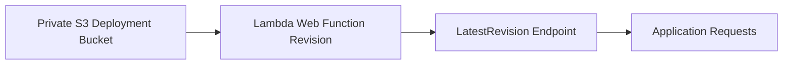
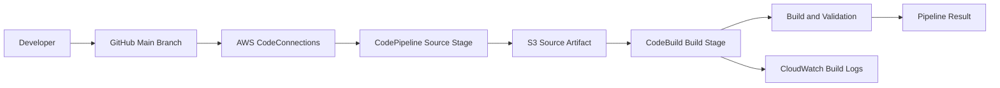
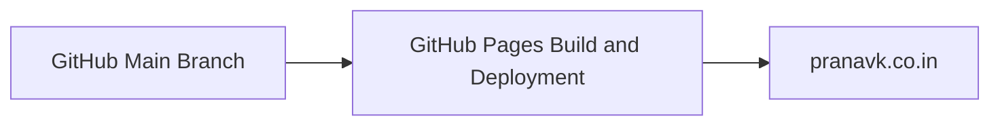

# AWS Infrastructure Inventory

## Project Information

| Property | Value |
| --- | --- |
| Project Name | AWS Serverless Student Portfolio |
| Environment | Production |
| Primary AWS Region | ap-south-1 (Mumbai) |
| Primary Website | https://pranavk.co.in/ |
| Frontend Hosting | GitHub Pages |
| Backend | AWS Lambda Web Function |
| Backend Runtime | Node.js 24.x |
| Source Control | GitHub |
| Infrastructure Management | AWS CloudFormation |
| Continuous Integration | AWS CodePipeline and AWS CodeBuild |
| Inventory Last Reviewed | November 17, 2026 |
| Primary AWS Services Implemented | 12 |
| Minimum AWS Service Requirement | 10 |
| AWS Service Requirement Status | Achieved |
| Inventory Status | Updated infrastructure documented; final validation pending |

This document records the existing deployed infrastructure,
application architecture, security configurations, monitoring,
auditing, infrastructure automation, continuous integration,
custom domain configuration and verification results.

Configuration values reflect the latest recorded inspections.

Historical verification results are retained where applicable.

This inventory is not a comprehensive security or compliance audit.

---

## Table of Contents

1. AWS Lambda Web Function
2. Amazon DynamoDB
3. Amazon Cognito
4. Amazon SES
5. AWS Identity and Access Management
6. Amazon CloudWatch
7. AWS CloudFormation
8. Amazon S3
9. Amazon SNS
10. AWS CloudTrail
11. Frontend Hosting and Custom Domain
12. Infrastructure Architecture
13. AWS Service Implementation Summary
14. Infrastructure Automation and Continuous Integration
15. Infrastructure Reference Template
16. Completed Configuration Verification
17. Application and Integration Testing
18. Pending Configuration Verification
19. Cost Management
20. Security Management
21. Resource Protection Summary
22. Important Notes
23. Remaining Project Activities
24. Inventory Status
25. Infrastructure Implementation History

---

## 1. AWS Lambda Web Function

### Lambda Web Function Configuration

| Property | Configuration |
| --- | --- |
| Function Name | student-portfolio-api |
| Function Type | AWS Lambda Web Function |
| Region | ap-south-1 |
| Function Status | Active |
| Runtime | Node.js 24.x |
| Previous Verified Revision | rev-6boxt |
| Latest Verified Revision | rev-f0wre |
| Revision State | Active |
| Timeout | 30 seconds |
| Maximum Concurrency Per Environment | 64 |
| Environment Variables | None configured |
| Customer-Managed KMS Key | Not configured |
| VPC Network Connector | Not configured |
| Architecture | Not verified |
| Package Type Applicability | Not verified |
| Memory Configuration Applicability | Not verified |
| Execution Role | student-portfolio-api-role-g7fsr5wg |
| Deployment Artifact Storage | Amazon S3 |
| CloudFormation Import Status | Not imported |

### Endpoint Configuration

| Property | Configuration |
| --- | --- |
| Endpoint Name | student-portfolio-api-endpoint |
| Endpoint Type | HomeRegion |
| Primary Region | ap-south-1 |
| Endpoint Status | Active |
| Authentication Type | ApplicationManaged |
| Automatic Deployment | LatestRevision |
| Active Revision | rev-f0wre |
| Revision Traffic Allocation | 100 percent |
| Replicated Regions | None |
| Maximum Environments | Not explicitly configured at inspection |
| Endpoint Rate Limit | Not explicitly configured at inspection |

### Public Backend Endpoint

https://90y9wzfm46tg51xd.qws.lambda-web.ap-south-1.on.aws/

The Lambda Web Function provides a public HTTPS endpoint
for the portfolio REST API.

A separate Amazon API Gateway implementation is not used.

A conventional AWS Lambda function is not used as a
replacement for the existing Lambda Web Function.

### Backend Technologies

- Node.js 24.x
- JavaScript
- Node.js HTTP module
- Node.js Crypto module
- AWS SDK for JavaScript
- Amazon DynamoDB integration
- Amazon SES integration
- Amazon Cognito JWT access token validation

### Backend Application Files

- index.js
- package.json
- package-lock.json
- node_modules/

### Logging Configuration

| Property | Configuration |
| --- | --- |
| Application Log Level | INFO |
| System Log Level | INFO |
| Main Log Group | /aws/lambda/web/student-portfolio-api |
| Main Log Retention | 30 days |
| Local Log Group | /aws/lambda/web/student-portfolio-api.local |
| Local Log Retention | 30 days |

### Purpose

- Provides the backend REST API.
- Retrieves portfolio projects from DynamoDB.
- Retrieves published blog posts from DynamoDB.
- Processes portfolio contact form submissions.
- Sends contact form emails through Amazon SES.
- Supports authenticated administrator operations.
- Validates Cognito access tokens.
- Validates administrator group membership.
- Enforces contact form rate limiting.
- Generates application logs in Amazon CloudWatch.
- Provides backend metrics for monitoring.
- Supports automatic deployment of the latest revision.

### Public API Endpoints

| HTTP Method | Endpoint | Purpose |
| --- | --- | --- |
| GET | /api/projects | Retrieve portfolio projects |
| GET | /api/blog | Retrieve published blog posts |
| GET | /api/blog/:postId | Retrieve an individual published blog post |
| POST | /api/contact | Submit a contact form message |

### Administrator API Endpoints

| HTTP Method | Endpoint | Purpose |
| --- | --- | --- |
| GET | /api/admin/me | Verify administrator identity |
| GET | /api/admin/projects | Retrieve administrator project records |
| POST | /api/admin/projects | Create a project |
| PUT | /api/admin/projects/:projectId | Update a project |
| DELETE | /api/admin/projects/:projectId | Delete a project |
| GET | /api/admin/blog | Retrieve published and draft blog posts |
| POST | /api/admin/blog | Create a blog post |
| PUT | /api/admin/blog/:postId | Update a blog post |
| DELETE | /api/admin/blog/:postId | Delete a blog post |

### Security Configuration

- Administrator authentication: Amazon Cognito.
- Administrator authorization: PortfolioAdmins group.
- Token type: Cognito access token.
- Token validation: Performed by the Lambda Web Function backend.
- JWT signature verification: Implemented.
- JWT issuer validation: Implemented.
- JWT client identifier validation: Implemented.
- JWT expiration validation: Implemented.
- Administrator group validation: Implemented.
- Public blog access: Published posts only.
- Draft blog access: Restricted to authorized administrators.
- Contact form input validation: Implemented.
- Contact form rate limiting: Amazon DynamoDB.
- Contact form email delivery: Amazon SES.
- Cross-Origin Resource Sharing: Explicit origin allowlist.
- HTTPS communication: Enabled.

### Cross-Origin Resource Sharing Configuration

The backend permits the following recorded origins:

| Origin | Purpose |
| --- | --- |
| https://pranavk.co.in | Primary production website |
| https://santhoshpranavk.github.io | Legacy GitHub Pages origin |
| http://127.0.0.1:5500 | Local development |
| http://localhost:8080 | Local development |

The production custom domain was added to the backend
origin allowlist during the custom domain migration.

The application handles browser CORS preflight requests.

The custom domain origin does not include a trailing slash.

CORS is a browser access-control mechanism and does not
replace backend authentication or authorization.

### Custom Domain Backend Update

The custom domain initially encountered a CORS error
when the administrator dashboard attempted to access:

GET /api/admin/me

The backend origin allowlist was updated to include:

https://pranavk.co.in

A new Lambda Web Function revision was created and deployed.

| Verification | Result |
| --- | --- |
| Updated Backend Origin Allowlist | Completed |
| New Revision | rev-f0wre |
| Revision Activation | Successful |
| Endpoint Traffic Allocation | 100 percent |
| Administrator Authentication | Passed |
| Administrator Dashboard Access | Passed |
| Administrator Project Creation | Passed |
| Public Project Visibility | Passed |

No additional Lambda Web Function or endpoint was created.

### Private Backend Backup

A local backend source backup is maintained separately
from the published frontend source.

| Property | Configuration |
| --- | --- |
| Backup File | lambda-index-updated.js |
| Backup Purpose | Local backend source preservation |
| Git Ignore Rule | /lambda-index-updated.js |
| Git Ignore Verification | Passed |
| Current Git Tracking | Not tracked |
| Custom Domain CORS Update | Included |
| Public Repository Publication | Not intended |

The local backup is excluded from Git using .gitignore.

The backup must not be committed to the public repository.

The Git ignore verification confirms the current exclusion
and tracking state. It does not independently establish
the contents of every historical Git commit.

The backup is not a substitute for a complete
disaster recovery strategy.

### Infrastructure Management Notes

- Preserve the existing Lambda Web Function.
- Preserve the existing public HTTPS endpoint.
- Preserve the existing execution role.
- Preserve required application permissions.
- Preserve administrator authentication and authorization.
- Preserve the production CORS origin.
- Preserve the existing deployment artifact storage.
- Preserve the active deployment revision.
- Do not create duplicate backend functions.
- Do not replace the Lambda Web Function with a conventional Lambda function.
- Verify resource import support before importing the function.
- Review deployment compatibility before changing revisions.
- Do not store credentials or authentication tokens in source control.
- Keep private backend backups excluded from the public repository.

---

## 2. Amazon DynamoDB

### General Configuration

- Region: ap-south-1
- Total Portfolio Tables: 3
- Capacity Mode: On-demand
- Encryption: AWS-owned keys
- CloudFormation Import Status: All three tables imported

### Projects Table

| Property | Configuration |
| --- | --- |
| Table Name | student-portfolio-projects |
| Partition Key | projectId |
| Partition Key Type | String |
| Sort Key | None |
| Capacity Mode | On-demand |
| CloudFormation Billing Mode | PAY_PER_REQUEST |
| Table Status | Active |
| Point-in-Time Recovery | Disabled |
| Resource-Based Policy | Not active at inspection |
| Table-Specific CloudWatch Alarms | None at inspection |
| Deletion Protection | Enabled |
| Encryption | AWS-owned key |
| TTL | Disabled |

#### Purpose

- Stores portfolio project information.
- Provides project records to the public portfolio.
- Supports administrator project creation.
- Supports administrator project updates.
- Supports administrator project deletion.

### Blog Posts Table

| Property | Configuration |
| --- | --- |
| Table Name | student-portfolio-blog-posts |
| Partition Key | postId |
| Partition Key Type | String |
| Sort Key | None |
| Capacity Mode | On-demand |
| CloudFormation Billing Mode | PAY_PER_REQUEST |
| Table Status | Active |
| Point-in-Time Recovery | Disabled |
| Resource-Based Policy | Not active at inspection |
| Table-Specific CloudWatch Alarms | None at inspection |
| Deletion Protection | Enabled |
| Encryption | AWS-owned key |
| TTL | Disabled |

#### Purpose

- Stores portfolio blog posts.
- Supports draft and published blog statuses.
- Provides published blog posts to public visitors.
- Supports administrator blog creation.
- Supports administrator blog updates.
- Supports administrator blog deletion.
- Restricts draft visibility through backend authorization.

### Contact Rate Limit Table

| Property | Configuration |
| --- | --- |
| Table Name | student-portfolio-contact-ratelimit |
| Partition Key | rateLimitKey |
| Partition Key Type | String |
| Sort Key | None |
| Capacity Mode | On-demand |
| CloudFormation Billing Mode | PAY_PER_REQUEST |
| Table Status | Active |
| Point-in-Time Recovery | Disabled |
| Resource-Based Policy | Not active at inspection |
| Table-Specific CloudWatch Alarms | None at inspection |
| Deletion Protection | Disabled |
| Encryption | AWS-owned key |
| TTL | Enabled |
| TTL Attribute | expiresAt |
| Warm Read Throughput at Inspection | 12000 units/sec |
| Warm Write Throughput at Inspection | 4000 units/sec |
| Tags at Inspection | None |

#### Purpose

- Stores contact form request counters.
- Supports application-level contact form rate limiting.
- Uses expiresAt to identify expired records.
- Allows DynamoDB to remove expired records through TTL.
- Helps reduce contact form spam.
- Helps limit excessive SES email requests.

DynamoDB TTL deletion is asynchronous and does not
guarantee immediate removal at the expiration timestamp.

### DynamoDB Protection Summary

| Table | Deletion Protection | Encryption | TTL | PITR |
| --- | --- | --- | --- | --- |
| student-portfolio-projects | Enabled | AWS-owned key | Disabled | Disabled |
| student-portfolio-blog-posts | Enabled | AWS-owned key | Disabled | Disabled |
| student-portfolio-contact-ratelimit | Disabled | AWS-owned key | Enabled | Disabled |

### Project Record Restoration

During final administrator dashboard testing, the
AWS Serverless Student Portfolio project record was
accidentally deleted through the application.

The deletion affected the DynamoDB project item.

It did not delete the AWS infrastructure, CloudFormation
stack, Lambda Web Function or GitHub repository.

The project entry was recreated through the
administrator dashboard.

| Verification | Result |
| --- | --- |
| Administrator Project Creation | Successful |
| Project Record Restoration | Successful |
| Public Projects Section | Verified |
| AWS Infrastructure Impact | No infrastructure deletion performed |

The recreated record represents the restored project
listing. It is not a verified byte-for-byte restoration
of the original deleted item.

This incident demonstrates that table deletion protection
does not prevent authorized deletion of individual items.

### Infrastructure Management Notes

- Preserve all existing production table data.
- Do not create duplicate DynamoDB tables.
- Preserve existing table names and partition keys.
- Preserve deletion protection for content tables.
- Preserve the contact rate limit TTL configuration.
- Preserve CloudFormation retention safeguards.
- Maintain DeletionPolicy: Retain.
- Maintain UpdateReplacePolicy: Retain.
- Review backup requirements before enabling paid backup features.
- Avoid deleting production records during testing.
- Use temporary records for future CRUD testing.
- Point-in-Time Recovery is currently disabled.
- ExpenseTrackTable is outside the portfolio project scope.

---

## 3. Amazon Cognito

### User Pool

| Property | Configuration |
| --- | --- |
| User Pool Name | User pool - vqmsd |
| User Pool ID | ap-south-1_CQ6N2FL3Z |
| Region | ap-south-1 |
| Feature Plan | Essentials |
| Estimated Users at Inspection | 1 |
| Deletion Protection | Enabled |
| Created Date | November 6, 2026 |
| Public Self-Registration | Disabled |
| Multi-Factor Authentication | Disabled |
| CloudFormation Import Status | Imported |

### App Client

| Property | Configuration |
| --- | --- |
| App Client Name | student-portfolio-admin-spa |
| App Client ID | 2gnvmkc5l9cm3ab9mq8rm0n8uq |
| Client Secret | None |
| Application Type | Single Page Application |
| Authentication Session Duration | 3 minutes |
| Access Token Expiration | 60 minutes |
| ID Token Expiration | 60 minutes |
| Refresh Token Expiration | 5 days |
| Token Revocation | Enabled |
| Prevent User Existence Errors | Enabled |
| CloudFormation Import Status | Imported |

### Authentication Flows

- Choice-based sign-in.
- Secure Remote Password authentication.
- Get user tokens from existing authenticated sessions.

### Managed Login and OAuth Configuration

| Property | Configuration |
| --- | --- |
| Managed Login Status | Available |
| Identity Provider | Cognito user pool directory |
| OAuth Grant Type | Authorization code grant |
| PKCE | Implemented in frontend |
| OpenID Connect Scopes | email, openid |
| Custom Scopes | None |

### Allowed Callback URLs

- https://pranavk.co.in/
- https://pranavk.co.in/admin.html
- https://santhoshpranavk.github.io/AWS-Serverless-Student-Portfolio/
- https://santhoshpranavk.github.io/AWS-Serverless-Student-Portfolio/admin.html

### Allowed Sign-Out URLs

- https://pranavk.co.in/
- https://pranavk.co.in/admin.html
- https://santhoshpranavk.github.io/AWS-Serverless-Student-Portfolio/
- https://santhoshpranavk.github.io/AWS-Serverless-Student-Portfolio/admin.html

### Default Redirect URL

https://pranavk.co.in/

The custom domain is the primary application redirect
destination.

The legacy GitHub Pages URLs remain configured for
compatibility with the previous frontend address.

Their continued presence does not establish that
authentication through the legacy URL has been retested
after the custom domain migration.

### Administrator Group

| Property | Configuration |
| --- | --- |
| Group Name | PortfolioAdmins |
| Description | Authorized administrators for the AWS Serverless Student Portfolio |
| IAM Role ARN | None |
| Precedence | Not configured |
| Group Members at Inspection | 1 |
| Administrator Email Verified | Yes |
| Administrator Confirmation Status | Confirmed |
| Administrator Status | Enabled |
| CloudFormation Import Status | Imported |

Personal administrator account information is intentionally
excluded from this public inventory.

### Cognito Domain

| Property | Configuration |
| --- | --- |
| Domain Type | Cognito service-owned domain |
| Domain Prefix | ap-south-1cq6n2fl3z |
| Branding Version | Managed login |
| Managed Login Version | 2 |
| Custom Cognito Domain | None |
| Custom ACM Certificate | Not configured |
| Issuer Type | Original |
| CloudFormation Import Status | Not imported |

#### Domain URL

https://ap-south-1cq6n2fl3z.auth.ap-south-1.amazoncognito.com

#### Issuer URL

https://cognito-idp.ap-south-1.amazonaws.com/ap-south-1_CQ6N2FL3Z

#### Token Signing Key URL

https://cognito-idp.ap-south-1.amazonaws.com/ap-south-1_CQ6N2FL3Z/.well-known/jwks.json

### Managed Login Branding

| Property | Configuration |
| --- | --- |
| Assigned App Client | student-portfolio-admin-spa |
| Managed Login Branding Styles | 1 |
| Use Cognito Provided Values | False |
| Color Scheme | Dark |
| Spacing Density | Condensed |
| Form Alignment | Center |
| Form Border Radius | 8 |
| Page Header | Disabled |
| Page Footer | Disabled |
| Custom Branding Assets | None |
| CloudFormation Import Status | Not imported |

### Custom Domain Authentication Migration

The frontend was migrated from its original GitHub Pages
address to the custom domain pranavk.co.in.

The following authentication changes were completed:

- Added the custom domain homepage callback URL.
- Added the custom domain administrator callback URL.
- Added the custom domain homepage sign-out URL.
- Added the custom domain administrator sign-out URL.
- Preserved the previous GitHub Pages URLs.
- Changed the default redirect URL to the custom domain.
- Updated frontend authentication URLs in auth.js.
- Preserved Authorization Code Flow with PKCE.
- Preserved the existing user pool and app client.
- Preserved administrator group authorization.
- Updated the Lambda Web Function CORS allowlist.
- Verified administrator login through the custom domain.

### Authentication Troubleshooting History

The initial custom domain sign-in attempt reported:

Sign-in could not be completed. Please try again.

Browser inspection identified:

Cognito callback destination mismatch.

The frontend authentication configuration was updated
to use the custom domain.

The next authentication attempt completed the callback
but encountered a backend CORS preflight error.

The backend origin allowlist was updated and revision
rev-f0wre was deployed.

Administrator login and dashboard access subsequently
worked successfully.

### Authentication Verification

| Test | Result |
| --- | --- |
| Cognito Callback URL Update | Completed |
| Cognito Sign-Out URL Update | Completed |
| Default Redirect URL Update | Completed |
| Frontend Authentication Configuration | Updated |
| Backend CORS Configuration | Updated |
| Custom Domain Administrator Sign-In | Passed |
| Administrator Dashboard Access | Passed |
| Administrator Project Creation | Passed |
| Custom Domain Sign-Out Retest | Pending explicit verification |

### CloudFormation Configuration Note

The existing Cognito app client is managed by the
live CloudFormation stack.

Its callback and sign-out URLs were updated directly
through the Cognito console.

The reference template has been updated to represent
the new configuration.

The live CloudFormation stack has not been updated
using the expanded reference template.

The previous IN_SYNC drift result predates the
custom domain configuration changes.

A fresh drift inspection is required before claiming
that the current live stack remains fully in sync.

### Purpose

- Provides administrator authentication.
- Provides managed login functionality.
- Issues authentication and authorization tokens.
- Supports administrator group-based access control.
- Allows authorized administrators to manage projects and blogs.
- Integrates with the frontend through OAuth 2.0.
- Uses Authorization Code Flow with PKCE.

### Authentication Security Notes

- Public self-registration is disabled.
- Administrator group membership is verified by the backend.
- The SPA does not use a client secret.
- Cognito user pool deletion protection is enabled.
- Cognito token revocation is enabled.
- Cognito MFA is currently disabled.
- Administrator MFA should be evaluated separately.
- MFA changes must not interrupt existing administrator access.

### Infrastructure Management Notes

- Preserve the existing user pool.
- Preserve the existing app client.
- Preserve existing administrator accounts.
- Preserve current callback and sign-out URLs.
- Preserve the PortfolioAdmins group.
- Preserve the existing Cognito domain.
- Preserve the managed login branding configuration.
- Preserve user pool deletion protection.
- Do not generate a client secret for the SPA.
- Do not store passwords or authentication tokens.
- Verify import eligibility before importing additional resources.
- Avoid changes that could interrupt administrator authentication.

---

## 4. Amazon SES

### Email Identity

| Property | Configuration |
| --- | --- |
| Identity Type | Email address |
| Identity Status | Verified |
| Email Provider | Gmail |
| Email Identity | Existing verified portfolio email |
| Region | ap-south-1 |
| Custom MAIL FROM Domain | Not configured |
| Domain-Level DKIM Configuration | Not configured for individual email identity |
| Domain-Level DMARC Configuration | Not configured for individual email identity |
| CloudFormation Import Status | Imported |

### Account Configuration

| Property | Configuration |
| --- | --- |
| Account Access | Sandbox |
| Production Access | Not enabled |
| Account Health at Inspection | Healthy |
| Daily Sending Quota | 200 emails per 24 hours |
| Maximum Sending Rate | 1 email per second |

### Portfolio Contact Form Integration

| Property | Configuration |
| --- | --- |
| Backend Service | AWS Lambda Web Function |
| Lambda Web Function | student-portfolio-api |
| API Endpoint | POST /api/contact |
| Email Delivery Service | Amazon SES |
| Recipient | Existing verified email identity |
| Rate Limiting | DynamoDB |
| Rate Limit Table | student-portfolio-contact-ratelimit |
| Application Rate Limit | 3 requests per hour |
| Rate Limit Scope | Global application-level limit |

### Purpose

- Sends email notifications for portfolio contact form submissions.
- Delivers visitor messages to the verified portfolio email address.
- Integrates with the Lambda Web Function backend.
- Avoids requiring SMTP credentials in the frontend.

### Sandbox Limitations

- Sending is subject to SES sandbox quotas.
- Recipients must generally be verified identities.
- Supported SES mailbox simulator addresses are an exception.
- The contact form sends messages to an existing verified recipient.
- Sending arbitrary emails to unverified recipients would require SES production access.

### Verification

| Test | Result |
| --- | --- |
| Email Identity Verification | Passed |
| Contact Form Submission | Previously passed |
| Contact Email Delivery | Previously passed |
| Post-CloudFormation Import Email Test | Passed |
| Custom Domain Contact Form Retest | Pending explicit verification |

### Infrastructure Management Notes

- Preserve the existing verified email identity.
- Preserve the existing contact form functionality.
- Sandbox access is sufficient for the current application design.
- Production access is not currently required.
- Do not create unnecessary email identities.
- Do not store SMTP credentials.
- Do not expose personal email addresses in this inventory.
- Use deployment parameters for email identities.
- Review SES costs before enabling additional features.

---

## 5. AWS Identity and Access Management (IAM)

### Lambda Web Function Execution Role

| Property | Configuration |
| --- | --- |
| Role Name | student-portfolio-api-role-g7fsr5wg |
| Role Path | /service-role/ |
| Role Type | AWS service execution role |
| Trusted Service | lambda.amazonaws.com |
| Trust Action | sts:AssumeRole |
| Maximum Session Duration | 1 hour |
| Total Permission Policies | 6 |
| Permissions Boundary | Not configured |
| CloudFormation Import Status | Imported |

The execution role allows the Lambda Web Function
backend to access DynamoDB, Amazon SES and
CloudWatch Logs.

### Permission Policy 1: AWS Managed Logging

- Policy Name: AWSLambdaBasicExecutionRole
- Policy Type: AWS managed
- Resource Scope: All resources

#### Allowed Actions

- logs:CreateLogGroup
- logs:CreateLogStream
- logs:PutLogEvents

#### Purpose

Provides basic CloudWatch logging permissions.

### Permission Policy 2: Customer Managed Logging

- Policy Name: AWSLambdaBasicExecutionRole-2d16ed02-ef6b-44cb-ba2b-d0e7b612e26f
- Policy Type: Customer managed
- Target Resource Region: ap-south-1
- Log Group: /aws/lambda/web/student-portfolio-api
- CloudFormation Import Status: Imported

#### Allowed Actions

- logs:CreateLogGroup
- logs:CreateLogStream
- logs:PutLogEvents

#### Resource Scope

- Log group creation within the AWS account and Mumbai region.
- Log stream creation and event writing within the specified portfolio log group.

#### Purpose

Provides resource-scoped logging permissions.

### Permission Policy 3: Contact Rate Limiting

- Policy Name: StudentPortfolioContactRateLimitPolicy
- Policy Type: Customer inline
- Allowed Table: student-portfolio-contact-ratelimit

#### Allowed Actions

- dynamodb:GetItem
- dynamodb:UpdateItem

#### Purpose

Reads and updates contact form request counters.

### Permission Policy 4: DynamoDB Admin Write

- Policy Name: StudentPortfolioDynamoDBAdminWrite
- Policy Type: Customer managed
- CloudFormation Import Status: Imported

#### Allowed Actions

- dynamodb:PutItem
- dynamodb:UpdateItem
- dynamodb:DeleteItem

#### Allowed Tables

- student-portfolio-projects
- student-portfolio-blog-posts

#### Purpose

Supports administrator content management operations.

Administrator authorization is enforced by the
Lambda Web Function backend using Cognito access
tokens and administrator group membership.

### Permission Policy 5: DynamoDB Read Only

- Policy Name: StudentPortfolioDynamoDBReadOnly
- Policy Type: Customer inline

#### Projects Table Permissions

Table: student-portfolio-projects

Allowed actions:

- dynamodb:GetItem
- dynamodb:Query
- dynamodb:Scan

#### Blog Posts Table Permissions

Table: student-portfolio-blog-posts

Allowed actions:

- dynamodb:Scan

#### Purpose

Retrieves portfolio projects and blog posts.

### Permission Policy 6: SES Send Email

- Policy Name: StudentPortfolioSESSendEmailPolicy
- Policy Type: Customer inline
- Allowed Action: ses:SendEmail
- Resource: Specific verified SES email identity
- Target Resource Region: ap-south-1
- Additional Conditions: None

#### Purpose

Sends portfolio contact form emails.

### Lambda Web Function IAM Policy Summary

| Policy | Type | Purpose |
| --- | --- | --- |
| AWSLambdaBasicExecutionRole | AWS managed | Basic CloudWatch logging |
| Customer Managed Lambda Logging | Customer managed | Resource-scoped logging |
| StudentPortfolioContactRateLimitPolicy | Inline | Contact rate limiting |
| StudentPortfolioDynamoDBAdminWrite | Customer managed | Administrator database writes |
| StudentPortfolioDynamoDBReadOnly | Inline | Database reads |
| StudentPortfolioSESSendEmailPolicy | Inline | SES email delivery |

### CodeBuild Service Role

| Property | Configuration |
| --- | --- |
| Role Name | codebuild-student-portfolio-build-service-role |
| Role Path | /service-role/ |
| Associated Service | AWS CodeBuild |
| Associated Project | student-portfolio-build |
| CloudFormation Import Status | Not imported |
| Full Permission Review | Not performed |

The CodeBuild service role supports the existing
build and validation workflow.

The reference template accepts the existing role
ARN through a deployment parameter.

The complete account-specific role ARN is intentionally
omitted from this public inventory.

### CodePipeline Service Role

| Property | Configuration |
| --- | --- |
| Role Name | AWSCodePipelineServiceRole-ap-south-1-student-portfolio-pipeline |
| Role Path | /service-role/ |
| Associated Service | AWS CodePipeline |
| Associated Pipeline | student-portfolio-pipeline |
| CloudFormation Import Status | Not imported |
| Full Permission Review | Not performed |

The CodePipeline service role supports source
retrieval, artifact handling and CodeBuild invocation.

An initial pipeline source execution encountered
an assume-role failure.

Subsequent executions succeeded, including the
automatically triggered GitHub push executions.

The successful pipeline executions verify the
required operational access for those executions.

They do not constitute a complete IAM permission audit.

### IAM Security Observations

- Lambda is the trusted service for the backend execution role.
- DynamoDB permissions are restricted to project-specific tables.
- SES sending permission is restricted to a verified identity.
- Administrator authorization is enforced by the backend.
- IAM permissions alone do not distinguish public and administrator requests within the same backend.
- The AWS-managed logging policy overlaps with the customer-managed logging policy.
- The broader AWS-managed logging policy means the customer-managed policy does not restrict the combined effective logging permissions.
- Both portfolio log groups must be considered before changing logging permissions.
- Logging policy overlap is documented for future optimization.
- AWS account IAM MFA configuration requires separate review.
- CodeBuild and CodePipeline service role permissions require separate review.
- No additional IAM optimization was performed during the final security review stage.

### Infrastructure Management Notes

- Preserve the existing Lambda Web Function execution role.
- Preserve required DynamoDB permissions.
- Preserve required SES permissions.
- Preserve required CloudWatch permissions.
- Preserve the Lambda trust relationship.
- Preserve the existing CodeBuild service role.
- Preserve the existing CodePipeline service role.
- Follow the principle of least privilege.
- Review overlapping logging permissions before making changes.
- Do not remove policies without validating application requirements.
- Do not attach unnecessary administrator-level permissions.
- Do not store AWS access keys or secret access keys.
- Use resource-specific ARNs and deployment parameters.
- Verify import support before importing additional IAM resources.

---

## 6. Amazon CloudWatch

### Lambda Log Group 1

| Property | Configuration |
| --- | --- |
| Log Group Name | /aws/lambda/web/student-portfolio-api |
| AWS Region | ap-south-1 |
| Associated Lambda Web Function | student-portfolio-api |
| Log Class | Standard |
| Retention Period | 30 days |
| Stored Data at Initial Inspection | 410.14 KB |
| Log Streams at Initial Inspection | 100+ |
| Metric Filters | 0 |
| Subscription Filters | 0 |
| Custom KMS Key | Not configured |
| Deletion Protection | Disabled |
| Anomaly Detection | Not configured |
| Data Protection Policy | Not configured |
| CloudFormation Import Status | Imported |

### Lambda Log Group 2

| Property | Configuration |
| --- | --- |
| Log Group Name | /aws/lambda/web/student-portfolio-api.local |
| AWS Region | ap-south-1 |
| Associated Lambda Web Function | student-portfolio-api |
| Log Class | Standard |
| Retention Period | 30 days |
| Stored Data at Initial Inspection | 411.93 KB |
| Log Streams at Initial Inspection | 100+ |
| Metric Filters | 0 |
| Subscription Filters | 0 |
| Custom KMS Key | Not configured |
| Deletion Protection | Disabled |
| Anomaly Detection | Not configured |
| Data Protection Policy | Not configured |
| CloudFormation Import Status | Imported |

### CodeBuild Log Group

| Property | Configuration |
| --- | --- |
| Log Group Name | /aws/codebuild/student-portfolio-build |
| AWS Region | ap-south-1 |
| Associated Build Project | student-portfolio-build |
| CloudWatch Logging | Enabled |
| S3 Build Logging | Disabled |
| Retention Period | Not independently verified |
| CloudFormation Import Status | Not imported |

### Log Group Summary

| Log Group | Retention | Status |
| --- | --- | --- |
| /aws/lambda/web/student-portfolio-api | 30 days | Implemented |
| /aws/lambda/web/student-portfolio-api.local | 30 days | Implemented |
| /aws/codebuild/student-portfolio-build | Not verified | Configured for build logging |

### Logging Purpose

- Collects Lambda Web Function execution logs.
- Collects CodeBuild execution logs.
- Supports backend troubleshooting.
- Helps identify API errors and application failures.
- Supports build failure investigation.
- Provides visibility into backend and build activity.

### Log Retention Optimization

- Both Lambda Web Function log groups previously used Never expire retention.
- Both Lambda Web Function log groups were updated to 30-day retention.
- Logs older than 30 days become eligible for automatic deletion.
- This prevents indefinite accumulation of backend log storage.
- CodeBuild log retention requires separate verification.
- Log ingestion and storage costs should be monitored.

### CloudWatch API Error Alarm

| Property | Configuration |
| --- | --- |
| Alarm Name | StudentPortfolio-API-5XX-Errors |
| Region | ap-south-1 |
| Metric Namespace | AWS/Lambda/Web |
| Metric Name | HTTPResponseStatusClass5XX |
| Function Name Dimension | student-portfolio-api |
| Endpoint Name Dimension | student-portfolio-api-endpoint |
| Statistic | Sum |
| Period | 300 seconds |
| Threshold Type | Static |
| Comparison Operator | GreaterThanOrEqualToThreshold |
| Threshold | 1 |
| Evaluation Periods | 1 |
| Datapoints to Alarm | 1 out of 1 |
| Missing Data Treatment | Not Breaching |
| Evaluation Window | Sliding |
| Alarm Actions | Enabled |
| Notification Destination | StudentPortfolioAlerts |
| Project Tag | StudentPortfolio |
| Last Verified Alarm State | OK |
| CloudFormation Import Status | Not imported |

#### Purpose

The alarm monitors HTTP 5XX server errors generated
by the portfolio Lambda Web Function endpoint.

When at least one server error is recorded during
a five-minute evaluation period, CloudWatch can
transition the alarm into the ALARM state and
publish a notification to Amazon SNS.

Missing metric data is treated as not breaching.

### CloudWatch High Memory Alarm

| Property | Configuration |
| --- | --- |
| Alarm Name | student-portfolio-lambda-web-high-memory |
| Region | ap-south-1 |
| Metric Namespace | AWS/Lambda/Web |
| Metric Name | EnvironmentMaxMemoryUsage |
| Function Name Dimension | student-portfolio-api |
| Statistic | Maximum |
| Period | 300 seconds |
| Threshold Type | Static |
| Comparison Operator | GreaterThanThreshold |
| Threshold | 1600 MB |
| Evaluation Periods | 2 |
| Datapoints to Alarm | 2 out of 2 |
| Missing Data Treatment | Not Breaching |
| Alarm Actions | Enabled |
| ALARM Notification Destination | StudentPortfolioAlerts |
| OK Notification Action | Not configured |
| Last Verified Alarm State | OK |
| CloudFormation Import Status | Not imported |

#### Alarm Description

Monitors the student-portfolio-api Lambda Web Function
and sends an SNS email notification when maximum
memory usage exceeds 1600 MB for two consecutive
5-minute evaluation periods.

#### Purpose

- Monitors maximum Lambda Web Function environment memory usage.
- Helps identify sustained high memory consumption.
- Sends an email notification through Amazon SNS.
- Supports proactive investigation of backend resource usage.

### CloudWatch Monitoring Dashboard

| Property | Configuration |
| --- | --- |
| Dashboard Name | student-portfolio-dashboard |
| Monitored Resource Region | ap-south-1 |
| Total Widgets | 6 |
| Dashboard Status | Implemented |
| Metrics Display | Verified |
| CloudFormation Import Status | Not imported |
| Reference Template Definition | Included |

### Dashboard Widget Configuration

| Widget | Namespace or Source | Metric | Statistic | Period |
| --- | --- | --- | --- | --- |
| Lambda Web - CPU Time | AWS/Lambda/Web | EnvironmentCPUTime | Sum | 300 seconds |
| Lambda Web - Memory Usage | AWS/Lambda/Web | EnvironmentMaxMemoryUsage | Maximum | 300 seconds |
| Lambda Web - Concurrent Requests | AWS/Lambda/Web | EnvironmentConcurrentRequests | Maximum | 300 seconds |
| DynamoDB - Read and Write Capacity | AWS/DynamoDB | ConsumedReadCapacityUnits and ConsumedWriteCapacityUnits | Sum | 300 seconds |
| Lambda Web - High Memory Alarm | CloudWatch Alarm | High Memory Alarm | Alarm annotation | Alarm configuration |
| Lambda Web - API 5XX Errors | CloudWatch Alarm | API Error Alarm | Alarm annotation | Alarm configuration |

### Dashboard Layout

| Widget | X Position | Y Position | Width | Height |
| --- | --- | --- | --- | --- |
| CPU Time | 0 | 0 | 6 | 6 |
| Memory Usage | 6 | 0 | 6 | 6 |
| Concurrent Requests | 12 | 0 | 6 | 6 |
| DynamoDB Capacity | 18 | 0 | 6 | 6 |
| High Memory Alarm | 0 | 6 | 6 | 6 |
| API 5XX Errors | 6 | 6 | 6 | 6 |

The DynamoDB widget monitors all three portfolio tables:

- student-portfolio-blog-posts
- student-portfolio-contact-ratelimit
- student-portfolio-projects

Both consumed read capacity and consumed write
capacity metrics are represented.

The Lambda Web Function metrics use the
AWS/Lambda/Web namespace.

The conventional AWS/Lambda namespace is not
used for these Lambda Web Function dashboard metrics.

### Monitoring Architecture



### Alarm Integration Testing

The CloudWatch SetAlarmState API was used to
temporarily simulate ALARM states.

#### API Error Alarm Test

- Alarm transitioned from OK to ALARM.
- CloudWatch executed the SNS notification action.
- Administrator received the automatic email.
- Notification contained the correct alarm name.
- Notification contained the manual test reason.
- Alarm subsequently returned to OK.
- Alarm action history confirmed successful execution.

#### High Memory Alarm Test

- Alarm was manually transitioned to ALARM.
- CloudWatch executed the configured SNS action.
- Administrator received the automatic email.
- Notification contained the correct alarm name.
- Notification contained the manual test reason.
- Alarm subsequently returned to OK.

Both notification workflows were verified.

No actual backend failure or sustained memory
overload was introduced.

Detection of a real HTTP 5XX server error and
detection of sustained high memory usage have
not been independently tested.

An OK alarm state does not independently establish
continuous application health or availability.

### Existing Account Alarms

- Initial Inspection Date: November 12, 2026
- Existing Account Alarms at Initial Inspection: 5
- Portfolio-Specific Alarms Configured: 2

The five previously identified alarms belong to
the separate ExpenseTrack project.

ExpenseTrack alarms are excluded from the portfolio inventory.

No unrelated ExpenseTrack alarms were modified.

### Monitoring Implementation Status

| Monitoring Component | Status |
| --- | --- |
| Centralized Lambda Web Function Logging | Implemented |
| Main Log Group Retention | Implemented |
| Local Log Group Retention | Implemented |
| CodeBuild Logging | Configured |
| Existing Account Alarm Inspection | Completed |
| HTTP 5XX Error Monitoring | Implemented |
| High Memory Monitoring | Implemented |
| CPU Time Monitoring | Implemented |
| Concurrent Request Monitoring | Implemented |
| DynamoDB Capacity Monitoring | Implemented |
| CloudWatch Dashboard | Implemented |
| Dashboard Metric Display | Verified |
| Amazon SNS Integration | Implemented |
| SNS Email Subscription | Confirmed |
| API Alarm Notification Testing | Passed |
| High Memory Alarm Notification Testing | Passed |
| Alarm Recovery Testing | Passed |
| Real HTTP 5XX Detection Testing | Not performed |
| Real High Memory Detection Testing | Not performed |

### Future Monitoring Improvements

- Review alarm thresholds as application usage increases.
- Verify actual error detection in a safe test environment.
- Verify sustained high memory detection safely if required.
- Evaluate additional availability metrics.
- Verify CodeBuild log retention.
- Review monitoring costs before enabling additional features.
- Periodically review alarm and notification configurations.

### Infrastructure Management Notes

- Preserve both existing Lambda Web Function log groups.
- Preserve the 30-day backend log retention policies.
- Preserve required application logging permissions.
- Preserve the existing API error alarm.
- Preserve the existing high memory alarm.
- Preserve the existing monitoring dashboard.
- Preserve both SNS notification actions.
- Preserve CodeBuild logging.
- Avoid creating duplicate monitoring resources.
- Do not modify unrelated ExpenseTrack alarms.
- Do not expose sensitive information in application logs.

---

## 7. AWS CloudFormation

### Stack Information

| Property | Configuration |
| --- | --- |
| Stack Name | student-portfolio-stack |
| Region | ap-south-1 |
| Last Verified Stack Status | IMPORT_COMPLETE |
| Termination Protection | Enabled |
| Import Date | November 13, 2026 |
| Last Recorded Drift Detection Status | IN_SYNC |
| Last Recorded Drift Verification | November 13, 2026 |
| Total Imported Resources | 12 |
| Resources Checked for Drift | 11 |
| Resources In Sync at Last Drift Check | 11 |
| Resources Without Supported Drift Results | 1 |

The recorded drift status predates the custom
domain Cognito app client changes.

Current drift status requires fresh verification.

### Infrastructure as Code Generator

| Property | Configuration |
| --- | --- |
| Generated Template Name | student-portfolio-infrastructure |
| Generated Date | November 13, 2026 |
| Generated Resources | 12 |
| DeletionPolicy | Retain |
| UpdateReplacePolicy | Retain |

Automatically recommended runtime log streams were
excluded from the generated infrastructure template.

CloudWatch log groups were retained as infrastructure resources.

### Imported Resources

| Resource Type | Count |
| --- | ---: |
| DynamoDB Tables | 3 |
| Cognito User Pool | 1 |
| Cognito App Client | 1 |
| Cognito User Pool Group | 1 |
| IAM Execution Role | 1 |
| IAM Customer Managed Policies | 2 |
| CloudWatch Log Groups | 2 |
| SES Email Identity | 1 |
| Total | 12 |

### Imported Resource Details

| Resource | CloudFormation Resource Type |
| --- | --- |
| student-portfolio-projects | AWS::DynamoDB::Table |
| student-portfolio-blog-posts | AWS::DynamoDB::Table |
| student-portfolio-contact-ratelimit | AWS::DynamoDB::Table |
| Existing Cognito User Pool | AWS::Cognito::UserPool |
| student-portfolio-admin-spa | AWS::Cognito::UserPoolClient |
| PortfolioAdmins | AWS::Cognito::UserPoolGroup |
| student-portfolio-api-role-g7fsr5wg | AWS::IAM::Role |
| Customer Managed Lambda Logging Policy | AWS::IAM::ManagedPolicy |
| StudentPortfolioDynamoDBAdminWrite | AWS::IAM::ManagedPolicy |
| Main Lambda Log Group | AWS::Logs::LogGroup |
| Local Lambda Log Group | AWS::Logs::LogGroup |
| Existing Verified SES Email Identity | AWS::SES::EmailIdentity |

The latest recorded Resources tab inspection showed
all 12 imported resources in UPDATE_COMPLETE status.

The stack itself remained in IMPORT_COMPLETE status.

### Resource Protection

- DeletionPolicy: Retain
- UpdateReplacePolicy: Retain
- Stack Termination Protection: Enabled

Termination protection helps prevent accidental stack deletion.

It does not prevent every possible resource modification,
replacement or deletion outside CloudFormation.

### Historical Drift Detection Results

- Supported resources checked: 11.
- Supported resources in sync: 11.
- Resources without supported drift results: 1.
- Cognito user pool drift detection was not supported.

Drift detection verifies supported resource properties.

It does not guarantee that every resource property,
application configuration or security setting is correct.

### Current Drift Considerations

The Cognito app client callback URLs, sign-out URLs
and default redirect URL were modified after the
previous drift verification.

The reference template reflects the new URLs.

The live stack template may still contain the previous URLs.

A new drift inspection should be performed before
attempting any live stack reconciliation.

No automatic reconciliation has been performed.

### Resource Import Verification

- Existing resources were imported successfully.
- No duplicate production resources were created.
- Existing application data was preserved during import.
- Existing application endpoints were preserved.
- Existing administrator authentication was preserved.
- Application functionality was tested after import.
- Stack termination protection was enabled.

### Live Stack and Reference Template Comparison

| Property | Live Stack | Reference Template |
| --- | --- | --- |
| Resource Definitions | 12 imported resources | 27 definitions |
| Additional Reference Definitions | None imported | 15 |
| Distinct Reference Resource Types | Not applicable | 22 |
| Reference Template Parameters | Not applicable | 14 |
| Production Deployment | Existing imported stack | Not performed |
| Custom Domain Configuration | Direct Cognito changes completed | Represented |
| CodeBuild | External to stack | Represented |
| CodePipeline | External to stack | Represented |
| CloudWatch Dashboard | External to stack | Represented |

### Purpose

- Provides Infrastructure as Code management.
- Documents existing AWS resources.
- Supports controlled infrastructure changes.
- Supports resource retention safeguards.
- Supports drift detection for compatible resources.
- Demonstrates infrastructure automation.

### Infrastructure Management Notes

- Preserve the existing CloudFormation stack.
- Preserve all imported production resources.
- Keep stack termination protection enabled.
- Review change sets before execution.
- Do not replace existing resources unnecessarily.
- Verify import support for additional resource types.
- Do not deploy the expanded reference template directly over the existing production stack.
- Do not overwrite the working custom domain authentication configuration.
- Verify current drift before performing reconciliation.

---

## 8. Amazon S3

Amazon S3 provides backend deployment artifact storage,
CloudTrail audit log storage and CodePipeline artifact storage.

The portfolio uses three existing S3 buckets.

None of these buckets provides frontend website hosting.

### S3 Bucket Summary

| Bucket Purpose | Region | Versioning | Encryption | Public Access |
| --- | --- | --- | --- | --- |
| Lambda Deployment Artifacts | ap-south-1 | Enabled | SSE-S3 | Blocked |
| CloudTrail Audit Logs | ap-south-1 | Not enabled | SSE-S3 | Blocked |
| CodePipeline Artifacts | ap-south-1 | Not independently verified | Bucket default not independently verified | Not independently verified |

Physical bucket identifiers are intentionally omitted
from this public inventory.

### Bucket 1: Lambda Backend Deployment Storage

| Property | Configuration |
| --- | --- |
| Bucket Purpose | Lambda Web Function deployment artifacts |
| Bucket Type | General Purpose |
| Region | ap-south-1 |
| Deployment Object Key | student-portfolio-api |
| Storage Class | Standard |
| Previously Verified Artifact Size | Approximately 3 MB |
| Bucket Versioning | Enabled |
| Object Versions at Initial Inspection | 13 |
| Default Encryption | SSE-S3 |
| Block Public Access | Enabled |
| Object Ownership | BucketOwnerEnforced |
| ACLs | Disabled |
| MFA Delete | Disabled |
| SSE-C | Blocked |
| Static Website Hosting | Disabled |
| Transfer Acceleration | Disabled |
| Object Lock | Disabled |
| Requester Pays | Disabled |
| Event Notifications | Not configured |
| EventBridge Integration | Disabled |
| Server Access Logging | Disabled |
| Lifecycle Configuration | Not fully verified |
| CloudFormation Import Status | Not imported |

The current artifact version is associated with
Lambda Web Function revision rev-f0wre.

The exact S3 object version identifier is omitted
from this public inventory.

### Deployment Bucket Policy

The existing bucket policy:

- Denies requests using insecure transport.
- Allows the AWS Lambda service to retrieve deployment objects.
- Allows the AWS Lambda service to retrieve object versions.
- Does not provide public website hosting.

#### Allowed Lambda Service Actions

- s3:GetObject
- s3:GetObjectVersion

### Deployment Bucket Purpose

- Stores the backend deployment artifact.
- Supports Lambda Web Function revisions.
- Preserves deployment object versions.
- Allows Lambda to retrieve the backend application package.

The deployment bucket is managed externally to the
live CloudFormation stack.

The reference template uses parameters for the
deployment bucket, object key and object version.

### Bucket 2: CloudTrail Audit Log Storage

| Property | Configuration |
| --- | --- |
| Bucket Purpose | CloudTrail audit log storage |
| Bucket Type | General Purpose |
| Region | ap-south-1 |
| Public Access | Blocked |
| Default Encryption | SSE-S3 |
| Encryption Algorithm | AES256 |
| SSE-C | Blocked |
| Object Ownership | BucketOwnerEnforced |
| ACLs | Disabled |
| Bucket Versioning | Not enabled |
| Customer-Managed KMS Key | Not configured |
| Log Retention | 90 days |
| CloudFormation Import Status | Not imported |

The audit bucket is separate from the Lambda
Web Function deployment artifact bucket.

Its generated name is intentionally omitted because
it contains the AWS account identifier.

### Audit Bucket Public Access Protection

All four S3 Block Public Access settings were verified:

- BlockPublicAcls: Enabled
- IgnorePublicAcls: Enabled
- BlockPublicPolicy: Enabled
- RestrictPublicBuckets: Enabled

### Audit Bucket Policy

The bucket policy grants the CloudTrail service
the following permissions:

- s3:GetBucketAcl
- s3:PutObject

The permissions are restricted using the AWS:SourceArn
condition for the dedicated CloudTrail trail.

Object delivery is restricted to the appropriate
AWSLogs account prefix.

The write permission requires the
bucket-owner-full-control canned ACL.

The bucket uses BucketOwnerEnforced ownership controls.

### Audit Log Storage Structure

The audit bucket stores:

- CloudTrail management event log files.
- CloudTrail digest files.

Files are organized by AWS region and date under
the AWSLogs prefix.

CloudTrail delivers compressed JSON files using
the .json.gz file extension.

### Audit Bucket Lifecycle Configuration

| Property | Configuration |
| --- | --- |
| Rule Name | StudentPortfolio-AuditLog-Retention |
| Rule Status | Enabled |
| Rule Scope | Prefix filter |
| Prefix | AWSLogs/ |
| Expire Current Objects | Enabled |
| Expiration Period | 90 days |
| Storage Class Transitions | None |

### Audit Retention Behavior

The lifecycle rule controls long-term storage costs
by expiring audit logs and digest files after 90 days.

Bucket versioning is not enabled.

Expired objects are permanently deleted when
S3 processes lifecycle expiration.

The retention rule applies to account-wide CloudTrail
logs stored under the configured prefix.

The retention period is intended for this student
project and is not a compliance retention guarantee.

### Audit Storage Verification

| Verification | Status |
| --- | --- |
| Public Access Protection | Verified |
| Default Encryption | Verified |
| Bucket Ownership Controls | Verified |
| CloudTrail Bucket Policy | Verified |
| Bucket Versioning Status | Verified |
| Lifecycle Rule Creation | Verified |
| Audit Log Delivery | Verified |
| Digest File Delivery | Verified |

### Bucket 3: CodePipeline Artifact Storage

| Property | Configuration |
| --- | --- |
| Bucket Purpose | Continuous integration artifact storage |
| Region | ap-south-1 |
| Artifact Store Type | S3 |
| Associated Pipeline | student-portfolio-pipeline |
| Source Artifact | SourceArtifact |
| Build Artifact | BuildArtifact |
| Bucket Identifier | Omitted from public inventory |
| Public Access Protection | Not independently verified |
| Bucket Versioning | Not independently verified |
| Bucket Default Encryption | Not independently verified |
| Lifecycle Configuration | Not independently verified |
| CloudFormation Import Status | Not imported |
| Reference Template Parameter | PipelineArtifactBucket |

The CodePipeline artifact bucket was verified
through the pipeline artifact store configuration.

It is separate from the backend deployment bucket
and CloudTrail audit bucket.

The CodeBuild project specifies the AWS-managed
aws/s3 KMS key for artifact encryption.

This does not independently establish the bucket's
default encryption configuration.

### Pipeline Artifact Storage Purpose

- Stores source artifacts retrieved from GitHub.
- Supports artifact transfer between pipeline stages.
- Supports the CodeBuild action.
- Provides storage for pipeline-generated build artifacts.

### Architecture Clarification

- GitHub Pages hosts the public frontend.
- Amazon S3 stores Lambda Web Function deployment artifacts.
- Amazon S3 stores CloudTrail audit logs.
- Amazon S3 stores CodePipeline artifacts.
- Amazon S3 website hosting is not used.
- Amazon CloudFront is not used.
- No additional frontend hosting bucket is required.

### Infrastructure Management Notes

- Preserve all three existing S3 buckets.
- Preserve deployment artifact versions.
- Preserve required Lambda service access.
- Preserve CloudTrail log delivery permissions.
- Preserve verified public access protection.
- Preserve existing encryption settings.
- Preserve the audit lifecycle rule.
- Preserve pipeline artifact access.
- Review deployment bucket version storage costs.
- Verify deployment bucket lifecycle settings before changes.
- Verify pipeline artifact bucket security and lifecycle settings.
- Do not delete active deployment artifact versions.
- Do not delete audit logs outside the approved retention policy.
- Do not expose raw audit logs or private artifacts publicly.

---

## 9. Amazon Simple Notification Service (SNS)

### SNS Topic Configuration

| Property | Configuration |
| --- | --- |
| Topic Name | StudentPortfolioAlerts |
| Topic Type | Standard |
| Display Name | StudentPortfolioAlerts |
| Region | ap-south-1 |
| Maximum Message Size | 256 KiB |
| Subscription Protocol | Email |
| Subscription Status | Confirmed |
| Purpose | Infrastructure monitoring notifications |
| Integrated CloudWatch Alarms | 2 |
| CloudFormation Import Status | Not imported |

The administrator email address and subscription
identifiers are intentionally omitted from this
public inventory.

### SNS Integration

Amazon SNS is integrated with Amazon CloudWatch
to deliver automatic email notifications when either
configured portfolio alarm enters the ALARM state.

### Integrated CloudWatch Alarms

| Alarm | Purpose |
| --- | --- |
| StudentPortfolio-API-5XX-Errors | Backend server error notifications |
| student-portfolio-lambda-web-high-memory | Sustained high memory notifications |

### Notification Flow



### SNS Verification

| Verification | Result |
| --- | --- |
| SNS Topic Creation | Successful |
| Email Subscription Confirmation | Successful |
| Manual SNS Notification | Successful |
| API Error Alarm Notification | Successful |
| High Memory Alarm Notification | Successful |
| API Alarm Action History | Verified |
| Alarm Recovery to OK | Verified |

### Manual Notification Test

A manual test notification was published to the SNS topic.

Test subject:

Student Portfolio - SNS Test Alert

The administrator confirmed successful email delivery.

### CloudWatch Notification Tests

CloudWatch was configured to publish to
StudentPortfolioAlerts when the configured alarms
enter the ALARM state.

Temporary manual alarm state changes were performed.

The administrator received the automatic alarm notifications.

Both alarms subsequently returned to their evaluated OK states.

### Purpose

- Delivers automatic monitoring notifications.
- Alerts the administrator about configured backend errors.
- Alerts the administrator about sustained high memory usage.
- Integrates with CloudWatch alarms.
- Provides a notification mechanism independent of the portfolio contact form.

### SNS and SES Responsibilities

| Service | Purpose |
| --- | --- |
| Amazon SNS | Infrastructure monitoring and alert notifications |
| Amazon SES | Application contact form email delivery |

### Infrastructure Management Notes

- Preserve the existing SNS topic.
- Preserve the confirmed email subscription.
- Preserve both CloudWatch alarm integrations.
- Do not publish subscription confirmation links.
- Do not publish unsubscribe links.
- Review notification costs before adding subscribers.
- Verify topic policies and encryption requirements before changing existing settings.
- Do not create duplicate notification topics unnecessarily.

Amazon SNS is the ninth distinct primary AWS service
verified during project implementation.

---

## 10. AWS CloudTrail

### Trail Configuration

| Property | Configuration |
| --- | --- |
| Trail Name | student-portfolio-audit-trail |
| Home Region | ap-south-1 |
| Multi-Region Trail | Enabled |
| Logging Status | Active at last verification |
| Management Events | Read and Write |
| KMS Management Event Exclusion | Not selected |
| RDS Data API Management Event Exclusion | Not selected |
| Data Events | Disabled |
| Insights Events | Disabled |
| Network Activity Events | Disabled |
| Log File Validation | Enabled |
| Recursive Logging | Enabled at console configuration |
| SSE-KMS Encryption | Disabled |
| SNS Delivery Notifications | Disabled |
| CloudWatch Logs Integration | Disabled |
| Log Destination | Dedicated Amazon S3 audit bucket |
| Project Tag | StudentPortfolio |
| CloudFormation Import Status | Not imported |

### Purpose

AWS CloudTrail provides infrastructure auditing
and management activity tracking.

The trail records AWS management API activities,
including supported operations involving:

- Resource creation.
- Resource configuration changes.
- Resource deletion.
- Supported resource read operations.
- Infrastructure administration.

The multi-region trail provides account-wide
management event auditing.

It is not restricted exclusively to portfolio resources.

### CloudTrail Event History Verification

The following portfolio-related management events
were identified in CloudTrail Event history:

- SetAlarmState
- PutMetricAlarm

The SetAlarmState event was inspected and verified
against the previously executed CloudWatch alarm test.

The event record confirmed:

- CloudWatch management API activity.
- Correct portfolio alarm name.
- Simulated ALARM state.
- Manual notification test reason.
- Mumbai AWS region.
- IAM user identity.
- TLS-encrypted API communication.

Event history includes management events recorded
before the dedicated trail was created.

Raw CloudTrail event records are intentionally
excluded from the public repository.

These records may contain account identifiers,
IAM identities, access key identifiers, source IP
addresses and other operational information.

### CloudTrail Log Delivery Verification

CloudTrail successfully delivered compressed JSON
audit log files to the dedicated S3 bucket.

Verified results:

- Active trail logging.
- Successful S3 audit log delivery.
- Successful digest file delivery.
- Log delivery from multiple AWS regions.
- No delivery errors reported at the last check.

### Recorded Delivery Status

| Property | Recorded Value |
| --- | --- |
| Logging Start | November 15, 2026, 06:02:48 UTC |
| Verified Digest Delivery | November 15, 2026, 07:13:27 UTC |
| Verified Log Delivery | November 15, 2026, 07:27:58 UTC |
| Delivery Status | Successful at last check |

### Log Integrity Validation

CloudTrail log file validation is enabled.

The AWS CLI validate-logs command was executed
against the newly created trail in ap-south-1.

Initial validation successfully verified one digest file.

At that time, no actual audit log files were available
for integrity validation.

Subsequent validation results:

| Verification | Result |
| --- | --- |
| Validation Date | November 15, 2026 |
| Validation Region | ap-south-1 |
| Validated Start Time | 06:02:48 UTC |
| Validated End Time | 07:02:48 UTC |
| Digest Files Checked | 2 |
| Valid Digest Files | 2 |
| Invalid Digest Files | 0 |
| Audit Log Files Checked | 11 |
| Valid Audit Log Files | 11 |
| Invalid Audit Log Files | 0 |
| Initial Digest Validation | Passed |
| Subsequent Audit Log Validation | Passed |

Both digest files and all eleven audit log files
passed CloudTrail cryptographic integrity validation.

CloudTrail logging and S3 delivery were also verified
as operational, with no reported delivery errors.

This verification covers the available digest period
in ap-south-1 only.

It does not establish integrity for other regions
or subsequent audit log files.

### Auditing Workflow



### CloudTrail Cost Optimization

- Management events are enabled.
- Data events are disabled.
- Insights events are disabled.
- Network activity events are disabled.
- CloudWatch Logs integration is disabled.
- SNS log delivery notifications are disabled.
- Audit storage uses SSE-S3 encryption.
- A 90-day S3 lifecycle retention rule is enabled.
- No customer-managed KMS key is configured.

The first copy of management events delivered by
a trail does not incur additional CloudTrail
event delivery charges.

Standard S3 storage and request charges may still apply.

### Infrastructure Management Notes

- Preserve the existing CloudTrail trail.
- Preserve multi-region management event logging.
- Preserve log file validation.
- Preserve the existing audit bucket policy.
- Preserve public access protection and encryption.
- Preserve the 90-day lifecycle retention configuration.
- Monitor trail delivery status.
- Review retention requirements before changing the lifecycle rule.
- Do not enable additional paid event categories unnecessarily.
- Do not expose raw audit records publicly.
- Periodically validate new audit logs when digest files are available.

AWS CloudTrail is the tenth distinct primary AWS service
verified during project implementation.

---

## 11. Frontend Hosting and Custom Domain

### GitHub Pages

| Property | Configuration |
| --- | --- |
| Hosting Platform | GitHub Pages |
| Repository | AWS-Serverless-Student-Portfolio |
| Repository Owner | santhoshpranavk |
| Deployment Branch | main |
| Deployment Source | Branch deployment |
| Deployment Directory | Root |
| HTTPS | Enabled |
| Enforce HTTPS | Enabled |
| Custom Domain | pranavk.co.in |
| DNS Check | Successful |
| Amazon S3 Website Hosting | Not used |
| Amazon CloudFront | Not used |

### Repository URL

https://github.com/santhoshpranavk/AWS-Serverless-Student-Portfolio

### Primary Public Portfolio URL

https://pranavk.co.in/

### Primary Administrator Dashboard URL

https://pranavk.co.in/admin.html

### Legacy Public Portfolio URL

https://santhoshpranavk.github.io/AWS-Serverless-Student-Portfolio/

### Legacy Administrator Dashboard URL

https://santhoshpranavk.github.io/AWS-Serverless-Student-Portfolio/admin.html

The custom domain is the primary application address.

The legacy GitHub Pages addresses are retained
in the Cognito configuration.

Independent legacy URL functionality after the
migration has not been fully retested.

### Custom Domain Configuration

| Property | Configuration |
| --- | --- |
| Domain | pranavk.co.in |
| Hosting Provider | GitHub Pages |
| Domain Configuration File | CNAME |
| CNAME File Content | pranavk.co.in |
| DNS Verification | Successful |
| HTTPS Enforcement | Enabled |
| Public Homepage Verification | Passed |
| Incognito Browser Verification | Passed |
| Administrator Login Verification | Passed |

Domain registrar and DNS provider details are not
included because they were not independently
verified in this inventory.

### Frontend Technologies

- HTML5
- CSS3
- JavaScript
- REST API integration
- Amazon Cognito OAuth 2.0 authentication
- Authorization Code Flow with PKCE
- Responsive frontend design

### Frontend Repository Structure

```text
AWS-Serverless-Student-Portfolio/
|
|-- infrastructure/
|   |-- aws-resource-inventory.md
|   |-- student-portfolio-stack.yaml
|
|-- .gitignore
|-- admin.css
|-- admin.html
|-- admin.js
|-- auth.js
|-- buildspec.yml
|-- CNAME
|-- favicon.svg
|-- index.html
|-- README.md
|-- script.js
|-- style.css
```

The local working directory also contains the private
lambda-index-updated.js backup.

That file is excluded from Git and is intentionally
not represented as a published repository file.

### Administrator Dashboard

| Property | Configuration |
| --- | --- |
| Dashboard File | admin.html |
| Dashboard Stylesheet | admin.css |
| Dashboard JavaScript | admin.js |
| Authentication JavaScript | auth.js |
| Authentication Provider | Amazon Cognito |
| Administrator Group | PortfolioAdmins |
| Primary Dashboard Domain | pranavk.co.in |

### GitHub Pages Deployment Verification

A GitHub Pages deployment was verified following
the frontend authentication configuration update.

| Verification | Result |
| --- | --- |
| Authentication Update Commit | 1d5ed22 |
| Pages Deployment | Successful |
| Build Job | Successful |
| Deployment Job | Successful |
| Custom Domain Homepage | Operational |
| Custom Domain Administrator Login | Operational after backend CORS update |

A Node.js 20 deprecation warning was observed in
the GitHub Actions deployment environment.

The warning did not prevent the recorded deployment.

It is separate from the AWS CodeBuild Node.js 24 runtime.

The GitHub Pages deployment for the latest
infrastructure-only commit requires separate
verification if needed.

### Purpose

- Hosts the public portfolio website.
- Hosts the administrator dashboard.
- Displays portfolio projects.
- Displays published blog posts.
- Connects to the Lambda Web Function backend.
- Provides a contact form for visitors.
- Supports administrator sign-in.
- Supports authenticated content management.
- Provides a custom HTTPS domain.

### Infrastructure Management Notes

- Preserve the existing GitHub repository.
- Preserve the custom domain configuration.
- Preserve the CNAME file.
- Preserve HTTPS enforcement.
- Preserve the existing frontend design.
- Preserve frontend API integration.
- Preserve Cognito callback and sign-out URLs.
- Do not expose AWS credentials in frontend JavaScript.
- Do not publish the private backend backup.
- Do not introduce unnecessary S3 frontend hosting.
- Do not introduce CloudFront unless a migration is planned.
- Preserve the existing backend S3 deployment bucket.
- Preserve the existing CloudTrail audit bucket.
- Preserve the existing CodePipeline artifact bucket.

GitHub Pages is managed separately from AWS CloudFormation.

GitHub and GitHub Pages are external services and
are not included in the primary AWS service count.

---

## 12. Infrastructure Architecture

### Complete Project Architecture



CloudFormation currently manages only the
12 imported resources represented by the
applicable management links.

The reference template documents additional
resources but does not establish live stack ownership.

The CodePipeline workflow performs continuous
integration and build validation.

It does not automatically deploy the CloudFormation
reference template or Lambda Web Function backend.

### Public Portfolio Request Flow

1. A visitor opens the custom domain hosted on GitHub Pages.
2. The frontend sends an HTTPS request to the Lambda Web Function.
3. The backend processes the request.
4. The backend retrieves project or published blog data from DynamoDB.
5. The backend returns the API response.
6. The frontend displays the returned data.



### Administrator Authentication Flow

1. The administrator opens the custom domain dashboard.
2. The frontend redirects to Cognito managed login.
3. Cognito authenticates the administrator.
4. Cognito redirects to the configured callback URL.
5. The frontend completes Authorization Code Flow with PKCE.
6. The frontend sends a Cognito access token with API requests.
7. The backend validates the token.
8. The backend verifies PortfolioAdmins group membership.
9. Authorized requests perform DynamoDB operations.
10. Unauthorized requests are rejected.



### Contact Form Request Flow

1. A visitor submits the portfolio contact form.
2. The frontend sends the request to the Lambda Web Function.
3. The backend validates the submitted data.
4. The backend checks and updates the DynamoDB rate limit counter.
5. Requests exceeding the application rate limit are rejected.
6. Amazon SES sends permitted messages to the verified recipient.
7. The backend returns the appropriate API response.



### Application Logging Flow

1. The Lambda Web Function processes application requests.
2. Application and execution logs are generated.
3. Logs are delivered to associated CloudWatch log groups.
4. CloudWatch stores logs according to retention policies.
5. Logs can be inspected for troubleshooting.

### Backend Deployment Storage Flow

1. Backend application artifacts are stored in Amazon S3.
2. Lambda Web Function revisions reference deployment artifacts.
3. Lambda retrieves the required artifact.
4. The endpoint routes traffic to the active revision.
5. The existing endpoint automatically deploys the latest revision.



### Monitoring and Notification Flow

1. Lambda Web Function generates backend metrics.
2. DynamoDB generates consumed capacity metrics.
3. CloudWatch displays the metrics in the monitoring dashboard.
4. CloudWatch evaluates the API error and high memory alarms.
5. An ALARM state transition invokes the configured SNS action.
6. Amazon SNS delivers an email notification.
7. The administrator investigates the reported issue.

### Infrastructure Auditing Flow

1. AWS management API activities occur.
2. CloudTrail records supported management events.
3. CloudTrail delivers audit logs to Amazon S3.
4. CloudTrail delivers digest files for validation.
5. Audit logs can be inspected for infrastructure investigation.
6. The S3 lifecycle rule expires eligible logs after 90 days.

### Continuous Integration Flow

1. A source code or documentation change is committed.
2. The change is pushed to the GitHub main branch.
3. The configured CodeConnections integration provides the source connection.
4. The Git push trigger starts CodePipeline.
5. The Source stage retrieves the GitHub source artifact.
6. The source artifact is stored in the pipeline artifact store.
7. The Build stage invokes CodeBuild.
8. CodeBuild executes the repository buildspec.yml instructions.
9. Build validation results and logs are generated.
10. CodePipeline reports the execution result.



### Frontend Deployment Flow

GitHub Pages provides a separate frontend deployment workflow.



The GitHub Pages deployment workflow is separate
from the AWS CodePipeline build workflow.

### Architecture Summary

| Component | Service | Purpose |
| --- | --- | --- |
| Frontend | GitHub Pages | Website and dashboard hosting |
| Custom Domain | GitHub Pages configuration | Primary HTTPS website address |
| Backend | AWS Lambda Web Function | REST API and application logic |
| Database | Amazon DynamoDB | Projects, blogs and rate limiting |
| Authentication | Amazon Cognito | Administrator authentication |
| Authorization | Cognito and Lambda Web Function | Administrator access control |
| Application Email | Amazon SES | Contact form email delivery |
| Permissions | AWS IAM | Backend and automation permissions |
| Logging | Amazon CloudWatch | Application and build logs |
| Monitoring | Amazon CloudWatch | Dashboard and backend alarms |
| Infrastructure Management | AWS CloudFormation | Imported resource management |
| Deployment Storage | Amazon S3 | Backend deployment artifacts |
| Alert Notifications | Amazon SNS | Monitoring email notifications |
| Infrastructure Auditing | AWS CloudTrail | Management event auditing |
| Audit Storage | Amazon S3 | Audit logs and digest files |
| Build Validation | AWS CodeBuild | Automated project validation |
| CI Orchestration | AWS CodePipeline | Source and build automation |
| Source Integration | AWS CodeConnections | GitHub connection |
| Pipeline Storage | Amazon S3 | Pipeline artifacts |

---

## 13. AWS Service Implementation Summary

### Currently Implemented Primary AWS Services

| No. | AWS Service | Purpose | Status |
| --- | --- | --- | --- |
| 1 | AWS Lambda Web Function | Serverless backend and REST API | Implemented |
| 2 | Amazon DynamoDB | Application data and rate limiting | Implemented |
| 3 | Amazon Cognito | Administrator authentication | Implemented |
| 4 | Amazon SES | Contact form email delivery | Implemented |
| 5 | AWS IAM | Execution roles and permissions | Implemented |
| 6 | Amazon CloudWatch | Logging, dashboard and monitoring | Implemented |
| 7 | AWS CloudFormation | Infrastructure as Code management | Implemented |
| 8 | Amazon S3 | Deployment, audit and pipeline artifacts | Implemented |
| 9 | Amazon SNS | Monitoring and email notifications | Implemented |
| 10 | AWS CloudTrail | Infrastructure management auditing | Implemented |
| 11 | AWS CodeBuild | Automated build and validation | Implemented |
| 12 | AWS CodePipeline | Continuous integration orchestration | Implemented |

### AWS Service Requirement

| Property | Value |
| --- | --- |
| Minimum AWS Services Required | 10 |
| Primary AWS Services Implemented | 12 |
| Primary AWS Services Verified | 12 |
| Remaining AWS Services Required | 0 |
| Additional Services Beyond Minimum | 2 |
| Requirement Status | Achieved |
| Latest Inventory Review | November 17, 2026 |

The minimum AWS service requirement has been exceeded.

The project implements 12 primary AWS services
against the required minimum of 10.

This does not mean every optional project feature,
security review or infrastructure verification task
has been completed.

### Supporting AWS Integrations

| Service or Feature | Purpose | Status |
| --- | --- | --- |
| AWS CodeConnections | GitHub source connection | Operational |
| AWS KMS AWS-managed key | CodeBuild artifact encryption configuration | Configured |
| AWS CloudShell | AWS CLI administration and template validation | Used |

These supporting integrations are documented separately
from the established 12-primary-service project count.

The project does not claim that only 12 AWS products
or supporting AWS capabilities are involved.

### External Services

| Service | Purpose | Status |
| --- | --- | --- |
| GitHub | Source code repository | Implemented |
| GitHub Pages | Frontend website hosting | Implemented |
| Custom Domain | Public portfolio address | Implemented |

### Services Not Separately Implemented

| AWS Service | Reason |
| --- | --- |
| Amazon API Gateway | Lambda Web Function provides the HTTPS backend endpoint |
| Amazon CloudFront | GitHub Pages provides frontend hosting |
| Amazon Route 53 | No project-specific Route 53 implementation verified |
| Customer-Managed AWS KMS | No separately configured customer-managed key |
| Amazon S3 Website Hosting | Frontend is hosted on GitHub Pages |

### Service Counting Notes

- Multiple resources within one AWS service count as one primary service.
- Three DynamoDB tables count as one service.
- IAM roles and policies count as one service.
- CloudWatch logs, metrics, alarms and dashboards count as one service.
- Three S3 buckets count as one service.
- SNS topics and subscriptions count as one service.
- CloudTrail trails and event history count as one service.
- Lambda Web Function revisions and endpoints count within AWS Lambda.
- GitHub and GitHub Pages are not AWS services.
- AWS CodeBuild and AWS CodePipeline are implemented primary services.
- CodeConnections is documented as a supporting integration.
- AWS-managed encryption is documented separately from customer-managed KMS implementation.
- Resources belonging to unrelated projects are excluded.

---

## 14. Infrastructure Automation and Continuous Integration

### Current Automation Status

| Component | Status |
| --- | --- |
| CloudFormation Stack | Implemented |
| Existing AWS Infrastructure | Provisioned |
| Infrastructure Inventory | Updated |
| Infrastructure as Code | Partially implemented |
| Resource Import | Completed for 12 resources |
| Reference Template | Published |
| Reference Template Resource Definitions | 27 |
| AWS CodeBuild | Implemented |
| AWS CodePipeline | Implemented |
| GitHub Source Integration | Implemented |
| Automatic Git Push Trigger | Verified through recorded testing |
| Automated Build Validation | Verified |
| Additional Resource Imports | Not performed |
| Automated AWS Production Deployment | Not implemented |

### AWS CodeBuild

AWS CodeBuild performs automated project build
and validation tasks.

### CodeBuild Project Configuration

| Property | Configuration |
| --- | --- |
| Project Name | student-portfolio-build |
| Region | ap-south-1 |
| Project Visibility | PRIVATE |
| Source Provider | GitHub |
| Source Repository | AWS-Serverless-Student-Portfolio |
| Source Version | main |
| Git Clone Depth | 1 |
| Git Submodule Fetching | Disabled |
| Build Status Reporting | Disabled |
| Insecure SSL | Disabled |
| Build Specification | buildspec.yml |
| Environment Type | LINUX_CONTAINER |
| Build Image | aws/codebuild/amazonlinux-x86_64-standard:6.0 |
| Runtime | Node.js 24 |
| Compute Type | BUILD_GENERAL1_SMALL |
| Host Kernel | LINUX_KERNEL_6 |
| Privileged Mode | Disabled |
| Image Pull Credentials | CODEBUILD |
| Build Timeout | 10 minutes |
| Queued Timeout | 10 minutes |
| Concurrent Build Limit | 1 |
| Cache | NO_CACHE |
| Standalone Project Artifact Type | NO_ARTIFACTS |
| CloudWatch Logs | Enabled |
| CloudWatch Log Group | /aws/codebuild/student-portfolio-build |
| S3 Build Logs | Disabled |
| Build Badge | Disabled |
| Artifact Encryption Key | AWS-managed aws/s3 key |
| Project Tag | StudentPortfolio |
| CloudFormation Import Status | Not imported |

### CodeBuild Project Description

Validates the AWS Serverless Student Portfolio
frontend using Node.js 24, checks the CloudFormation
reference template, and prepares build artifacts
for CodePipeline.

### CodeBuild Environment Variables

| Name | Value | Type |
| --- | --- | --- |
| CODEBUILD_CONFIG_AUTO_DISCOVER | false | PLAINTEXT |

No application secrets are represented in the
recorded CodeBuild environment variable configuration.

### CodeBuild Service Role

codebuild-student-portfolio-build-service-role

The complete account-specific ARN is omitted.

The reference template accepts the existing
service role ARN through CodeBuildServiceRoleArn.

### Build Specification

File:

buildspec.yml

Location:

Repository root.

The build specification defines the automated
validation instructions used by CodeBuild.

The build project is configured to validate
the frontend and CloudFormation reference template
and prepare artifacts for CodePipeline.

The exact individual checks executed during each
build should be confirmed from the build specification
and corresponding build logs.

### CodeBuild Artifact Configuration Note

The standalone CodeBuild project configuration
uses NO_ARTIFACTS.

The CodePipeline Build action separately declares
a BuildArtifact output.

The successful pipeline executions establish
that the configured workflow completed.

They do not independently establish every detail
of the generated artifact contents.

### CodeBuild Verification

| Verification | Result |
| --- | --- |
| Project Creation | Completed |
| GitHub Source Configuration | Verified |
| Node.js 24 Configuration | Verified |
| Build Specification | Configured |
| Build Service Role | Configured |
| CloudWatch Logging | Enabled |
| Manual and Pipeline Build History | Verified |
| Latest Infrastructure Update Build | Successful |

### AWS CodePipeline

AWS CodePipeline orchestrates the source and
build stages of the portfolio continuous
integration workflow.

### CodePipeline Configuration

| Property | Configuration |
| --- | --- |
| Pipeline Name | student-portfolio-pipeline |
| Region | ap-south-1 |
| Pipeline Type | V2 |
| Execution Mode | SUPERSEDED |
| Pipeline Version | 1 |
| Source Provider | CodeStarSourceConnection |
| GitHub Integration | GitHub via GitHub App |
| Source Branch | main |
| Artifact Store Type | S3 |
| Source Stage | Implemented |
| Build Stage | Implemented |
| AWS Deploy Stage | Not configured |
| Git Push Trigger | Configured |
| CloudFormation Import Status | Not imported |

### CodePipeline Service Role

AWSCodePipelineServiceRole-ap-south-1-student-portfolio-pipeline

The complete account-specific role ARN is omitted.

The reference template accepts the existing
service role ARN through PipelineServiceRoleArn.

### CodePipeline Artifact Store

| Property | Configuration |
| --- | --- |
| Storage Service | Amazon S3 |
| Region | ap-south-1 |
| Bucket | Existing pipeline artifact bucket |
| Reference Template Parameter | PipelineArtifactBucket |

The physical bucket name is omitted from
this public inventory.

### Source Stage Configuration

| Property | Configuration |
| --- | --- |
| Stage Name | Source |
| Action Name | Source |
| Action Category | Source |
| Action Owner | AWS |
| Action Provider | CodeStarSourceConnection |
| Action Version | 1 |
| Run Order | 1 |
| Repository | santhoshpranavk/AWS-Serverless-Student-Portfolio |
| Branch | main |
| DetectChanges | false |
| Output Artifact Format | CODE_ZIP |
| Input Artifacts | None |
| Output Artifact | SourceArtifact |
| Namespace | SourceVariables |
| Region | ap-south-1 |

### Build Stage Configuration

| Property | Configuration |
| --- | --- |
| Stage Name | Build |
| Action Name | Build |
| Action Category | Build |
| Action Owner | AWS |
| Action Provider | CodeBuild |
| Action Version | 1 |
| Run Order | 1 |
| Build Project | student-portfolio-build |
| Input Artifact | SourceArtifact |
| Output Artifact | BuildArtifact |
| Namespace | BuildVariables |
| Region | ap-south-1 |

### Git Push Trigger Configuration

| Property | Configuration |
| --- | --- |
| Trigger Provider Type | CodeStarSourceConnection |
| Source Action Name | Source |
| Trigger Event | Git Push |
| Included Branch | main |
| Automatic Execution | Enabled through configured trigger |

The source action has DetectChanges set to false.

Automatic execution is configured through the
explicit CodePipeline V2 Git push trigger.

### AWS CodeConnections Integration

The pipeline uses an existing authorized GitHub
connection through AWS CodeConnections.

| Property | Configuration |
| --- | --- |
| Integration | GitHub |
| Connection Provider | GitHub App |
| Associated Pipeline | student-portfolio-pipeline |
| Connection ARN | Omitted |
| Reference Template Parameter | GitHubConnectionArn |
| Operational Verification | Successful source executions |

The connection is managed externally to the
live CloudFormation stack.

### Pipeline Execution Verification

An initial source execution encountered an
assume-role failure.

Subsequent manual execution succeeded.

An empty Git commit was then pushed to main
to verify automatic pipeline execution.

| Verification | Result |
| --- | --- |
| Automatic Trigger Test Commit | deb845f |
| Source Stage | Successful |
| Build Stage | Successful |
| Recorded Execution Duration | Approximately 37 seconds |
| Automatic Git Push Trigger | Verified |

### Latest Infrastructure Update Execution

| Property | Recorded Result |
| --- | --- |
| Commit | e76ffd4 |
| Commit Message | Update infrastructure reference with monitoring and CI pipeline |
| Source Branch | main |
| Source Stage | All actions succeeded |
| Build Stage | All actions succeeded |
| Overall Pipeline Result | Successful |
| Reference Template Publication | Successful |

### Continuous Integration Limitations

The current pipeline contains two stages:

1. Source
2. Build

The pipeline does not contain an AWS Deploy stage.

The successful build does not establish automatic
deployment of the Lambda Web Function or the
CloudFormation reference template.

GitHub Pages frontend deployment operates separately.

The existing Lambda Web Function endpoint uses
LatestRevision deployment behavior independently
of the CodePipeline workflow.

The current AWS automation is accurately described
as continuous integration with automated build validation.

### Completed Infrastructure Automation

- Inspected existing AWS resources.
- Identified supported CloudFormation resource types.
- Generated an infrastructure template using IaC Generator.
- Configured resource retention safeguards.
- Imported 12 existing AWS resources.
- Enabled stack termination protection.
- Completed historical supported resource drift detection.
- Verified 11 supported resources as IN_SYNC.
- Tested application functionality after import.
- Created a sanitized infrastructure reference template.
- Expanded the reference template to 17 resource definitions.
- Published the original 17-resource reference template.
- Expanded the reference template to 23 resource definitions.
- Added monitoring and auditing resource definitions.
- Created the CloudWatch monitoring dashboard.
- Created the high memory alarm.
- Configured AWS CodeBuild.
- Configured AWS CodePipeline.
- Configured the GitHub source connection.
- Verified automatic Git push execution.
- Expanded the reference template to 27 resource definitions.
- Updated custom domain authentication configuration.
- Completed AWS CloudFormation template validation.
- Completed conditional lint validation with E3006 excluded.
- Published the updated reference template.
- Verified successful pipeline execution for the updated template.

### Resources Managed Outside CloudFormation

The following resources remain outside the existing
live CloudFormation stack:

- Lambda Web Function.
- Lambda Web Function revision.
- Lambda Web Function endpoint.
- Cognito managed login domain.
- Cognito managed login branding.
- S3 backend deployment artifact bucket.
- Backend deployment bucket policy.
- SNS notification topic.
- SNS email subscription.
- CloudWatch API error alarm.
- CloudWatch high memory alarm.
- CloudWatch monitoring dashboard.
- CloudTrail audit trail.
- S3 audit log bucket.
- Audit bucket policy.
- Audit bucket lifecycle configuration.
- CodeBuild project.
- CodeBuild service role.
- CodeBuild log group.
- CodePipeline pipeline.
- CodePipeline service role.
- CodePipeline artifact bucket.
- CodeConnections GitHub connection.
- Existing Cognito administrator accounts and memberships.
- Runtime-generated CloudWatch log streams.
- GitHub repository.
- GitHub Pages frontend hosting configuration.
- Custom domain hosting configuration.

These resources must not be treated as imported resources.

### Future Infrastructure Automation

- Review remaining Lambda Web Function lint compatibility limitations.
- Verify import eligibility before additional resource imports.
- Review infrastructure change sets before execution.
- Preserve existing production resources.
- Avoid unnecessary infrastructure replacements.
- Validate application functionality after infrastructure changes.
- Evaluate automated production deployment only if required.
- Review CodeBuild and CodePipeline costs.
- Verify pipeline artifact storage configuration.
- Verify CodeBuild log retention.
- Review current live stack drift.

### Resource Import Safety

- Do not create duplicate resources.
- Do not delete existing production resources.
- Do not replace resources containing production data.
- Preserve existing resource names and identifiers.
- Preserve existing application endpoints.
- Preserve administrator accounts and authentication settings.
- Preserve verified SES email identities.
- Preserve required IAM permissions.
- Preserve DynamoDB deletion protection.
- Preserve Cognito deletion protection.
- Preserve CloudWatch log retention.
- Preserve SNS notification subscriptions.
- Preserve CloudWatch alarm configurations.
- Preserve the monitoring dashboard.
- Preserve CloudTrail logging and validation.
- Preserve S3 public access protection and encryption.
- Preserve the audit log retention policy.
- Preserve the existing CI workflow.
- Verify resource import support independently.
- Use appropriate DeletionPolicy settings.
- Use appropriate UpdateReplacePolicy settings.
- Keep CloudFormation termination protection enabled.
- Review CloudFormation change sets before execution.
- Check for unexpected resource replacements.
- Review potential AWS costs.

---

## 15. Infrastructure Reference Template

### Template Information

| Property | Configuration |
| --- | --- |
| File Name | student-portfolio-stack.yaml |
| Directory | infrastructure/ |
| Template Format | AWS CloudFormation YAML |
| Template Format Version | 2010-09-09 |
| Total Resource Definitions | 27 |
| Distinct Resource Types | 22 |
| Template Parameters | 14 |
| Existing Imported Resources | 12 |
| Additional Reference Resource Definitions | 15 |
| Direct Production Deployment | Not recommended |
| GitHub Publication | Completed |
| Publication Commit | e76ffd4 |
| Pipeline Validation | Successful |

### Reference Template Location

infrastructure/student-portfolio-stack.yaml

### Resource Distribution

| AWS Service | Resource Definitions |
| --- | ---: |
| Amazon DynamoDB | 3 |
| Amazon Cognito | 5 |
| AWS Lambda Web Function | 3 |
| AWS IAM | 3 |
| Amazon CloudWatch | 5 |
| Amazon SES | 1 |
| Amazon S3 | 2 |
| Amazon SNS | 2 |
| AWS CloudTrail | 1 |
| AWS CodeBuild | 1 |
| AWS CodePipeline | 1 |
| Total | 27 |

CloudFormation is the infrastructure management
service and is not represented as a separate
nested stack resource in this template.

### Distinct Resource Types

| Resource Type | Definitions |
| --- | ---: |
| AWS::DynamoDB::Table | 3 |
| AWS::Cognito::UserPool | 1 |
| AWS::Cognito::UserPoolClient | 1 |
| AWS::Cognito::UserPoolGroup | 1 |
| AWS::Cognito::UserPoolDomain | 1 |
| AWS::Cognito::ManagedLoginBranding | 1 |
| AWS::IAM::Role | 1 |
| AWS::IAM::ManagedPolicy | 2 |
| AWS::Logs::LogGroup | 2 |
| AWS::SES::EmailIdentity | 1 |
| AWS::Lambda::WebFunction | 1 |
| AWS::Lambda::WebFunctionRevision | 1 |
| AWS::Lambda::WebFunctionEndpoint | 1 |
| AWS::SNS::Topic | 1 |
| AWS::SNS::Subscription | 1 |
| AWS::CloudWatch::Alarm | 2 |
| AWS::CloudWatch::Dashboard | 1 |
| AWS::CloudTrail::Trail | 1 |
| AWS::S3::Bucket | 1 |
| AWS::S3::BucketPolicy | 1 |
| AWS::CodeBuild::Project | 1 |
| AWS::CodePipeline::Pipeline | 1 |
| Total | 27 |

The template contains 22 distinct resource types.

Repeated resource types are counted as separate
resource definitions but not separate distinct types.

### Additional Reference Resource Definitions

The expanded reference template includes the
following fifteen definitions beyond the live
imported stack:

- AWS::Lambda::WebFunction
- AWS::Lambda::WebFunctionRevision
- AWS::Lambda::WebFunctionEndpoint
- AWS::Cognito::UserPoolDomain
- AWS::Cognito::ManagedLoginBranding
- AWS::SNS::Topic
- AWS::SNS::Subscription
- AWS::CloudWatch::Alarm for API errors
- AWS::CloudWatch::Alarm for high memory usage
- AWS::CloudWatch::Dashboard
- AWS::CloudTrail::Trail
- AWS::S3::Bucket
- AWS::S3::BucketPolicy
- AWS::CodeBuild::Project
- AWS::CodePipeline::Pipeline

These fifteen resource definitions have not been
imported into the live CloudFormation stack.

### Template Parameters

| Parameter | Purpose |
| --- | --- |
| LambdaArtifactBucket | Existing deployment artifact bucket |
| LambdaArtifactKey | Deployment artifact object key |
| LambdaArtifactVersion | Exact deployment artifact object version |
| PortfolioWebsiteURL | Primary frontend website URL |
| PortfolioLegacyWebsiteURL | Previous GitHub Pages website URL |
| PortfolioEmailIdentity | Verified SES email identity |
| PortfolioCognitoDomainPrefix | Cognito domain prefix |
| PortfolioAlertEmail | SNS monitoring notification email |
| PipelineArtifactBucket | Existing CodePipeline artifact bucket |
| PipelineServiceRoleArn | Existing CodePipeline IAM service role |
| CodeBuildServiceRoleArn | Existing CodeBuild IAM service role |
| GitHubConnectionArn | Existing authorized GitHub connection |
| GitHubRepositoryId | GitHub repository owner and name |
| GitHubBranch | GitHub source branch |

### Default Parameter Values

| Parameter | Default Value |
| --- | --- |
| PortfolioWebsiteURL | https://pranavk.co.in/ |
| PortfolioLegacyWebsiteURL | https://santhoshpranavk.github.io/AWS-Serverless-Student-Portfolio/ |
| LambdaArtifactKey | student-portfolio-api |
| GitHubRepositoryId | santhoshpranavk/AWS-Serverless-Student-Portfolio |
| GitHubBranch | main |

The PortfolioEmailIdentity and PortfolioAlertEmail
parameters use NoEcho.

NoEcho does not guarantee that sensitive values
are hidden from every resource identifier or
AWS service configuration.

### Template Expansion History

| Version | Resource Definitions | Distinct Resource Types | Parameters |
| --- | ---: | ---: | ---: |
| Original Expanded Reference | 17 | Historical count not repeated here | Historical configuration |
| Monitoring and Auditing Expansion | 23 | 19 | 7 |
| Monitoring and CI Expansion | 27 | 22 | 14 |

### Monitoring and Auditing Expansion

The reference template was expanded from 17
to 23 resource definitions on November 15, 2026.

The following six resource definitions were added:

| Resource | Reference Resource Type |
| --- | --- |
| SNS Notification Topic | AWS::SNS::Topic |
| SNS Email Subscription | AWS::SNS::Subscription |
| CloudWatch API Error Alarm | AWS::CloudWatch::Alarm |
| CloudTrail Audit Trail | AWS::CloudTrail::Trail |
| S3 Audit Log Bucket | AWS::S3::Bucket |
| S3 Audit Bucket Policy | AWS::S3::BucketPolicy |

The S3 audit log lifecycle configuration is represented
within the audit bucket resource.

### Monitoring and CI Expansion

The reference template was subsequently expanded
from 23 to 27 resource definitions.

The following four resource definitions were added:

| Logical Resource ID | Resource Type |
| --- | --- |
| CloudWatchStudentPortfolioHighMemoryAlarm | AWS::CloudWatch::Alarm |
| CloudWatchStudentPortfolioDashboard | AWS::CloudWatch::Dashboard |
| CodeBuildStudentPortfolioProject | AWS::CodeBuild::Project |
| CodePipelineStudentPortfolio | AWS::CodePipeline::Pipeline |

The expansion also included:

- Primary custom domain parameter.
- Legacy website URL parameter.
- Updated Cognito callback URLs.
- Updated Cognito sign-out URLs.
- Updated default Cognito redirect URL.
- Updated Lambda Web Function revision documentation.
- Six-widget CloudWatch dashboard configuration.
- High memory alarm configuration.
- CodeBuild project configuration.
- CodePipeline source and build configuration.
- GitHub push trigger configuration.
- Existing IAM service role parameters.
- Existing pipeline artifact bucket parameter.
- Existing GitHub connection parameter.

### Template Validation Results

| Validation Check | Result |
| --- | --- |
| CloudFormation ValidateTemplate | Passed |
| CloudFormation GetTemplateSummary | Passed |
| Resource Definition Count | Verified - 27 |
| Distinct Resource Type Count | Verified - 22 |
| Template Parameter Count | Verified - 14 |
| AWS Regional Resource Registry | Verified |
| Standard CloudFormation Lint | Three known E3006 errors |
| Conditional CloudFormation Lint | No additional errors reported |
| IAM Capability | CAPABILITY_NAMED_IAM |
| GitHub Publication | Successful |
| CodePipeline Source Stage | Successful |
| CodePipeline Build Stage | Successful |
| Production Deployment | Not performed |
| Additional Resource Imports | Not performed |

### Validation Environment

The initial local AWS CLI validation attempt failed
with InvalidClientTokenId.

A subsequent local STS identity check reported
the same credential error.

AWS CloudShell was used to perform the template
validation through the authenticated AWS console session.

| Property | Configuration |
| --- | --- |
| Validation Environment | AWS CloudShell |
| Validation Region | ap-south-1 |
| CloudFormation Linter Version | 1.53.3 |
| Local AWS CLI Credential Issue | Not resolved |
| AWS CloudShell Validation | Successful |

No new access keys were required for the
CloudShell validation workflow.

### Linter Compatibility

The installed cfn-lint version reported E3006
for the following three resource types:

- AWS::Lambda::WebFunction
- AWS::Lambda::WebFunctionRevision
- AWS::Lambda::WebFunctionEndpoint

All three resource types were independently verified
in the AWS CloudFormation regional resource registry
for ap-south-1.

The standard lint command reported these three
resource availability errors.

No additional linting issues were reported when
E3006 was temporarily excluded.

### Validation Commands

```bash
aws cloudformation validate-template \
  --template-body file://student-portfolio-stack.yaml \
  --region ap-south-1 \
  --no-cli-pager
```

```bash
aws cloudformation get-template-summary \
  --template-body file://student-portfolio-stack.yaml \
  --region ap-south-1 \
  --no-cli-pager
```

```bash
cfn-lint -t student-portfolio-stack.yaml -r ap-south-1
```

```bash
aws cloudformation list-types \
  --visibility PUBLIC \
  --type RESOURCE \
  --filters Category=AWS_TYPES,TypeNamePrefix=AWS::Lambda::WebFunction \
  --region ap-south-1 \
  --query 'TypeSummaries[].TypeName' \
  --no-cli-pager
```

```bash
cfn-lint -t student-portfolio-stack.yaml -r ap-south-1 -i E3006
```

The successful conditional lint check does not
constitute a complete lint pass.

Full property validation of the Lambda Web Function
resource definitions remains incomplete.

Successful template validation does not guarantee
successful deployment or resource import.

### Template Security

- AWS account references use CloudFormation pseudo parameters.
- AWS region references use CloudFormation pseudo parameters.
- SES email identity is parameterized.
- SNS notification email is parameterized.
- Both email parameters use NoEcho.
- Cognito domain prefix is parameterized.
- S3 deployment bucket is parameterized.
- S3 deployment object version is parameterized.
- Pipeline artifact bucket is parameterized.
- Pipeline service role ARN is parameterized.
- CodeBuild service role ARN is parameterized.
- GitHub connection ARN is parameterized.
- Cognito user pool and app client references are dynamic.
- Resource retention safeguards are represented.
- Private backend source is not included in the template.

A targeted sensitive information scan was included
in the publication workflow.

Its complete output was not independently retained
in the recorded verification.

A comprehensive secret scan and security audit
have not been performed.

### Template Backup

A private backup of the previous reference template
was created before the 27-resource update.

The original and backup SHA256 hashes were compared
and matched before the replacement.

The backup was stored outside the Git repository.

### Template Publication

| Property | Configuration |
| --- | --- |
| Repository | AWS-Serverless-Student-Portfolio |
| Branch | main |
| Commit | e76ffd4 |
| Commit Message | Update infrastructure reference with monitoring and CI pipeline |
| Git Push | Successful |
| Pipeline Source | Successful |
| Pipeline Build | Successful |

### Template Limitations

The template is an infrastructure reference and is
not intended for direct production deployment.

The live CloudFormation stack manages 12 imported
resources, not all 27 reference resource definitions.

The additional fifteen resource definitions have not
been imported into the live stack.

The template uses sanitized resource names and
simplified configuration properties.

The complete exported Cognito branding configuration
is not reproduced in the reference template.

Explicit Lambda Web Function revision routing is
represented instead of automatic LatestRevision deployment.

The existing S3 deployment bucket and its bucket
policy are managed externally.

The existing pipeline artifact bucket is managed externally.

The existing CodeBuild and CodePipeline IAM service
roles are managed externally.

The authorized GitHub connection is managed externally.

The CodeBuild log group is referenced by configuration
but is not a separate log group resource definition
in the reference template.

Existing DynamoDB records, Cognito users, administrator
group memberships and GitHub Pages configuration are
not recreated by this template.

The template is not a complete standalone disaster
recovery package.

### Fresh Deployment Requirements

A fresh deployment would require:

- Application configuration changes.
- Valid backend deployment artifacts.
- Verified email identities.
- Administrator provisioning.
- Existing or newly provisioned deployment storage.
- Existing or newly provisioned pipeline artifact storage.
- Valid CodeBuild service role.
- Valid CodePipeline service role.
- Authorized GitHub connection.
- Application endpoint configuration.
- Domain and frontend configuration.
- Additional deployment validation.
- Review of resource naming conflicts.
- Review of Lambda Web Function resource schemas.

### Reference Template Management Notes

- Preserve the current validated reference template.
- Back up the template before editing.
- Parameterize sensitive or account-specific values.
- Validate resource types and properties.
- Validate resource dependencies.
- Avoid circular dependencies.
- Validate the updated template before publishing.
- Do not execute a production stack update using the reference template.
- Do not import additional resources without separate approval.
- Do not treat reference resource definitions as live resources.
- Preserve the current custom domain configuration.

---

## 16. Completed Configuration Verification

### Lambda Web Function Verification

| Configuration | Verified Value |
| --- | --- |
| Function Name | student-portfolio-api |
| Function Type | Lambda Web Function |
| Runtime | Node.js 24.x |
| Latest Verified Revision | rev-f0wre |
| Revision Status | Active |
| Timeout | 30 seconds |
| Maximum Concurrency Per Environment | 64 |
| Endpoint Status | Active |
| Endpoint Authentication | ApplicationManaged |
| Automatic Deployment | LatestRevision |
| Revision Traffic | 100 percent |
| Deployment Artifact Storage | Amazon S3 |
| Custom Domain CORS | Configured |

### DynamoDB Verification

| Configuration | Verified Value |
| --- | --- |
| Projects Table Deletion Protection | Enabled |
| Projects Table Encryption | AWS-owned key |
| Projects Table TTL | Disabled |
| Blog Table Deletion Protection | Enabled |
| Blog Table Encryption | AWS-owned key |
| Blog Table TTL | Disabled |
| Contact Rate Limit Table Deletion Protection | Disabled |
| Contact Rate Limit Table Encryption | AWS-owned key |
| Contact Rate Limit Table TTL | Enabled |
| Contact Rate Limit TTL Attribute | expiresAt |
| Table Capacity Mode | On-demand |
| Imported Tables | 3 |
| Restored Project Record | Publicly visible |

### Cognito Verification

| Configuration | Verified Value |
| --- | --- |
| User Pool Deletion Protection | Enabled |
| Administrator Group | PortfolioAdmins |
| Administrator Account Status | Enabled and confirmed |
| Administrator Email Verification | Verified |
| App Client Secret | None |
| Token Revocation | Enabled |
| Prevent User Existence Errors | Enabled |
| OAuth Grant Type | Authorization code |
| PKCE | Implemented |
| Managed Login Domain | Configured |
| Managed Login Branding | Configured |
| Public Self-Registration | Disabled |
| MFA | Disabled |
| Custom Domain Callback URLs | Configured |
| Custom Domain Sign-Out URLs | Configured |
| Default Redirect URL | https://pranavk.co.in/ |
| Custom Domain Administrator Login | Passed |

### SES Verification

| Configuration | Verified Value |
| --- | --- |
| Email Identity | Verified |
| Account Access | Sandbox |
| Historical Contact Email Delivery | Passed |
| Daily Sending Quota | 200 emails |
| Maximum Sending Rate | 1 email per second |

### IAM Verification

| Configuration | Verified Value |
| --- | --- |
| Lambda Web Function Execution Role | Verified |
| Lambda Trust Relationship | Verified |
| Backend Permission Policies | 6 |
| DynamoDB Permissions | Verified |
| SES Permissions | Verified |
| CloudWatch Logging Permissions | Verified |
| Logging Policy Overlap | Documented |
| CodeBuild Service Role | Configured |
| CodePipeline Service Role | Configured |
| Pipeline Operational Permissions | Successful executions |

### CloudWatch Verification

| Configuration | Verified Value |
| --- | --- |
| Main Log Group Retention | 30 days |
| Local Log Group Retention | 30 days |
| CodeBuild Logging | Enabled |
| Portfolio-Specific Alarms | 2 |
| API Error Metric | HTTPResponseStatusClass5XX |
| API Error Threshold | Greater than or equal to 1 |
| High Memory Metric | EnvironmentMaxMemoryUsage |
| High Memory Threshold | Greater than 1600 MB |
| High Memory Evaluation | 2 out of 2 periods |
| Evaluation Period | 300 seconds |
| Missing Data Treatment | Not Breaching |
| Alarm Actions | Enabled |
| SNS Integration | Verified |
| Monitoring Dashboard | student-portfolio-dashboard |
| Dashboard Widgets | 6 |
| Dashboard Metrics | Verified |
| API Alarm Notification Test | Passed |
| High Memory Alarm Notification Test | Passed |
| Alarm Recovery | Verified |
| Last Verified Alarm States | OK |

### CloudFormation Verification

| Configuration | Verified Value |
| --- | --- |
| Stack Name | student-portfolio-stack |
| Last Verified Stack Status | IMPORT_COMPLETE |
| Termination Protection | Enabled |
| Imported Resources | 12 |
| Historical Supported Resources Checked | 11 |
| Historical Supported Resources In Sync | 11 |
| Reference Template Resources | 27 |
| Distinct Reference Resource Types | 22 |
| Reference Template Parameters | 14 |
| Template Validation | Passed |
| Conditional Lint Validation | Passed with E3006 excluded |
| Reference Template Publication | Successful |
| Current Drift After Cognito Changes | Not reverified |

### S3 Verification

| Configuration | Verified Value |
| --- | --- |
| Portfolio-Related Buckets | 3 |
| Deployment Bucket Public Access | Blocked |
| Deployment Bucket Encryption | SSE-S3 |
| Deployment Bucket Versioning | Enabled |
| Deployment Bucket Ownership | BucketOwnerEnforced |
| Deployment Artifact | Verified |
| Audit Bucket Public Access | Blocked |
| Audit Bucket Encryption | SSE-S3 |
| Audit Bucket Ownership | BucketOwnerEnforced |
| Audit Bucket Versioning | Not enabled |
| Audit Bucket Policy | Verified |
| Audit Lifecycle Retention | 90 days |
| Audit Log Delivery | Verified |
| Pipeline Artifact Bucket | Verified through pipeline configuration |

### SNS Verification

| Configuration | Verified Value |
| --- | --- |
| Topic Name | StudentPortfolioAlerts |
| Topic Type | Standard |
| Email Subscription | Confirmed |
| Manual Email Delivery | Passed |
| API Error Alarm Notification | Passed |
| High Memory Alarm Notification | Passed |

### CloudTrail Verification

| Configuration | Verified Value |
| --- | --- |
| Trail Name | student-portfolio-audit-trail |
| Trail Logging | Active at last check |
| Multi-Region Logging | Enabled |
| Management Events | Read and Write |
| Data Events | Disabled |
| Log File Validation | Enabled |
| Event History Inspection | Completed |
| S3 Log Delivery | Verified |
| Digest Delivery | Verified |
| Initial Digest Validation | Passed |
| Subsequent Audit Log Validation | Passed - 11/11 log files valid |

### CodeBuild Verification

| Configuration | Verified Value |
| --- | --- |
| Project Name | student-portfolio-build |
| Runtime | Node.js 24 |
| Compute Type | BUILD_GENERAL1_SMALL |
| Build Image | amazonlinux-x86_64-standard:6.0 |
| Build Timeout | 10 minutes |
| Concurrent Build Limit | 1 |
| Build Specification | buildspec.yml |
| CloudWatch Logging | Enabled |
| Latest Infrastructure Update Build | Successful |

### CodePipeline Verification

| Configuration | Verified Value |
| --- | --- |
| Pipeline Name | student-portfolio-pipeline |
| Pipeline Type | V2 |
| Execution Mode | SUPERSEDED |
| Source Branch | main |
| Source Stage | Successful |
| Build Stage | Successful |
| Git Push Trigger | Verified |
| Latest Verified Commit | e76ffd4 |
| Deploy Stage | Not configured |

### Frontend Verification

| Configuration | Verified Value |
| --- | --- |
| Hosting Platform | GitHub Pages |
| Deployment Branch | main |
| Deployment Directory | Root |
| Custom Domain | pranavk.co.in |
| DNS Check | Successful |
| Enforce HTTPS | Enabled |
| Public Homepage | Passed |
| Administrator Dashboard | Passed |
| Public Project Visibility | Passed |

---

## 17. Application and Integration Testing

### Post-CloudFormation Import Testing

The following tests were completed after the
original CloudFormation resource import.

| Test | Result |
| --- | --- |
| Public Homepage | Passed |
| Public Projects Section | Passed |
| Public Blog Section | Passed |
| Contact Form Submission | Passed |
| Contact Email Delivery | Passed |
| Administrator Sign-In | Passed |
| Administrator Dashboard Access | Passed |
| Administrator Project Retrieval | Passed |
| Administrator Blog Retrieval | Passed |
| Blog Creation | Passed |
| Blog Update | Passed |
| Blog Deletion | Passed |
| Administrator Sign-Out | Passed |
| Unauthorized Dashboard Access Prevention | Passed |

These historical tests were completed before
the custom domain migration.

### Administrator Blog Testing

A temporary draft blog post was created for
post-import functionality verification.

Temporary blog title:

CloudFormation Import Test

The temporary post was updated to:

CloudFormation Import Test - Updated

The temporary test post was subsequently deleted.

The original published blog post remained unchanged.

### Earlier Application Testing

The following functionality was verified during
earlier application implementation:

- Administrator project creation.
- Administrator project updates.
- Administrator project deletion.
- Administrator blog creation.
- Administrator blog updates.
- Administrator blog deletion.
- Public published blog retrieval.
- Restricted draft blog access.
- Unauthorized administrator API rejection.
- Invalid authentication token rejection.

Administrator project write operations were not
independently repeated during the original
post-import test.

Project creation was subsequently verified during
custom domain administrator testing.

### Custom Domain Application Testing

| Test | Result |
| --- | --- |
| Custom Domain DNS Verification | Passed |
| HTTPS Homepage Access | Passed |
| Incognito Homepage Access | Passed |
| Administrator Authentication Callback | Passed after configuration update |
| Administrator API CORS Preflight | Passed through successful dashboard access |
| Administrator Dashboard Access | Passed |
| Administrator Project Creation | Passed |
| Portfolio Project Record Restoration | Passed |
| Public Project Visibility | Passed |
| Custom Domain Blog Retest | Pending explicit verification |
| Custom Domain Contact Form Retest | Pending explicit verification |
| Custom Domain Contact Email Retest | Pending explicit verification |
| Custom Domain Sign-Out Retest | Pending explicit verification |
| Custom Domain Unauthorized Access Retest | Pending explicit verification |

### Monitoring Integration Testing

| Test | Result |
| --- | --- |
| SNS Topic Creation | Passed |
| SNS Email Subscription Confirmation | Passed |
| Manual SNS Email Notification | Passed |
| API Error Alarm State Simulation | Passed |
| High Memory Alarm State Simulation | Passed |
| API Error Alarm SNS Notification | Passed |
| High Memory Alarm SNS Notification | Passed |
| API Alarm Action History Verification | Passed |
| Alarm Recovery to OK | Passed |
| Dashboard Metric Display | Passed |
| Actual HTTP 5XX Error Detection | Not performed |
| Actual Sustained High Memory Detection | Not performed |

### Auditing Integration Testing

| Test | Result |
| --- | --- |
| CloudTrail Trail Creation | Passed |
| Trail Logging Status | Passed |
| Management Event History Inspection | Passed |
| S3 Audit Log Delivery | Passed |
| Multi-Region Log Delivery | Passed |
| Digest File Delivery | Passed |
| Initial Digest Integrity Validation | Passed |
| Subsequent Audit Log Integrity Validation | Passed - 2/2 digests and 11/11 logs valid |

### Continuous Integration Testing

| Test | Result |
| --- | --- |
| CodeBuild Project Creation | Passed |
| CodePipeline Creation | Passed |
| GitHub Connection | Passed |
| Initial Pipeline Source Execution | Failed with assume-role issue |
| Subsequent Manual Pipeline Execution | Passed |
| Automatic Git Push Trigger | Passed |
| Source Artifact Retrieval | Passed through successful source execution |
| CodeBuild Invocation | Passed |
| Source Stage | Passed |
| Build Stage | Passed |
| Latest Reference Template Commit | e76ffd4 |
| Latest Reference Template Pipeline | Passed |
| Automatic AWS Production Deployment | Not implemented |

### Private Backup Verification

| Test | Result |
| --- | --- |
| Backend Backup Git Ignore Rule | Passed |
| Git Ignore Check | Passed |
| Current Git Tracking Check | Not tracked |
| Backend Backup Custom Domain CORS | Updated |
| Reference Template Backup | Created |
| Reference Template Backup Hash Comparison | Passed |

### Testing Limitations

The completed tests demonstrate the recorded
application and infrastructure functionality.

They do not constitute:

- A comprehensive application security assessment.
- A penetration test.
- A complete disaster recovery test.
- A complete performance or load test.
- A production availability guarantee.
- A compliance certification.
- A fully tested automated AWS production deployment.
- Complete validation of every Lambda Web Function CloudFormation property.

---

## 18. Pending Configuration Verification

| Service | Configuration or Task | Status |
| --- | --- | --- |
| Lambda Web Function | Architecture | Not verified |
| Lambda Web Function | Package type applicability | Not verified |
| Lambda Web Function | Memory configuration applicability | Not verified |
| Lambda Web Function | Additional resource import eligibility | Pending |
| S3 Deployment Bucket | Lifecycle configuration | Not fully verified |
| S3 Pipeline Bucket | Public access protection | Not independently verified |
| S3 Pipeline Bucket | Default encryption | Not independently verified |
| S3 Pipeline Bucket | Versioning and lifecycle configuration | Not independently verified |
| AWS IAM | AWS account MFA configuration | Deferred review |
| AWS IAM | Logging policy overlap optimization | Optional review |
| AWS IAM | CodeBuild and CodePipeline role permissions | Deferred review |
| Amazon Cognito | Administrator MFA improvement | Optional review |
| Amazon DynamoDB | Backup and PITR requirements | Optional review |
| Amazon CloudWatch | Actual HTTP 5XX detection test | Not performed |
| Amazon CloudWatch | Actual sustained high memory detection test | Not performed |
| Amazon CloudWatch | CodeBuild log retention | Pending |
| Amazon SNS | Additional security configuration review | Deferred |
| AWS CloudTrail | Subsequent audit log integrity validation | Periodic maintenance |
| AWS CloudFormation | Full Lambda Web Function lint validation | Pending |
| AWS CloudFormation | Current drift after Cognito URL changes | Pending |
| AWS CloudFormation | Reference template production deployment | Not planned |
| AWS CodeBuild | Detailed build artifact contents | Not independently verified |
| AWS CodePipeline | Automatic AWS production deployment | Not implemented |
| AWS CLI | Local credential validity | Unresolved |
| GitHub Pages | Latest infrastructure-only commit deployment | Not independently verified |
| AWS Billing | Final cost and credit review | Pending |
| Application | Custom domain blog verification | Pending |
| Application | Custom domain contact form verification | Pending |
| Application | Custom domain sign-out verification | Pending |
| Application | Final end-to-end verification | Pending |
| Documentation | Updated inventory publication | Pending |
| Documentation | README update | Pending |
| Documentation | Project demonstration preparation | Pending |

### Completed Items Removed from the Pending List

- GitHub Pages deployment branch verification.
- GitHub Pages deployment source verification.
- Custom domain DNS verification.
- HTTPS enforcement verification.
- CloudWatch monitoring dashboard implementation.
- High memory alarm implementation.
- CodeBuild implementation.
- CodePipeline implementation.
- Automatic Git push trigger verification.
- Updated reference template validation.
- Updated reference template publication.

Unverified configuration values must not be treated
as confirmed settings.

Optional improvements should be evaluated based on
project requirements, security and cost efficiency.

---

## 19. Cost Management

### General Cost Management

- Reuse existing AWS infrastructure.
- Avoid provisioning duplicate resources.
- Monitor actual AWS service usage.
- Review regional pricing before enabling features.
- Review AWS Free Tier eligibility.
- Review account-specific credits and limits.
- Do not assume that every AWS service is free.
- Review billing information periodically.
- Evaluate AWS Budgets and billing alerts where appropriate.

### Lambda Web Function Cost Management

- Use the existing serverless backend.
- Avoid unnecessary backend functions.
- Monitor request and execution usage.
- Review concurrency and scaling settings.
- Avoid unnecessary provisioned resources.
- Review backend CPU and memory usage through CloudWatch.

### DynamoDB Cost Management

- Preserve on-demand capacity mode.
- Monitor read and write requests.
- Monitor table storage usage.
- Preserve TTL for expired rate limit records.
- Review backup and PITR pricing before enabling them.

### Cognito Cost Management

- Monitor authentication usage.
- Review Essentials feature plan pricing.
- Avoid unnecessary user pools.
- Preserve the existing administrator authentication design.

### SES Cost Management

- Preserve the existing verified email identity.
- Use the existing sandbox configuration.
- Preserve application-level contact form rate limiting.
- Monitor email sending usage.
- Avoid unnecessary production access requests.

### IAM Cost Management

- Reuse existing execution roles.
- Avoid unnecessary duplicate IAM resources.
- Preserve required permissions.

### CloudWatch Cost Management

- Preserve 30-day backend log retention.
- Monitor log ingestion and storage.
- Maintain the two existing portfolio-specific alarms.
- Maintain one portfolio monitoring dashboard.
- Review alarm and dashboard pricing.
- Verify CodeBuild log retention.
- Avoid unnecessary dashboards and additional alarms.
- Review monitoring costs before enabling new features.

### CloudFormation Cost Management

- Reuse the existing imported stack.
- Avoid duplicate production resources.
- Review the costs of resources defined by templates.
- Avoid executing unnecessary stack deployments.

### S3 Cost Management

- Reuse the existing deployment artifact bucket.
- Monitor deployment object versions.
- Review old deployment artifact storage.
- Preserve active deployment artifact versions.
- Preserve the audit bucket lifecycle configuration.
- Expire eligible audit logs after 90 days.
- Monitor pipeline artifact storage.
- Review pipeline artifact lifecycle requirements.
- Avoid unnecessary storage class transitions.
- Monitor S3 storage and request charges.

### SNS Cost Management

- Use one Standard notification topic.
- Use the existing confirmed email subscription.
- Reuse the same topic for both monitoring alarms.
- Avoid unnecessary notification destinations.
- Monitor applicable SNS usage and charges.

### CloudTrail Cost Management

- Record management events only.
- Keep data events disabled unless required.
- Keep Insights events disabled unless required.
- Keep network activity events disabled unless required.
- Avoid unnecessary CloudWatch Logs integration.
- Use SSE-S3 encryption for audit storage.
- Preserve the configured audit log lifecycle rule.

The first copy of management events delivered by
a CloudTrail trail does not incur additional
CloudTrail event delivery charges.

S3 storage, S3 requests, CloudWatch alarms and
applicable SNS usage can still generate charges.

### CodeBuild Cost Management

- Use the existing build project.
- Preserve the BUILD_GENERAL1_SMALL compute configuration.
- Preserve the 10-minute build timeout.
- Preserve the 10-minute queued timeout.
- Preserve the concurrent build limit of one.
- Avoid unnecessary manual builds.
- Avoid repeated test commits without a clear purpose.
- Monitor actual build duration and usage.
- Review account-specific Free Tier eligibility.
- Review CloudWatch build log storage costs.

### CodePipeline Cost Management

- Use the existing V2 pipeline.
- Preserve the existing two-stage CI workflow.
- Trigger builds from the main branch.
- Avoid unnecessary manual pipeline executions.
- Avoid duplicate pipelines.
- Monitor pipeline execution and action usage.
- Review current V2 pipeline pricing.
- Monitor S3 artifact storage.
- Review account-specific credits and usage limits.

The V2 pipeline must not be assumed to have
the same pricing model as a V1 pipeline.

### Custom Domain Cost Management

- Preserve the existing GitHub Pages hosting.
- Avoid unnecessary AWS frontend hosting resources.
- Review domain registration and renewal costs separately.
- Domain registration costs are not included in AWS service charges.

### Cost Optimization Summary

| Component | Optimization |
| --- | --- |
| Lambda Web Function | Serverless backend |
| DynamoDB | On-demand capacity |
| Rate Limiting | DynamoDB TTL |
| Cognito | Existing administrator user pool |
| SES | Existing verified sandbox identity |
| CloudWatch Logs | 30-day backend retention |
| CloudWatch Alarms | Two targeted portfolio alarms |
| CloudWatch Dashboard | One six-widget dashboard |
| CloudFormation | Reuse imported infrastructure |
| S3 Deployment Storage | Reuse existing artifact bucket |
| S3 Audit Storage | 90-day lifecycle expiration |
| S3 Pipeline Storage | Reuse existing artifact bucket |
| SNS | One Standard topic with email subscription |
| CloudTrail | Management events only |
| CodeBuild | Small compute and limited concurrency |
| CodePipeline | Two-stage CI workflow |
| Frontend | Existing GitHub Pages hosting |

### Final Billing Review

| Verification | Status |
| --- | --- |
| Actual AWS Monthly Charges | Pending |
| AWS Free Tier Usage | Pending |
| Available AWS Credits | Pending |
| CodeBuild Charges | Pending |
| CodePipeline Charges | Pending |
| CloudWatch Charges | Pending |
| S3 Storage Charges | Pending |
| Budget Alert Configuration | Not independently verified |

Actual AWS costs depend on usage, regional pricing,
account eligibility and available credits.

No fixed monthly cost or zero-cost guarantee is
established by this inventory.

---

## 20. Security Management

### Credential Protection

- Never store AWS access keys in GitHub.
- Never store AWS secret access keys in GitHub.
- Never store administrator passwords in source control.
- Never store Cognito access tokens in documentation.
- Never store Cognito ID tokens in documentation.
- Never store Cognito refresh tokens in documentation.
- Never store SMTP credentials in frontend code.
- Do not publish SNS subscription confirmation links.
- Do not publish SNS unsubscribe links.
- Do not publish raw CloudTrail event records.
- Do not expose personal email addresses unnecessarily.
- Do not publish account-specific pipeline connection identifiers unnecessarily.
- Do not publish private backend deployment artifacts.

### Private Backend Source Protection

The private local backup file is:

lambda-index-updated.js

The repository .gitignore contains:

```gitignore
# Private Lambda Web Function backup
/lambda-index-updated.js
```

The ignore rule was verified using Git.

The backup was not tracked at the recorded check.

The .gitignore protection was published in commit:

0e199c0

Git ignore rules do not remove files that were
already tracked or previously committed.

Historical Git content requires separate inspection
if there is concern about previous exposure.

### Identity and Access Security

- Use IAM least-privilege permissions.
- Preserve the Lambda service trust relationship.
- Restrict DynamoDB access to required project tables.
- Restrict SES access to the verified email identity.
- Validate administrator authorization in the backend.
- Preserve Cognito JWT signature validation.
- Preserve Cognito issuer validation.
- Preserve Cognito client identifier validation.
- Preserve Cognito token expiration validation.
- Preserve administrator group validation.
- Preserve Cognito token revocation.
- Review AWS account MFA configuration.
- Evaluate Cognito administrator MFA separately.
- Review CodeBuild and CodePipeline service permissions.

### Application Security

- Restrict draft blog content to authorized administrators.
- Preserve contact form input validation.
- Preserve contact form rate limiting.
- Preserve contact form spam protection.
- Use HTTPS for frontend and backend communication.
- Preserve the explicit CORS origin allowlist.
- Preserve the production custom domain origin.
- Preserve Authorization Code Flow with PKCE.
- Do not treat CORS as a substitute for authentication.
- Review application dependencies periodically.
- Review application logs for accidental sensitive information.
- Avoid deleting production data during testing.

### Data Security

- Preserve DynamoDB encryption at rest.
- Preserve deletion protection for content tables.
- Preserve contact rate limit TTL.
- Preserve S3 encryption at rest.
- Preserve verified S3 public access protection.
- Preserve S3 ownership controls.
- Preserve required bucket policies.
- Review backup requirements.
- Avoid exposing production database records publicly.
- Verify pipeline artifact bucket security configuration.

### Infrastructure Security

- Preserve CloudFormation stack termination protection.
- Preserve resource retention safeguards.
- Review infrastructure change sets before deployment.
- Avoid replacing existing production resources.
- Preserve CloudTrail logging.
- Preserve CloudTrail log file validation.
- Preserve CloudTrail audit bucket access restrictions.
- Preserve the approved audit log retention policy.
- Monitor infrastructure changes through CloudTrail.
- Do not modify resources belonging to unrelated projects.
- Do not deploy the expanded reference template directly over the live stack.

### Continuous Integration Security

- Preserve the existing authorized GitHub connection.
- Preserve the CodeBuild service role.
- Preserve the CodePipeline service role.
- Preserve the main branch source configuration.
- Keep the CodeBuild project private.
- Keep CodeBuild privileged mode disabled unless required.
- Avoid storing secrets in plaintext build environment variables.
- Avoid exposing private build artifacts.
- Review repository changes before committing.
- Review staged files before pushing.
- Review pipeline execution results after important changes.
- Review GitHub connection permissions periodically.
- Do not add an automatic production deployment stage without separate validation.

### Public Configuration Values

The following are public application configuration
values and are not authentication secrets:

- Public portfolio URL.
- Public administrator dashboard URL.
- Public Lambda Web Function endpoint.
- Cognito user pool identifier.
- Cognito public SPA client identifier.
- Cognito managed login domain.
- Cognito issuer URL.
- Cognito public token signing key URL.

Public configuration values do not grant administrator
access without valid authentication and authorization.

### Security Limitations and Review Items

- Cognito administrator MFA is currently disabled.
- AWS account IAM MFA requires separate verification.
- IAM logging permissions overlap.
- CodeBuild and CodePipeline role permissions have not undergone a complete review.
- DynamoDB PITR is currently disabled.
- DynamoDB deletion protection does not protect individual items.
- CloudWatch backend log group deletion protection is disabled.
- CodeBuild log retention has not been independently verified.
- Audit bucket versioning is not enabled.
- Audit logs are subject to permanent lifecycle expiration.
- Pipeline artifact bucket security requires separate verification.
- CloudTrail integrity validation passed for two digest files and eleven audit log files in ap-south-1.
- Other regions and future audit logs are outside the verified integrity scope.
- The application has not undergone a comprehensive penetration test.
- The infrastructure reference template is not fully deployment-tested.
- Current CloudFormation drift requires verification after Cognito changes.
- The targeted template privacy scan is not a comprehensive secret audit.
- The local AWS CLI credential issue remains unresolved.

### Final Security Review Status

A separate final security review was proposed.

The project owner chose to defer that review
and continue with final project verification.

No additional IAM security optimization was
performed during that stage.

The documented security controls must not be
interpreted as a complete security certification.

No security settings should be changed without
evaluating their impact on the working application.

---

## 21. Resource Protection Summary

| Resource | Protection | Status |
| --- | --- | --- |
| DynamoDB Projects Table | Deletion Protection | Enabled |
| DynamoDB Blog Posts Table | Deletion Protection | Enabled |
| DynamoDB Contact Rate Limit Table | Deletion Protection | Disabled |
| DynamoDB Tables | Encryption at Rest | Enabled |
| DynamoDB Contact Rate Limit Table | TTL | Enabled |
| DynamoDB Tables | PITR | Disabled |
| Cognito User Pool | Deletion Protection | Enabled |
| Cognito App Client | Token Revocation | Enabled |
| Cognito Administrator Access | MFA | Disabled |
| Cognito Public Registration | Self-Registration | Disabled |
| CloudWatch Main Log Group | Retention | 30 days |
| CloudWatch Local Log Group | Retention | 30 days |
| CloudWatch Backend Log Groups | Deletion Protection | Disabled |
| CodeBuild Log Group | Retention | Not verified |
| CloudFormation Stack | Termination Protection | Enabled |
| Imported Resources | DeletionPolicy | Retain |
| Imported Resources | UpdateReplacePolicy | Retain |
| S3 Deployment Bucket | Public Access Protection | Enabled |
| S3 Deployment Bucket | Encryption | SSE-S3 |
| S3 Deployment Bucket | Versioning | Enabled |
| S3 Audit Bucket | Public Access Protection | Enabled |
| S3 Audit Bucket | Encryption | SSE-S3 |
| S3 Audit Bucket | Versioning | Not enabled |
| S3 Audit Bucket | Lifecycle Retention | 90 days |
| S3 Pipeline Bucket | Public Access Protection | Not independently verified |
| S3 Pipeline Bucket | Default Encryption | Not independently verified |
| CloudTrail | Management Event Logging | Enabled |
| CloudTrail | Log File Validation | Enabled |
| CodeBuild | Project Visibility | Private |
| CodeBuild | Privileged Mode | Disabled |
| CodeBuild | Concurrent Build Limit | 1 |
| CodeBuild | Artifact Encryption Key | AWS-managed aws/s3 |
| Frontend | HTTPS | Enabled |
| Frontend | HTTPS Enforcement | Enabled |
| Backend | HTTPS | Enabled |
| Backend | CORS Origin Allowlist | Configured |
| Private Backend Backup | Git Ignore Protection | Enabled |

Resource protection settings reduce specific risks.

They do not replace backups, monitoring, access
control reviews or disaster recovery planning.

---

## 22. Important Notes

- This document describes existing deployed infrastructure and separately identified future improvements.
- This document is an inventory, not a deployable CloudFormation template.
- Configuration values reflect recorded inspections.
- Configuration values may change over time.
- Unverified values must not be treated as confirmed.
- The project uses 12 primary AWS services.
- The minimum 10-service requirement has been exceeded.
- Supporting AWS integrations are documented separately.
- The live CloudFormation stack manages 12 imported resources.
- The reference template contains 27 resource definitions.
- The reference template contains 22 distinct resource types.
- The reference template contains 14 deployment parameters.
- Fifteen reference definitions remain outside the live imported stack.
- Monitoring, auditing and CI reference expansion is completed.
- AWS CloudFormation template validation has passed.
- Conditional lint validation has passed with E3006 excluded.
- Full Lambda Web Function lint validation remains incomplete.
- The expanded reference template has not been deployed.
- Additional reference definitions are not imported resources.
- The updated reference template is published on GitHub.
- The latest verified pipeline execution succeeded.
- The current AWS pipeline performs continuous integration.
- An AWS production deployment stage is not configured.
- Do not duplicate existing AWS resources.
- Preserve existing production data.
- Preserve existing application functionality.
- Review costs before provisioning services.
- Never store AWS credentials or secrets in this file.
- Keep the private backend backup excluded from Git.
- GitHub Pages provides frontend hosting.
- The primary website is https://pranavk.co.in/.
- Amazon S3 provides backend deployment artifact storage.
- Amazon S3 provides CloudTrail audit log storage.
- Amazon S3 provides CodePipeline artifact storage.
- Amazon S3 website hosting is not used.
- Amazon CloudFront is not used.
- A separate Amazon API Gateway implementation is not used.
- AWS CodeBuild and AWS CodePipeline are implemented.
- CodeConnections provides the GitHub source integration.
- ExpenseTrack resources are outside the portfolio project scope.
- CloudTrail management event logging is account-wide.
- The CloudTrail lifecycle rule applies to the configured account-wide audit log prefix.
- The previous IN_SYNC drift result predates the Cognito custom domain changes.
- Infrastructure automation must preserve the working application.
- The separate final security review was deferred.
- Final AWS cost verification remains pending.
- Successful verification does not constitute a comprehensive security or compliance audit.

---

## 23. Remaining Project Activities

### Required Documentation and Validation Activities

- Publish the updated infrastructure inventory.
- Update the project README.
- Update the project architecture documentation.
- Complete final custom domain application verification.
- Verify public blog functionality.
- Verify contact form submission and email delivery.
- Verify administrator sign-out.
- Verify unauthorized administrator access prevention.
- Review current CloudFormation drift.
- Review final AWS costs and available credits.
- Prepare project demonstration documentation.
- Publish verified documentation updates to GitHub.

### Deferred Security and Configuration Reviews

- Review AWS account IAM MFA configuration.
- Review CodeBuild service role permissions.
- Review CodePipeline service role permissions.
- Review pipeline artifact bucket public access protection.
- Review pipeline artifact bucket encryption.
- Review pipeline artifact bucket versioning and lifecycle configuration.
- Review CodeBuild log retention.
- Review SNS security configuration.
- Review remaining Lambda Web Function lint compatibility limitations.
- Resolve local AWS CLI credential validity if local CLI access is required.

### Optional Future Improvements

- Add additional backend monitoring metrics if required.
- Test real HTTP 5XX detection in a safe environment.
- Test sustained high memory detection safely.
- Evaluate administrator MFA.
- Evaluate DynamoDB backup and PITR requirements.
- Review IAM logging policy overlap.
- Review deployment artifact lifecycle management.
- Evaluate additional CloudFormation resource imports.
- Evaluate automated AWS production deployment.
- Evaluate additional cost controls and budget alerts.

### Ongoing Maintenance

- Periodically review AWS costs.
- Periodically review CloudWatch alarms.
- Periodically inspect application and build logs.
- Periodically validate available CloudTrail audit logs.
- Periodically review dependencies.
- Preserve the working custom domain configuration.
- Preserve the existing deployment artifacts.
- Keep infrastructure documentation synchronized with verified changes.

Optional improvements are not required to satisfy
the minimum AWS service count.

Any future infrastructure changes should be evaluated
for application impact, security and cost.

---

## 24. Inventory Status

| Component | Status |
| --- | --- |
| AWS Lambda Web Function | Implemented and documented |
| Amazon DynamoDB | Implemented and documented |
| Amazon Cognito | Implemented and documented |
| Amazon SES | Implemented and documented |
| AWS IAM | Implemented and documented |
| Amazon CloudWatch | Implemented and documented |
| AWS CloudFormation | Implemented and documented |
| Amazon S3 | Implemented and documented |
| Amazon SNS | Implemented and documented |
| AWS CloudTrail | Implemented and documented |
| AWS CodeBuild | Implemented and documented |
| AWS CodePipeline | Implemented and documented |
| AWS CodeConnections | Operational supporting integration |
| GitHub Pages | Operational at last test |
| Custom Domain | Configured and verified |
| HTTPS Enforcement | Enabled |
| Public Portfolio Website | Operational at last test |
| Backend API | Operational at last test |
| Administrator Dashboard | Operational at last test |
| DynamoDB Operations | Operational at last test |
| Restored Portfolio Project | Verified |
| Contact Email Delivery | Historically verified |
| DynamoDB Protection Configuration | Documented |
| Cognito Deletion Protection | Enabled |
| Cognito Custom Domain URLs | Updated |
| Backend Custom Domain CORS | Updated |
| Lambda Web Function Revision | rev-f0wre active at last check |
| CloudWatch Backend Log Retention | Configured |
| CloudWatch API Error Alarm | Configured |
| CloudWatch High Memory Alarm | Configured |
| CloudWatch Monitoring Dashboard | Implemented |
| CloudWatch Dashboard Widgets | 6 |
| SNS Email Subscription | Confirmed |
| SNS Email Notification Testing | Passed |
| CloudWatch Alarm Integration | Verified |
| CloudWatch Alarm Recovery | Verified |
| CloudTrail Logging | Active at last check |
| CloudTrail S3 Delivery | Verified |
| Audit Bucket Public Access Protection | Verified |
| Audit Bucket Encryption | Verified |
| Audit Log Retention | Enabled - 90 days |
| Initial Digest Validation | Passed |
| Subsequent Audit Log Validation | Passed - 11/11 log files valid |
| CloudFormation Resource Import | Completed - 12 resources |
| CloudFormation Stack Status | IMPORT_COMPLETE at last check |
| Historical Supported Resource Drift | IN_SYNC |
| Current Drift After Cognito Changes | Pending verification |
| CloudFormation Reference Template | Expanded - 27 resource definitions |
| Reference Template Resource Types | 22 verified |
| Reference Template Parameters | 14 verified |
| Reference Template Validation | Passed |
| Reference Template Lint | Conditional pass |
| Reference Template Publication | Successful |
| Reference Template Commit | e76ffd4 |
| Infrastructure Architecture | Updated |
| CodeBuild Project | Operational |
| CodePipeline Source Stage | Successful |
| CodePipeline Build Stage | Successful |
| Automatic Git Push Trigger | Verified |
| AWS Production Deployment Stage | Not configured |
| Private Backend Backup | Excluded from current Git tracking |
| Local AWS CLI Credentials | Unresolved validation issue |
| Final Security Review | Deferred |
| Final AWS Cost Review | Pending |
| Final Application Verification | Partially completed |
| Updated Inventory Publication | Pending |
| Minimum 10 AWS Services Requirement | Achieved - 12 primary services implemented |

---

## 25. Infrastructure Implementation History

### November 12, 2026 - Infrastructure Inspection

- Inspected existing portfolio AWS resources.
- Documented Lambda Web Function configuration.
- Documented DynamoDB tables.
- Documented Cognito authentication.
- Documented SES configuration.
- Documented IAM roles and policies.
- Inspected CloudWatch log groups.
- Configured 30-day CloudWatch log retention.
- Identified unrelated ExpenseTrack alarms.
- Documented GitHub Pages frontend hosting.

### November 13, 2026 - Infrastructure as Code

- Enabled Cognito user pool deletion protection.
- Generated an infrastructure template using IaC Generator.
- Imported 12 existing resources into CloudFormation.
- Enabled CloudFormation termination protection.
- Completed supported resource drift detection.
- Verified 11 supported resources as IN_SYNC.
- Completed post-import application testing.
- Preserved existing production data and functionality.

### November 14, 2026 - Infrastructure Expansion and Monitoring

- Verified Lambda Web Function deployment configuration.
- Verified Lambda Web Function endpoint configuration.
- Verified S3 backend deployment artifact storage.
- Verified Cognito domain configuration.
- Verified Cognito managed login branding.
- Expanded the reference template to 17 resource definitions.
- Completed CloudFormation template validation.
- Verified regional Lambda Web Function resource types.
- Documented template validation limitations.
- Published the original 17-resource reference template.
- Created the StudentPortfolioAlerts SNS topic.
- Confirmed the SNS email subscription.
- Verified manual SNS notification delivery.
- Configured the CloudWatch API error alarm.
- Verified CloudWatch-triggered SNS notifications.
- Verified alarm recovery and action execution history.

### November 15, 2026 - Infrastructure Auditing

- Created the student-portfolio-audit-trail CloudTrail trail.
- Enabled multi-region management event logging.
- Enabled CloudTrail log file validation.
- Created a dedicated S3 audit log bucket.
- Verified S3 public access protection.
- Verified S3 default encryption.
- Verified S3 ownership controls.
- Verified CloudTrail bucket policy.
- Verified CloudTrail audit log delivery.
- Verified CloudTrail digest delivery.
- Configured 90-day audit log retention.
- Completed initial digest integrity validation.
- Completed subsequent CloudTrail integrity validation.
- Verified two valid digest files.
- Verified eleven valid audit log files.
- Verified continued CloudTrail logging and successful S3 delivery.
- Achieved the minimum 10 AWS service requirement.
- Consolidated infrastructure inventory documentation.
- Backed up the existing 17-resource reference template.
- Expanded the reference template to 23 resource definitions.
- Added SNS notification topic and subscription definitions.
- Added the CloudWatch API error alarm definition.
- Added the CloudTrail audit trail definition.
- Added the S3 audit bucket and bucket policy definitions.
- Represented the 90-day audit log lifecycle configuration.
- Added the PortfolioAlertEmail NoEcho parameter.
- Passed the Git whitespace check.
- Passed AWS CloudFormation ValidateTemplate.
- Verified 23 resource definitions using GetTemplateSummary.
- Verified 19 distinct resource types.
- Verified seven template parameters.
- Recorded three known Lambda Web Function E3006 lint errors.
- Completed conditional lint validation with E3006 excluded.
- Preserved the existing 12-resource live CloudFormation stack.

### Subsequent Implementation - Continuous Integration

- Configured AWS CodeBuild.
- Created the student-portfolio-build project.
- Configured the GitHub source repository.
- Configured Node.js 24 build validation.
- Configured buildspec.yml.
- Configured CloudWatch build logging.
- Configured AWS CodePipeline.
- Created the student-portfolio-pipeline pipeline.
- Configured the Source and Build stages.
- Configured the GitHub source connection.
- Configured the S3 pipeline artifact store.
- Configured the main branch Git push trigger.
- Investigated an initial source assume-role failure.
- Verified subsequent successful manual execution.
- Verified automatic execution using commit deb845f.
- Increased the primary AWS service count from 10 to 12.

### Subsequent Implementation - Monitoring Dashboard

- Created student-portfolio-dashboard.
- Configured Lambda Web Function CPU time monitoring.
- Configured Lambda Web Function memory monitoring.
- Configured Lambda Web Function concurrent request monitoring.
- Configured DynamoDB read and write capacity monitoring.
- Created student-portfolio-lambda-web-high-memory.
- Configured the 1600 MB memory threshold.
- Configured two consecutive five-minute evaluation periods.
- Integrated the high memory alarm with StudentPortfolioAlerts.
- Added both portfolio alarms to the dashboard.
- Verified all six dashboard widgets.
- Simulated the high memory alarm state.
- Verified SNS email delivery.
- Verified alarm recovery to OK.

### November 16-17, 2026 - Custom Domain and Final Verification

- Verified the GitHub Pages custom domain.
- Verified successful DNS configuration.
- Verified HTTPS enforcement.
- Verified the public portfolio in an incognito browser.
- Confirmed pranavk.co.in as the primary website.
- Verified the existing CloudFormation stack.
- Verified the 12 imported resources.
- Identified legacy Cognito callback URLs.
- Added custom domain callback URLs.
- Added custom domain sign-out URLs.
- Updated the default Cognito redirect URL.
- Investigated the authentication callback destination mismatch.
- Updated frontend authentication URLs in auth.js.
- Published authentication changes in commit 1d5ed22.
- Verified successful GitHub Pages deployment.
- Identified a backend CORS preflight error.
- Added the custom domain to the backend origin allowlist.
- Created Lambda Web Function revision rev-f0wre.
- Verified successful revision activation.
- Verified administrator dashboard access.
- Restored the accidentally deleted portfolio project record.
- Verified public project visibility.
- Added the private backend backup to .gitignore.
- Verified the backend backup ignore rule.
- Verified the backend backup was not currently tracked.
- Published Git ignore protection in commit 0e199c0.
- Updated the private backend backup with the production CORS origin.

### November 16-17, 2026 - Reference Template Final Expansion

- Inspected the live CloudWatch dashboard configuration.
- Inspected the high memory alarm configuration.
- Verified both SNS alarm integrations.
- Inspected the CodeBuild project configuration.
- Inspected the CodePipeline configuration.
- Verified the pipeline artifact store.
- Verified the GitHub source connection configuration.
- Verified the active Lambda Web Function revision.
- Created a private backup of the existing reference template.
- Verified matching SHA256 hashes for the original and backup.
- Expanded the reference template from 23 to 27 resource definitions.
- Added the high memory alarm resource.
- Added the monitoring dashboard resource.
- Added the CodeBuild project resource.
- Added the CodePipeline pipeline resource.
- Expanded the template from seven to fourteen parameters.
- Updated the primary and legacy website configuration.
- Updated Cognito callback and sign-out URL definitions.
- Parameterized external CI infrastructure identifiers.
- Encountered an invalid local AWS CLI credential error.
- Used AWS CloudShell for authenticated validation.
- Passed AWS CloudFormation ValidateTemplate.
- Passed AWS CloudFormation GetTemplateSummary.
- Verified 27 resource definitions.
- Verified 22 distinct resource types.
- Verified 14 template parameters.
- Verified the three Lambda Web Function resource types in Mumbai.
- Completed conditional cfn-lint validation with E3006 excluded.
- Recorded remaining Lambda Web Function property-validation limitations.
- Published the updated reference template in commit e76ffd4.
- Verified successful CodePipeline Source and Build stages.
- Preserved the existing 12-resource live CloudFormation stack.
- Updated the infrastructure inventory to reflect the completed implementation.

---

## Final Infrastructure Summary

The AWS Serverless Student Portfolio uses a
serverless backend with GitHub Pages frontend
hosting and a custom HTTPS domain.

The project integrates 12 primary AWS services
for application functionality, authentication,
data storage, email delivery, access management,
monitoring, infrastructure automation, artifact
storage, notifications, auditing and continuous
integration.

The minimum AWS service requirement has been exceeded.

### Project Implementation Summary

| Category | Result |
| --- | --- |
| Primary AWS Services Implemented | 12 |
| Minimum AWS Services Required | 10 |
| AWS Service Requirement | Achieved |
| DynamoDB Tables | 3 |
| S3 Buckets | 3 |
| Imported Backend CloudWatch Log Groups | 2 |
| Additional CodeBuild Log Group Configuration | 1 |
| Portfolio CloudWatch Alarms | 2 |
| CloudWatch Dashboards | 1 |
| CloudWatch Dashboard Widgets | 6 |
| SNS Notification Topics | 1 |
| Confirmed SNS Email Subscriptions | 1 |
| CloudTrail Trails | 1 |
| CodeBuild Projects | 1 |
| CodePipeline Pipelines | 1 |
| Pipeline Stages | 2 |
| Live CloudFormation Imported Resources | 12 |
| CloudFormation Reference Resource Definitions | 27 |
| Additional Reference Resource Definitions | 15 |
| Distinct Reference Resource Types | 22 |
| Reference Template Parameters | 14 |
| AWS Template Validation | Passed |
| CloudFormation Lint Validation | Conditional pass |
| Historical Supported Resources In Sync | 11 |
| Backend CloudWatch Log Retention | 30 days |
| CloudTrail Audit Log Retention | 90 days |
| Frontend Hosting | GitHub Pages |
| Primary Website | https://pranavk.co.in/ |
| Backend | AWS Lambda Web Function |
| Latest Verified Backend Revision | rev-f0wre |
| Continuous Integration | Operational |
| Latest Verified Pipeline Commit | e76ffd4 |
| Latest Verified Pipeline Result | Successful |
| AWS Production Deployment Automation | Not implemented |
| Infrastructure Documentation | Updated |
| Final Security Review | Deferred |
| Final Cost Review | Pending |
| Remaining Final Validation | Pending |

The monitoring, auditing and continuous integration
reference template expansion has been completed,
conditionally validated and published.

The live CloudFormation stack continues to manage
12 imported resources.

The expanded reference template documents 27
resource definitions but has not been deployed
over the existing production stack.

The custom domain and administrator dashboard
were operational at the latest functional test.

Remaining work focuses on final documentation
publication, application verification, current
drift inspection, cost review and project
demonstration preparation.

---

**Project:** AWS Serverless Student Portfolio

**Inventory Last Updated:** November 17, 2026

**Primary AWS Region:** ap-south-1 (Mumbai)

**Primary Website:** https://pranavk.co.in/

**Primary AWS Services Implemented:** 12

**Minimum AWS Service Requirement:** 10

**AWS Service Requirement Status:** Achieved

**Infrastructure Management:** Partially automated using AWS CloudFormation

**Continuous Integration:** AWS CodePipeline and AWS CodeBuild

**Application Status:** Operational at last functional test

**Reference Template Status:** Published and conditionally validated

**Final Project Validation:** Pending

---
