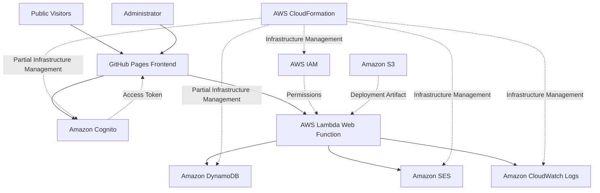

# AWS Infrastructure Inventory

## Project Information

- Project: AWS Serverless Student Portfolio
- AWS Region: ap-south-1 (Mumbai)
- Environment: Production
- Frontend Hosting: GitHub Pages
- Inventory Last Reviewed: November 12, 2026
- Inventory Status: Existing infrastructure documented; remaining settings require verification

---

## AWS Lambda

### Lambda Web Function

- Function Name: student-portfolio-api
- Function Type: AWS Lambda Web Function
- Runtime: Node.js 24.x
- Region: ap-south-1
- Current Revision: rev-6boxt
- Revision State: Active
- Timeout: 30 seconds
- Maximum Concurrency Per Environment: 64
- Environment Variables: None defined
- Auto Deployment: Latest revision
- Architecture: TO_BE_VERIFIED
- Package Type: TO_BE_VERIFIED
- Execution Role: student-portfolio-api-role-g7fsr5wg
- Endpoint: https://90y9wzfm46tg51xd.qws.lambda-web.ap-south-1.on.aws/

### Purpose

- Provides the backend API for the student portfolio.
- Retrieves portfolio projects from DynamoDB.
- Retrieves published blog posts from DynamoDB.
- Processes portfolio contact form submissions.
- Sends contact form emails through Amazon SES.
- Supports authenticated administrator operations.
- Validates Cognito access tokens and administrator group membership.
- Generates application logs in Amazon CloudWatch.

### Public API Endpoints

| HTTP Method | Endpoint | Purpose |
| --- | --- | --- |
| GET | /api/projects | Retrieve portfolio projects |
| GET | /api/blog | Retrieve published blog posts |
| GET | /api/blog/:postId | Retrieve an individual published blog post |
| POST | /api/contact | Submit a contact form message |

### Administrator API Endpoints

| HTTP Method | Endpoint | Purpose |
| --- | --- | --- |
| GET | /api/admin/me | Verify administrator identity |
| GET | /api/admin/projects | Retrieve administrator project records |
| POST | /api/admin/projects | Create a project |
| PUT | /api/admin/projects/:projectId | Update a project |
| DELETE | /api/admin/projects/:projectId | Delete a project |
| GET | /api/admin/blog | Retrieve published and draft blog posts |
| POST | /api/admin/blog | Create a blog post |
| PUT | /api/admin/blog/:postId | Update a blog post |
| DELETE | /api/admin/blog/:postId | Delete a blog post |

### Security Configuration

- Administrator authentication: Amazon Cognito
- Administrator authorization: PortfolioAdmins group
- Token type: Cognito access token
- Token validation: Performed by the Lambda backend
- Public blog access: Published posts only
- Draft blog access: Restricted to authorized administrators
- Contact form rate limiting: Amazon DynamoDB
- Contact form email delivery: Amazon SES
- Cross-Origin Resource Sharing (CORS): Configured for the portfolio frontend and permitted development origins

### Infrastructure Management Notes

- Preserve the existing Lambda Web Function.
- Preserve the existing public API endpoint.
- Preserve the existing execution role and required permissions.
- Preserve administrator authentication and authorization.
- Verify the deployment configuration before infrastructure automation.
- Verify CloudFormation support for the existing Lambda Web Function resource type.
- Do not assume that a Lambda Web Function can be imported using a conventional Lambda function resource definition.
- Do not create duplicate backend functions unnecessarily.
- Do not store credentials, access tokens, or secrets in source control.

---

## Amazon DynamoDB

- Region: ap-south-1
- Total Portfolio Tables: 3

### Projects Table

- Table Name: student-portfolio-projects
- Partition Key: projectId
- Partition Key Type: String
- Sort Key: None
- Capacity Mode: On-demand
- CloudFormation Billing Mode: PAY_PER_REQUEST
- Table Status: Active
- Point-in-Time Recovery (PITR): Disabled
- Resource-Based Policy: Not active
- Active CloudWatch Alarms at Inspection: None
- Deletion Protection: Enabled
- Encryption: AWS-owned key
- TTL: Disabled

#### Purpose

- Stores portfolio project information.
- Provides project records to the public portfolio.
- Supports administrator project creation, updates, and deletion.

### Blog Posts Table

- Table Name: student-portfolio-blog-posts
- Partition Key: postId
- Partition Key Type: String
- Sort Key: None
- Capacity Mode: On-demand
- CloudFormation Billing Mode: PAY_PER_REQUEST
- Table Status: Active
- Point-in-Time Recovery (PITR): Disabled
- Resource-Based Policy: Not active
- Active CloudWatch Alarms at Inspection: None
- Deletion Protection: Enabled
- Encryption: AWS-owned key
- TTL: Disabled

#### Purpose

- Stores portfolio blog posts.
- Supports draft and published blog statuses.
- Provides published blog posts to public visitors.
- Supports administrator blog creation, updates, and deletion.
- Draft visibility is controlled by the Lambda backend.

### Contact Rate Limit Table

- Table Name: student-portfolio-contact-ratelimit
- Partition Key: rateLimitKey
- Partition Key Type: String
- Sort Key: None
- Capacity Mode: On-demand
- CloudFormation Billing Mode: PAY_PER_REQUEST
- Table Status: Active
- Point-in-Time Recovery (PITR): Disabled
- Resource-Based Policy: Not active
- Active CloudWatch Alarms at Inspection: None
- Deletion Protection: Disabled
- Encryption: AWS-owned key
- TTL Status: Enabled
- TTL Attribute: expiresAt
- Warm Read Throughput at Inspection: 12000 units/sec
- Warm Write Throughput at Inspection: 4000 units/sec
- Tags at Inspection: None

#### Purpose

- Stores contact form request counters.
- Supports the application's contact form rate limiting.
- Uses the expiresAt attribute to identify expired records.
- Allows DynamoDB to automatically remove expired records through TTL.
- Helps reduce contact form spam and excessive email requests.

### DynamoDB Protection Summary

| Table | Deletion Protection | Encryption | TTL | PITR |
| --- | --- | --- | --- | --- |
| student-portfolio-projects | Enabled | AWS-owned key | Disabled | Disabled |
| student-portfolio-blog-posts | Enabled | AWS-owned key | Disabled | Disabled |
| student-portfolio-contact-ratelimit | Disabled | AWS-owned key | Enabled | Disabled |

### Infrastructure Management Notes

- Preserve all existing table data.
- Do not create duplicate DynamoDB tables.
- Preserve existing table names and partition keys.
- Preserve deletion protection for the projects and blog posts tables.
- Preserve the contact rate limit TTL configuration.
- Use appropriate retention safeguards during infrastructure import.
- Consider DeletionPolicy: Retain for imported tables.
- Consider UpdateReplacePolicy: Retain for production data resources.
- Verify resource import eligibility before CloudFormation import.
- Review backup requirements before enabling paid backup features.
- Deletion protection prevents accidental table deletion but does not prevent individual item deletion.
- ExpenseTrackTable is outside this project's scope.

---

## Amazon Cognito

### User Pool

- User Pool Name: User pool - vqmsd
- User Pool ID: ap-south-1_CQ6N2FL3Z
- Region: ap-south-1
- Feature Plan: Essentials
- Estimated Users: 1
- Deletion Protection: Enabled
- Created Date: November 6, 2026

### App Client

- App Client Name: student-portfolio-admin-spa
- App Client ID: 2gnvmkc5l9cm3ab9mq8rm0n8uq
- Client Secret: None
- Application Type: Single Page Application
- Authentication Session Duration: 3 minutes
- Access Token Expiration: 60 minutes
- ID Token Expiration: 60 minutes
- Refresh Token Expiration: 5 days
- Token Revocation: Enabled
- Prevent User Existence Errors: Enabled

### Authentication Flows

- Choice-based sign-in
- Secure Remote Password (SRP)
- Get user tokens from existing authenticated sessions

### Managed Login and OAuth Configuration

- Managed Login Status: Available
- Identity Provider: Cognito user pool directory
- OAuth Grant Type: Authorization code grant
- PKCE: Implemented in frontend
- OpenID Connect Scopes: email, openid
- Custom Scopes: None

#### Allowed Callback URLs

- https://santhoshpranavk.github.io/AWS-Serverless-Student-Portfolio/
- https://santhoshpranavk.github.io/AWS-Serverless-Student-Portfolio/admin.html

#### Allowed Sign-Out URLs

- https://santhoshpranavk.github.io/AWS-Serverless-Student-Portfolio/
- https://santhoshpranavk.github.io/AWS-Serverless-Student-Portfolio/admin.html

#### Default Redirect URL

- https://santhoshpranavk.github.io/AWS-Serverless-Student-Portfolio/

### Administrator Group

- Group Name: PortfolioAdmins
- Description: Authorized administrators for the AWS Serverless Student Portfolio
- IAM Role ARN: None
- Precedence: Not configured
- Group Members at Inspection: 1
- Administrator Email Verified: Yes
- Administrator Confirmation Status: Confirmed
- Administrator Status: Enabled

### Cognito Domain

- Domain Type: Cognito service-owned domain
- Domain Prefix: ap-south-1cq6n2fl3z
- Domain URL: https://ap-south-1cq6n2fl3z.auth.ap-south-1.amazoncognito.com
- Branding Version: Managed login
- Custom Domain: None
- Issuer Type: Original
- Issuer URL: https://cognito-idp.ap-south-1.amazonaws.com/ap-south-1_CQ6N2FL3Z
- Token Signing Key URL: https://cognito-idp.ap-south-1.amazonaws.com/ap-south-1_CQ6N2FL3Z/.well-known/jwks.json

### Purpose

- Provides secure administrator authentication.
- Provides managed login functionality.
- Issues authentication and authorization tokens.
- Supports administrator group-based access control.
- Allows authorized administrators to manage projects and blog posts.
- Integrates with the frontend through OAuth 2.0 Authorization Code Flow with PKCE.

### Infrastructure Management Notes

- Preserve the existing user pool and app client.
- Preserve existing administrator accounts.
- Preserve callback and sign-out URLs.
- Preserve the PortfolioAdmins group.
- Preserve the existing Cognito domain.
- Do not generate a client secret for the SPA.
- Do not store passwords, tokens, or personal user details.
- Verify remaining settings before CloudFormation import.
- Verify resource import support for each Cognito resource independently.
- Avoid changes that could interrupt administrator authentication.

---

## Amazon SES

### Email Identity

- Identity Type: Email address
- Identity Status: Verified
- Email Provider: Gmail
- Email Identity: Existing verified portfolio email
- Region: ap-south-1
- Custom MAIL FROM Domain: Not configured
- DKIM Configuration: Domain-level settings not verified
- DMARC Configuration: Domain-level settings not verified

### Account Configuration

- Account Access: Sandbox
- Production Access: Not enabled
- Account Health at Inspection: Healthy
- Daily Sending Quota: 200 emails per 24 hours
- Maximum Sending Rate: 1 email per second

### Portfolio Contact Form Integration

- Backend Service: AWS Lambda
- Lambda Function: student-portfolio-api
- API Endpoint: POST /api/contact
- Email Delivery: Amazon SES
- Recipient: Existing verified email identity
- Rate Limiting: DynamoDB
- Rate Limit Table: student-portfolio-contact-ratelimit
- Application Rate Limit: 3 requests per hour
- Rate Limit Scope: Global application-level limit

### Purpose

- Sends email notifications for portfolio contact form submissions.
- Delivers visitor messages to the verified portfolio email address.
- Integrates with the Lambda backend without requiring SMTP credentials in the frontend.

### Sandbox Limitations

- Sending is subject to the configured SES sandbox quotas.
- Email recipients must generally be verified identities, except supported SES mailbox simulator addresses.
- The current contact form sends messages to an existing verified recipient.
- Sending arbitrary emails to unverified recipients would require production access.

### Infrastructure Management Notes

- Preserve the existing verified email identity.
- Preserve the existing contact form functionality.
- Sandbox access is sufficient for the current application design.
- Production access is not currently required.
- Do not create unnecessary email identities.
- Do not store SMTP credentials or personal email addresses in this inventory.
- Use deployment parameters for email identities when required.
- Review SES costs before enabling additional features.

---

## Frontend Hosting

### GitHub Pages

- Hosting Platform: GitHub Pages
- Repository: AWS-Serverless-Student-Portfolio
- Repository URL: https://github.com/santhoshpranavk/AWS-Serverless-Student-Portfolio
- Portfolio URL: https://santhoshpranavk.github.io/AWS-Serverless-Student-Portfolio/
- Admin Dashboard URL: https://santhoshpranavk.github.io/AWS-Serverless-Student-Portfolio/admin.html
- HTTPS: Enabled
- Deployment Branch: TO_BE_VERIFIED
- Deployment Source: TO_BE_VERIFIED
- Amazon S3 Website Hosting: Not used
- Amazon CloudFront: Not used

### Frontend Technologies

- HTML
- CSS
- JavaScript
- REST API integration
- Amazon Cognito OAuth 2.0 authentication
- Authorization Code Flow with PKCE

### Administrator Dashboard

- Dashboard File: admin.html
- Dashboard Stylesheet: admin.css
- Dashboard JavaScript: admin.js
- Authentication JavaScript: auth.js
- Authentication Provider: Amazon Cognito
- Administrator Group: PortfolioAdmins

### Purpose

- Hosts the public portfolio website.
- Hosts the administrator dashboard.
- Displays projects and published blog posts.
- Connects to the Lambda Web Function backend.
- Provides a contact form for visitors.
- Supports secure administrator sign-in and content management.

### Infrastructure Management Notes

- Preserve the existing GitHub repository.
- Preserve the existing GitHub Pages URLs.
- Preserve the existing frontend design.
- Preserve frontend API integration.
- Preserve Cognito callback and sign-out URLs.
- Do not expose AWS credentials in frontend JavaScript.
- Do not introduce S3 or CloudFront unless a future migration is explicitly planned.
- GitHub Pages is managed separately from AWS CloudFormation.

---

## AWS Identity and Access Management (IAM)

### Lambda Execution Role

- Role Name: student-portfolio-api-role-g7fsr5wg
- Role Path: /service-role/
- Role Type: AWS service execution role
- Trusted Service: lambda.amazonaws.com
- Trust Action: sts:AssumeRole
- Maximum Session Duration: 1 hour
- Total Permission Policies: 6
- Permissions Boundary: Not configured
- Purpose: Allows the Lambda backend to access DynamoDB, Amazon SES, and CloudWatch Logs.

### Permission Policy 1: AWS Managed Logging

- Policy Name: AWSLambdaBasicExecutionRole
- Policy Type: AWS managed
- Allowed Actions:
  - logs:CreateLogGroup
  - logs:CreateLogStream
  - logs:PutLogEvents
- Resource Scope: All resources
- Purpose: Provides basic CloudWatch logging permissions.

### Permission Policy 2: Customer Managed Logging

- Policy Name: AWSLambdaBasicExecutionRole-2d16ed02-ef6b-44cb-ba2b-d0e7b612e26f
- Policy Type: Customer managed
- Target Resource Region: ap-south-1
- Allowed Actions:
  - logs:CreateLogGroup
  - logs:CreateLogStream
  - logs:PutLogEvents
- Log Group: /aws/lambda/web/student-portfolio-api
- Resource Scope:
  - Log group creation within the AWS account and Mumbai region.
  - Log stream creation and event writing within the specified portfolio log group.
- Purpose: Provides resource-scoped Lambda logging permissions.

### Permission Policy 3: Contact Rate Limiting

- Policy Name: StudentPortfolioContactRateLimitPolicy
- Policy Type: Customer inline
- Allowed Actions:
  - dynamodb:GetItem
  - dynamodb:UpdateItem
- Allowed Table: student-portfolio-contact-ratelimit
- Purpose: Reads and updates contact form request counters.

### Permission Policy 4: DynamoDB Admin Write

- Policy Name: StudentPortfolioDynamoDBAdminWrite
- Policy Type: Customer managed
- Allowed Actions:
  - dynamodb:PutItem
  - dynamodb:UpdateItem
  - dynamodb:DeleteItem
- Allowed Tables:
  - student-portfolio-projects
  - student-portfolio-blog-posts
- Purpose: Supports administrator content management operations.
- Administrator authorization is enforced by the Lambda backend using Cognito access tokens and group membership.

### Permission Policy 5: DynamoDB Read Only

- Policy Name: StudentPortfolioDynamoDBReadOnly
- Policy Type: Customer inline

#### Projects Table Permissions

- Table: student-portfolio-projects
- Allowed Actions:
  - dynamodb:GetItem
  - dynamodb:Query
  - dynamodb:Scan

#### Blog Posts Table Permissions

- Table: student-portfolio-blog-posts
- Allowed Actions:
  - dynamodb:Scan

- Purpose: Retrieves portfolio projects and blog posts.

### Permission Policy 6: SES Send Email

- Policy Name: StudentPortfolioSESSendEmailPolicy
- Policy Type: Customer inline
- Allowed Action: ses:SendEmail
- Resource: Specific verified SES email identity
- Target Resource Region: ap-south-1
- Additional Conditions: None
- Purpose: Sends portfolio contact form emails.

### IAM Security Observations

- Lambda is the trusted service for the execution role.
- DynamoDB permissions are restricted to project-specific tables.
- SES sending permission is restricted to a verified identity.
- Administrator authorization is enforced by the backend.
- IAM permissions alone do not distinguish public requests from administrator requests within the same Lambda function.
- The AWS-managed logging policy overlaps with the customer-managed logging policy.
- The broader AWS-managed logging policy means that the customer-managed policy does not restrict the combined effective logging permissions.
- The customer-managed logging policy explicitly targets the main portfolio log group.
- Both portfolio log groups must be considered before changing logging permissions.
- Logging policy overlap is documented for future optimization.
- No IAM permissions were modified during this inspection.
- This inventory is not a comprehensive security audit.

### Infrastructure Management Notes

- Preserve the existing Lambda execution role.
- Preserve required DynamoDB, SES, and CloudWatch permissions.
- Preserve the existing Lambda trust relationship.
- Follow the principle of least privilege.
- Review overlapping logging permissions before making changes.
- Do not remove policies without validating application requirements.
- Do not attach unnecessary administrator-level permissions.
- Do not store AWS access keys or secret access keys in source control.
- Use resource-specific ARNs and deployment parameters where appropriate.
- Verify IAM resource import support before CloudFormation import.

---

## Amazon CloudWatch

### Lambda Log Group 1

- Log Group Name: /aws/lambda/web/student-portfolio-api
- AWS Region: ap-south-1 (Mumbai)
- Associated Lambda Web Function: student-portfolio-api
- Log Class: Standard
- Retention Period: 30 days
- Stored Data at Inspection: 410.14 KB
- Log Streams at Inspection: 100+
- Metric Filters: 0
- Subscription Filters: 0
- Custom KMS Key: Not configured
- Deletion Protection: Disabled
- Anomaly Detection: Not configured
- Data Protection Policy: Not configured

### Lambda Log Group 2

- Log Group Name: /aws/lambda/web/student-portfolio-api.local
- AWS Region: ap-south-1 (Mumbai)
- Associated Lambda Web Function: student-portfolio-api
- Log Class: Standard
- Retention Period: 30 days
- Stored Data at Inspection: 411.93 KB
- Log Streams at Inspection: 100+
- Metric Filters: 0
- Subscription Filters: 0
- Custom KMS Key: Not configured
- Deletion Protection: Disabled
- Anomaly Detection: Not configured
- Data Protection Policy: Not configured

### Log Group Summary

| Log Group | Log Class | Retention | Status |
| --- | --- | --- | --- |
| /aws/lambda/web/student-portfolio-api | Standard | 30 days | Existing |
| /aws/lambda/web/student-portfolio-api.local | Standard | 30 days | Existing |

### Purpose

- Collects Lambda execution logs.
- Supports backend application troubleshooting.
- Helps identify API errors and application failures.
- Provides visibility into backend execution activity.
- Supports future monitoring and alerting configurations.

### Cost Optimization

- Both Lambda log groups use a 30-day retention policy.
- Previously, both log groups were configured to Never expire.
- The retention settings were updated successfully to 30 days.
- Logs older than 30 days become eligible for automatic deletion.
- This prevents indefinite accumulation of log storage.
- Log storage and ingestion costs should be monitored.
- Monitoring costs should be reviewed before enabling additional paid features.

### CloudWatch Alarms

- AWS Region: ap-south-1 (Mumbai)
- Inspection Date: November 12, 2026
- Existing Account Alarms at Inspection: 5
- Portfolio-Specific Alarms Identified: 0
- Portfolio Alarm Configuration: Not configured based on the inspected alarm list
- Existing alarms appear to belong to the separate ExpenseTrack project.
- ExpenseTrack alarms are excluded from the portfolio infrastructure inventory.
- No existing alarms were created, deleted, or modified during inspection.
- Portfolio-specific monitoring alarms will be configured separately.

### Monitoring Implementation Status

| Monitoring Component | Status |
| --- | --- |
| Centralized Lambda Logging | Implemented |
| Main Log Group Retention Policy | Implemented |
| Local Log Group Retention Policy | Implemented |
| Existing CloudWatch Alarm Inspection | Completed |
| Project-Specific CloudWatch Alarms | Not configured |
| CloudWatch Monitoring Dashboard | Pending |
| Amazon SNS Notification Integration | Pending |

### Future Monitoring Improvements

- Identify available metrics for the Lambda Web Function.
- Monitor Lambda errors and execution performance.
- Configure project-specific CloudWatch alarms where supported.
- Configure appropriate alarm thresholds.
- Integrate Amazon SNS for email notifications.
- Create a project monitoring dashboard.
- Monitor backend availability and application failures.
- Test monitoring and notification functionality.
- Review monitoring costs before enabling paid features.

### Infrastructure Management Notes

- Preserve both existing Lambda log groups.
- Preserve the configured 30-day retention policies.
- Preserve required application logging permissions.
- Avoid creating duplicate log groups.
- Do not modify unrelated ExpenseTrack alarms.
- Review log retention requirements before making future changes.
- Do not expose credentials, authentication tokens, or personal information in application logs.
- Verify CloudFormation import support before importing existing log groups.
- Avoid replacing existing production resources during infrastructure automation.

---

## Infrastructure Architecture

### Public Portfolio Request Flow

1. A visitor opens the portfolio hosted on GitHub Pages.
2. The frontend sends an HTTPS request to the Lambda Web Function.
3. Lambda processes the request.
4. Lambda retrieves project or published blog data from DynamoDB.
5. Lambda returns the API response.
6. The frontend displays the returned data.

### Administrator Authentication Flow

1. The administrator opens the GitHub Pages administrator dashboard.
2. The frontend redirects the administrator to Cognito managed login.
3. Cognito authenticates the administrator.
4. Cognito redirects the administrator to the configured callback URL.
5. The frontend completes the Authorization Code Flow with PKCE.
6. The frontend sends a Cognito access token with administrator API requests.
7. Lambda validates the token and PortfolioAdmins group membership.
8. Authorized requests perform the required DynamoDB operations.
9. Unauthorized requests are rejected.

### Contact Form Request Flow

1. A visitor submits the portfolio contact form.
2. The frontend sends the request to the Lambda Web Function.
3. Lambda validates the submitted data.
4. Lambda checks and updates the DynamoDB rate limit counter.
5. Requests exceeding the application rate limit are rejected.
6. Amazon SES sends permitted messages to the verified portfolio email address.
7. Lambda returns the appropriate API response.

### Application Logging Flow

1. The Lambda Web Function processes application requests.
2. Application and execution logs are generated.
3. Logs are delivered to the associated CloudWatch log groups.
4. CloudWatch stores logs according to the configured retention policies.
5. Logs can be inspected for troubleshooting and application monitoring.

### Architecture Summary

| Component | Service | Purpose |
| --- | --- | --- |
| Frontend | GitHub Pages | Website and administrator dashboard hosting |
| Backend | AWS Lambda Web Function | REST API and application logic |
| Database | Amazon DynamoDB | Projects, blog posts, and rate limiting |
| Authentication | Amazon Cognito | Administrator authentication |
| Authorization | Cognito and Lambda | Administrator access control |
| Email | Amazon SES | Contact form email delivery |
| Permissions | AWS IAM | Backend service permissions |
| Logging | Amazon CloudWatch | Application logs and troubleshooting |

---

## AWS Service Implementation Summary

### Currently Implemented AWS Services

| No. | AWS Service | Purpose | Status |
| --- | --- | --- | --- |
| 1 | AWS Lambda | Serverless backend and REST API | Implemented |
| 2 | Amazon DynamoDB | Application data and rate limiting | Implemented |
| 3 | Amazon Cognito | Administrator authentication | Implemented |
| 4 | Amazon SES | Contact form email delivery | Implemented |
| 5 | AWS IAM | Execution roles and access permissions | Implemented |
| 6 | Amazon CloudWatch | Application logging and log retention | Implemented |

### Planned AWS Services

| No. | AWS Service | Planned Purpose | Status |
| --- | --- | --- | --- |
| 7 | Amazon SNS | Monitoring and email notifications | Planned |
| 8 | AWS CloudFormation | Infrastructure as Code | Planned |
| 9 | AWS CodeBuild | Automated build and validation | Planned |
| 10 | AWS CodePipeline | CI/CD orchestration | Planned |

### External Services

| Service | Purpose | Status |
| --- | --- | --- |
| GitHub | Source code repository | Implemented |
| GitHub Pages | Frontend website hosting | Implemented |

### Service Count

- Minimum AWS Service Requirement: 10
- Currently Implemented AWS Services: 6
- Additional Planned AWS Services: 4
- Target AWS Service Count: 10
- Remaining AWS Services Required: 4
- Minimum AWS Service Requirement Status: Not yet fulfilled

### Service Counting Notes

- Multiple resources within a single AWS service are counted as one service.
- The three DynamoDB tables count as one AWS service.
- IAM roles and IAM policies count as one AWS service.
- CloudWatch logs, metrics, dashboards, and alarms count as one AWS service.
- GitHub and GitHub Pages are external services and are not included in the AWS service count.
- Amazon S3 and Amazon CloudFront are not part of the current portfolio architecture.
- Planned AWS services must be implemented, integrated, and verified before being counted as completed.
- AWS-managed encryption does not automatically establish a separate project-managed AWS KMS implementation.
- Resources belonging to unrelated projects must not be counted.

---

## Infrastructure Automation

### Current Status

- CloudFormation Stack: Not configured
- AWS CodeBuild Project: Not configured
- AWS CodePipeline: Not configured
- Existing AWS Infrastructure: Provisioned
- Infrastructure Inventory: Documented
- Infrastructure as Code: Planned
- Resource Import: Not started

### Planned Infrastructure Automation

- Verify all remaining infrastructure configuration values.
- Identify supported CloudFormation resource types.
- Verify resource import eligibility.
- Create infrastructure templates for supported resources.
- Configure retention safeguards for production resources.
- Validate templates before deployment.
- Review infrastructure change sets before execution.
- Import eligible existing resources where appropriate.
- Avoid replacing existing production resources.
- Validate application functionality after infrastructure changes.
- Evaluate CI/CD automation separately from resource import.

### Planned CI/CD Implementation

- Preserve the existing GitHub repository.
- Evaluate supported GitHub integration methods.
- Configure AWS CodeBuild for appropriate build and validation tasks.
- Configure AWS CodePipeline for supported deployment automation.
- Verify deployment support for the existing Lambda Web Function.
- Keep the existing GitHub Pages frontend operational.
- Do not introduce unnecessary S3 or CloudFront hosting resources.
- Review artifact storage requirements before creating pipeline resources.
- Review pipeline and build costs before deployment.
- Validate automated workflows before using them for production changes.

### Resource Import Safety

- Do not create duplicate resources.
- Do not delete existing production resources.
- Do not replace resources containing production data.
- Preserve existing resource names and identifiers where required.
- Preserve existing application endpoints.
- Preserve administrator accounts and authentication settings.
- Preserve verified SES email identities.
- Preserve required IAM permissions.
- Preserve DynamoDB deletion protection settings.
- Preserve CloudWatch log retention settings.
- Verify resource import support independently for each resource type.
- Use appropriate DeletionPolicy and UpdateReplacePolicy settings.
- Review CloudFormation change sets before execution.
- Check for unexpected resource replacements.
- Review potential AWS costs before deploying additional services.

### External Infrastructure

GitHub Pages and the GitHub repository are external to AWS CloudFormation management.

The existing frontend hosting configuration must remain operational during AWS infrastructure automation.

---

## Completed Configuration Verification

| Service | Configuration | Verified Value |
| --- | --- | --- |
| DynamoDB Projects Table | Deletion protection | Enabled |
| DynamoDB Projects Table | Encryption | AWS-owned key |
| DynamoDB Projects Table | TTL | Disabled |
| DynamoDB Blog Posts Table | Deletion protection | Enabled |
| DynamoDB Blog Posts Table | Encryption | AWS-owned key |
| DynamoDB Blog Posts Table | TTL | Disabled |
| DynamoDB Contact Rate Limit Table | Deletion protection | Disabled |
| DynamoDB Contact Rate Limit Table | Encryption | AWS-owned key |
| DynamoDB Contact Rate Limit Table | TTL | Enabled |
| DynamoDB Contact Rate Limit Table | TTL attribute | expiresAt |
| CloudWatch Main Log Group | Retention | 30 days |
| CloudWatch Local Log Group | Retention | 30 days |
| CloudWatch Alarms | Existing account alarms | 5 |
| CloudWatch Alarms | Portfolio-specific alarms identified | 0 |

---

## Pending Configuration Verification

| Service | Configuration | Status |
| --- | --- | --- |
| AWS Lambda Web Function | Architecture | TO_BE_VERIFIED |
| AWS Lambda Web Function | Package type | TO_BE_VERIFIED |
| Amazon Cognito | User pool deletion protection | TO_BE_VERIFIED |
| GitHub Pages | Deployment branch | TO_BE_VERIFIED |
| GitHub Pages | Deployment source | TO_BE_VERIFIED |

These values must be verified where applicable before creating infrastructure templates.

If a setting does not apply to the existing resource type, document it as Not applicable instead of inventing a value.

---

## Cost Management

- Use the existing AWS infrastructure wherever possible.
- Avoid provisioning duplicate resources.
- Monitor Lambda request and execution usage.
- Monitor DynamoDB read and write requests.
- Monitor DynamoDB storage usage.
- Preserve TTL for expired rate limit records.
- Monitor Amazon SES sending usage.
- Monitor Amazon Cognito usage.
- Monitor CloudWatch log ingestion and storage.
- Preserve the configured 30-day CloudWatch retention policies.
- Review CloudWatch alarm and dashboard pricing before configuration.
- Review Amazon SNS notification pricing before configuration.
- Review AWS CodeBuild and AWS CodePipeline pricing before deployment.
- Review artifact storage and data transfer costs where applicable.
- Review AWS Free Tier eligibility and account-specific limits.
- Review the cost of backup, monitoring, and automation services before enabling them.
- Do not assume that every AWS service is free.
- Use AWS Budgets and billing monitoring where appropriate.

---

## Security Management

- Never store AWS access keys or secret access keys in GitHub.
- Never store administrator passwords in source control.
- Never store Cognito access tokens, ID tokens, or refresh tokens in documentation.
- Do not expose personal email addresses or private user information unnecessarily.
- Use IAM least-privilege permissions.
- Validate administrator authorization in the backend.
- Preserve Cognito token validation.
- Restrict draft blog content to authorized administrators.
- Preserve contact form validation and rate limiting.
- Use HTTPS for frontend and backend communication.
- Preserve DynamoDB encryption at rest.
- Preserve deletion protection for production content tables.
- Review application logs for accidental sensitive information exposure.
- Review infrastructure changes before deployment.
- Do not modify resources belonging to unrelated projects.

Public application endpoints, Cognito user pool identifiers, and public SPA client identifiers are configuration values, not authentication secrets.

---

## Important Notes

- This document describes the existing deployed infrastructure and separately identified planned improvements.
- This document is an inventory, not a deployable CloudFormation template.
- Configuration values reflect the recorded inspection and may change over time.
- Unverified values must not be treated as confirmed settings.
- Planned services must not be treated as implemented services.
- Do not duplicate existing AWS resources.
- Verify resource configurations before deployment.
- Preserve existing production data.
- Preserve existing application functionality.
- Review costs before provisioning new services.
- Never store AWS credentials or secrets in this file.
- Amazon S3 and Amazon CloudFront are not part of the current deployed portfolio architecture.
- GitHub Pages is the current frontend hosting platform.
- ExpenseTrack resources are outside this project's scope.
- Infrastructure automation must preserve the working application.

---

## Inventory Status

| Component | Status |
| --- | --- |
| AWS Lambda Web Function | Documented |
| Amazon DynamoDB | Documented |
| Amazon Cognito | Documented |
| Amazon SES | Documented |
| GitHub Pages | Documented |
| AWS IAM | Documented |
| Amazon CloudWatch | Documented |
| DynamoDB Protection Configuration | Updated |
| CloudWatch Log Retention | Updated |
| CloudWatch Alarm Inspection | Completed |
| Infrastructure Architecture | Documented |
| Amazon SNS | Planned |
| AWS CloudFormation | Planned |
| AWS CodeBuild | Planned |
| AWS CodePipeline | Planned |
| Infrastructure Automation | Planned |
| Remaining Configuration Verification | Pending |
| CloudFormation Resource Import | Not started |
| Final Infrastructure Validation | Pending |
| Minimum 10 AWS Services Requirement | In progress - 6 of 10 implemented |

---

---

# Infrastructure Update - November 14, 2026

## 1. AWS CloudFormation

### Stack Information

- Stack Name: student-portfolio-stack
- Region: ap-south-1
- Stack Status: IMPORT_COMPLETE
- Termination Protection: Enabled
- Import Date: November 13, 2026
- Drift Detection Status: IN_SYNC
- Total Imported Resources: 12
- Resources Checked for Drift: 11
- Resources In Sync: 11
- Resources Not Checked: 1

### Imported Resources

| Resource Type | Count |
|---|---:|
| DynamoDB Tables | 3 |
| Cognito User Pool | 1 |
| Cognito App Client | 1 |
| Cognito User Pool Group | 1 |
| IAM Execution Role | 1 |
| IAM Managed Policies | 2 |
| CloudWatch Log Groups | 2 |
| SES Email Identity | 1 |
| Total | 12 |

### Resource Protection

- DeletionPolicy: Retain
- UpdateReplacePolicy: Retain
- Stack Termination Protection: Enabled

The Cognito user pool was not included in the supported
resource drift detection results.

The existing application was tested successfully after
the CloudFormation resource import.

### Post-Import Application Testing

- Public Homepage: Passed
- Public Projects Section: Passed
- Public Blog Section: Passed
- Contact Form Submission: Passed
- Contact Email Delivery: Passed
- Administrator Sign-In: Passed
- Administrator Dashboard Access: Passed
- Blog Creation: Passed
- Blog Update: Passed
- Blog Deletion: Passed
- Administrator Sign-Out: Passed
- Unauthorized Dashboard Access Prevention: Passed

These results represent the completed functional tests,
not a comprehensive application security assessment.

## 2. AWS Lambda Web Function

### Function Configuration

- Function Name: student-portfolio-api
- Function Type: Lambda Web Function
- Region: ap-south-1
- Status: Active
- Runtime: Node.js 24.x
- Latest Verified Revision: rev-6boxt
- Timeout: 30 seconds
- Maximum Concurrency Per Environment: 64
- Environment Variables: None configured
- Customer-Managed KMS Key: Not configured
- VPC Network Connector: Not configured
- Deployment Artifact Storage: Amazon S3
- CloudFormation Import Status: Not imported

### Endpoint Configuration

- Endpoint Name: student-portfolio-api-endpoint
- Endpoint Type: HomeRegion
- Primary Region: ap-south-1
- Authentication Type: ApplicationManaged
- Endpoint Status: Active
- Automatic Deployment: LatestRevision
- Revision Traffic Allocation: 100 percent
- Replicated Regions: None

### Logging Configuration

- Application Log Level: INFO
- System Log Level: INFO
- Log Group: /aws/lambda/web/student-portfolio-api
- Log Retention: 30 days

### Backend Responsibilities

- Public portfolio project retrieval
- Published blog post retrieval
- Contact form processing
- Contact submission rate limiting
- Email delivery through Amazon SES
- Cognito access token verification
- Administrator authorization
- Project management operations
- Blog management operations

## 3. Amazon S3 - Backend Deployment Storage

### Storage Configuration

- Bucket Purpose: Lambda backend deployment artifacts
- Bucket Type: General Purpose
- Region: ap-south-1
- Deployment Object Key: student-portfolio-api
- Storage Class: Standard
- Latest Verified Artifact Size: Approximately 3 MB
- Bucket Versioning: Enabled
- Default Encryption: SSE-S3
- Block Public Access: Enabled
- Object Ownership: Bucket Owner Enforced
- ACLs: Disabled
- Static Website Hosting: Disabled
- Transfer Acceleration: Disabled
- Object Lock: Disabled
- Event Notifications: Not configured
- Server Access Logging: Disabled
- CloudFormation Import Status: Not imported

### Bucket Access Policy

The bucket policy:

- Denies requests using insecure transport.
- Allows the AWS Lambda service to retrieve deployment
  objects and object versions.
- Does not provide public website hosting.

### Architecture Clarification

Amazon S3 is used for backend deployment artifact storage.

The public frontend is hosted using GitHub Pages.

Amazon CloudFront is not configured as a portfolio
frontend content delivery service.

The existing deployment bucket is managed externally
and is referenced by the infrastructure template.

No additional S3 bucket is required for the current
application architecture.

## 4. Amazon Cognito - Managed Login

### Domain Configuration

- Domain Type: AWS-Managed Cognito Domain
- Login Experience: Managed Login
- Managed Login Version: 2
- Custom Domain: Not configured
- Custom ACM Certificate: Not configured
- Issuer Type: Original
- CloudFormation Import Status: Not imported

### Branding Configuration

- Assigned App Client: student-portfolio-admin-spa
- Managed Login Branding Styles: 1
- AWS Default Branding Values: Disabled
- Color Scheme: Dark
- Spacing Density: Condensed
- Form Alignment: Center
- Form Border Radius: 8
- Page Header: Disabled
- Page Footer: Disabled
- Custom Branding Assets: None
- CloudFormation Import Status: Not imported

### Authentication Configuration

- Authentication Flow: OAuth 2.0 Authorization Code
- PKCE: Enabled by the application
- Administrator Group: PortfolioAdmins
- Public Self-Registration: Disabled
- Multi-Factor Authentication: Disabled
- User Pool Deletion Protection: Enabled

## 5. Infrastructure as Code Reference

### Template Information

- File Name: student-portfolio-stack.yaml
- Template Format: AWS CloudFormation YAML
- Template Format Version: 2010-09-09
- Total Resource Definitions: 17
- Distinct Resource Types: 13
- Template Parameters: 6
- Existing Imported Resources: 12
- Additional Reference Resource Definitions: 5

### Resource Distribution

| AWS Service | Resource Definitions |
|---|---:|
| Amazon DynamoDB | 3 |
| Amazon Cognito | 5 |
| AWS Lambda | 3 |
| AWS IAM | 3 |
| Amazon CloudWatch Logs | 2 |
| Amazon SES | 1 |
| Total | 17 |

### Additional Reference Resources

- AWS::Lambda::WebFunction
- AWS::Lambda::WebFunctionRevision
- AWS::Lambda::WebFunctionEndpoint
- AWS::Cognito::UserPoolDomain
- AWS::Cognito::ManagedLoginBranding

### Template Validation Results

| Validation Check | Result |
|---|---|
| CloudFormation ValidateTemplate | Passed |
| CloudFormation GetTemplateSummary | Passed |
| Resource Count Verification | Passed |
| Resource Type Count Verification | Passed |
| AWS Regional Resource Registry | Verified |
| CloudFormation Linter | Conditional Pass |
| Preliminary Sensitive Information Scan | Passed |

### Linter Compatibility

CloudFormation Linter Version: 1.53.3

The installed linter reported E3006 for three newer
Lambda Web Function resource types.

All three resource types were independently verified
in the AWS CloudFormation registry for ap-south-1.

The linter reported no additional issues when E3006
was temporarily excluded.

Full property validation of these Lambda resource
definitions remains incomplete.

### Template Security

- AWS account references use CloudFormation pseudo parameters.
- AWS region references use CloudFormation pseudo parameters.
- SES email identity is parameterized.
- Cognito domain prefix is parameterized.
- S3 deployment bucket is parameterized.
- S3 deployment object version is parameterized.
- Cognito user pool and app client references are dynamic.
- No hardcoded AWS access keys are included.

The preliminary sensitive information scan is not
a comprehensive security audit.

### Template Limitations

This template is an infrastructure reference and is
not intended for direct production deployment.

The live CloudFormation stack manages 12 imported
resources, not all 17 resource definitions.

The additional five resource definitions have not
been imported into the live stack.

The template uses sanitized resource names and
simplified configuration properties.

The complete exported Cognito branding configuration
is not reproduced in the reference template.

Explicit Lambda revision routing is represented
instead of automatic LatestRevision deployment.

The existing S3 deployment bucket and its bucket
policy are managed externally.

Existing DynamoDB records, Cognito users, administrator
group memberships and GitHub Pages configuration
are not recreated by this template.

A fresh deployment would require application
configuration changes, deployment artifacts,
email verification and administrator provisioning.

No live infrastructure changes were performed
during reference template validation.

## 6. AWS Service Utilization

| No. | AWS Service | Project Purpose |
|---:|---|---|
| 1 | AWS Lambda | Serverless backend API |
| 2 | Amazon DynamoDB | Application data storage |
| 3 | Amazon Cognito | Authentication and authorization |
| 4 | Amazon SES | Contact form email delivery |
| 5 | AWS IAM | Roles and permissions |
| 6 | Amazon CloudWatch | Application logging and monitoring |
| 7 | AWS CloudFormation | Infrastructure management |
| 8 | Amazon S3 | Backend deployment artifact storage |

### Service Requirement Progress

- Target AWS Services: 10
- Verified AWS Services: 8
- Remaining AWS Services: 2
- Completion: 80 percent

Amazon S3 is counted because it provides verified
backend deployment artifact storage.

GitHub Pages is used for frontend hosting but is
not counted as an AWS service.

Additional AWS services will be selected based on
application requirements, security, monitoring
and cost efficiency.

## 7. Current Project Architecture

## 8. Current Infrastructure Status

- Public Website: Operational at last test
- Backend API: Operational at last test
- Administrator Dashboard: Operational at last test
- Database Operations: Operational at last test
- Contact Email Delivery: Operational at last test
- CloudFormation Stack: IMPORT_COMPLETE
- Supported Resource Drift Status: IN_SYNC
- Infrastructure Reference Template: Documented
- AWS Service Requirement: In Progress

---
