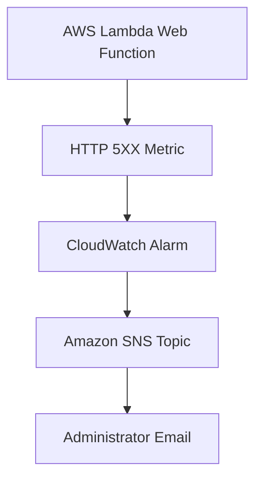
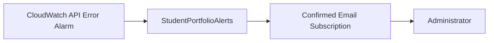
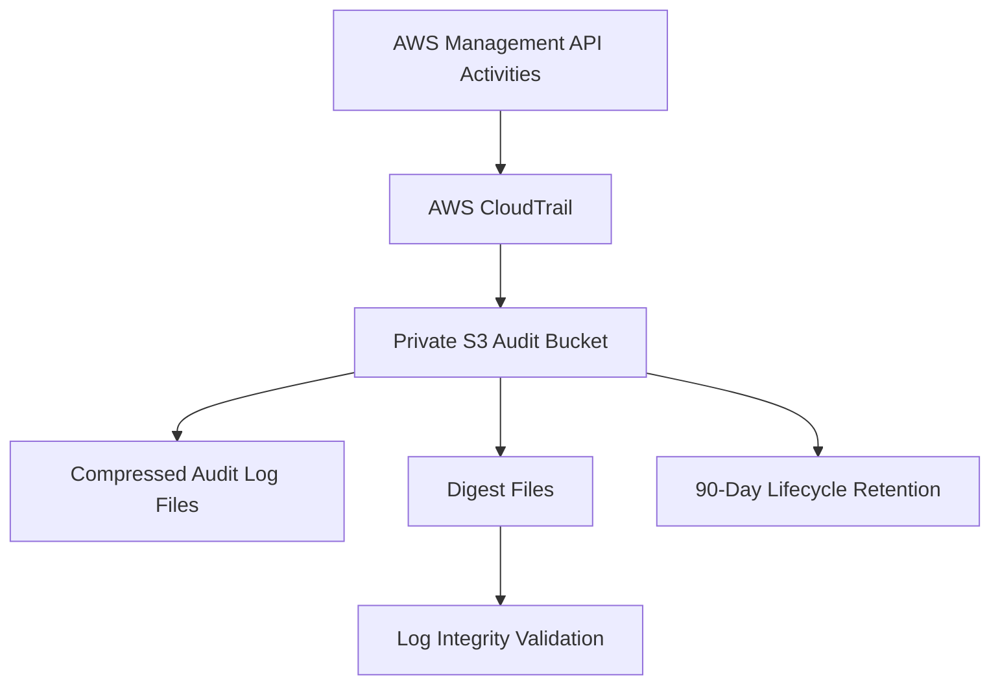
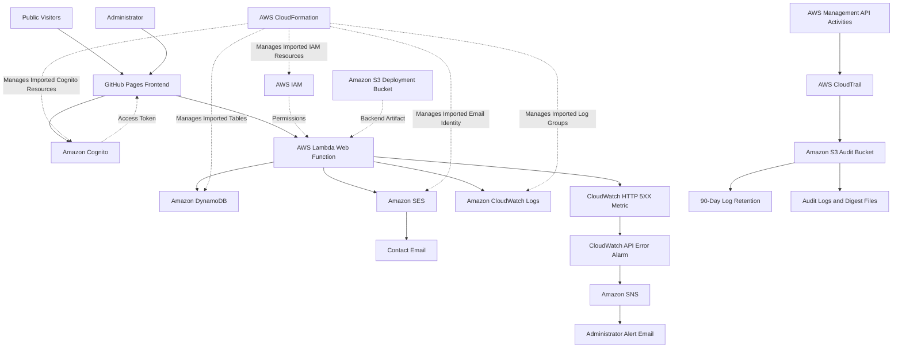
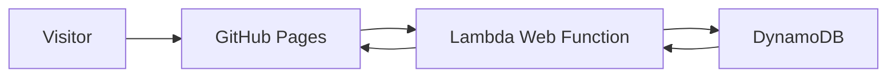
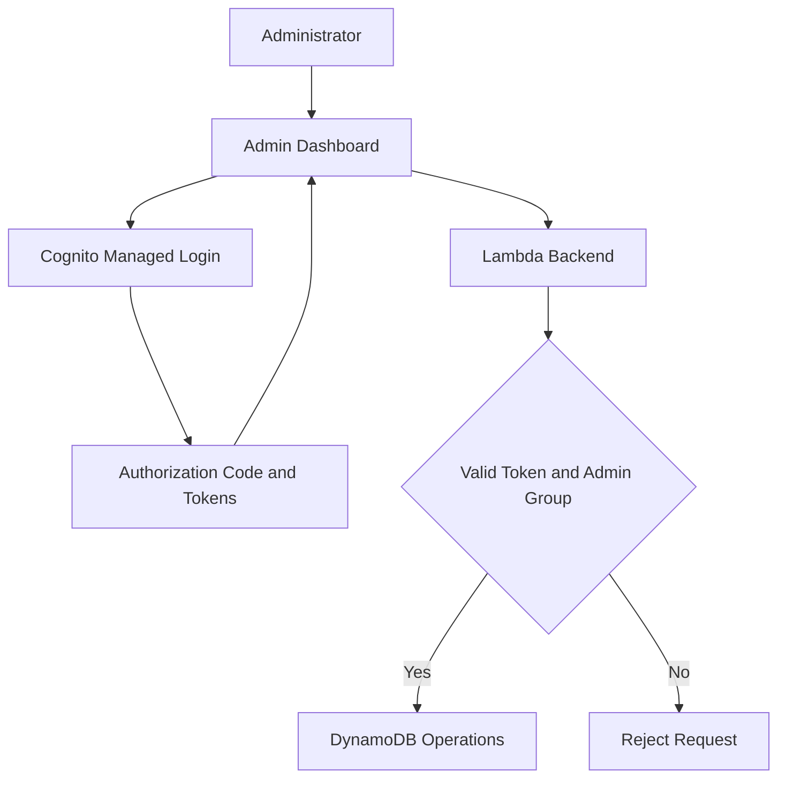
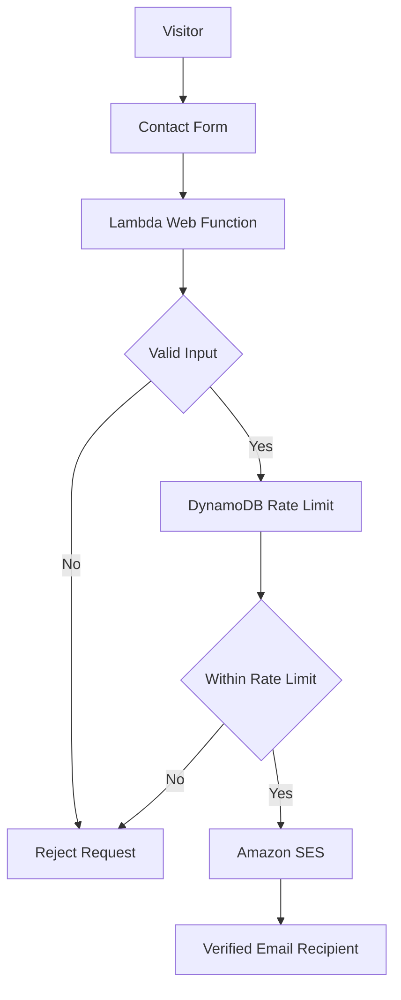

# AWS Infrastructure Inventory

## Project Information

| Property | Value |
| --- | --- |
| Project Name | AWS Serverless Student Portfolio |
| Environment | Production |
| Primary AWS Region | ap-south-1 (Mumbai) |
| Frontend Hosting | GitHub Pages |
| Backend | AWS Lambda Web Function |
| Source Control | GitHub |
| Infrastructure Management | AWS CloudFormation |
| Inventory Last Reviewed | November 15, 2026 |
| AWS Services Implemented | 10 |
| Minimum AWS Service Requirement | Achieved |
| Inventory Status | Implemented infrastructure documented; remaining validation tasks identified |

This document records the existing deployed infrastructure,
application architecture, security configurations, monitoring,
auditing, infrastructure automation and verification results.

Configuration values reflect the latest recorded inspection.

This inventory is not a comprehensive security or compliance audit.

---

## Table of Contents

1. AWS Lambda
2. Amazon DynamoDB
3. Amazon Cognito
4. Amazon SES
5. AWS IAM
6. Amazon CloudWatch
7. AWS CloudFormation
8. Amazon S3
9. Amazon SNS
10. AWS CloudTrail
11. Frontend Hosting
12. Infrastructure Architecture
13. AWS Service Implementation Summary
14. Infrastructure Automation
15. Infrastructure Reference Template
16. Completed Configuration Verification
17. Application and Integration Testing
18. Pending Configuration Verification
19. Cost Management
20. Security Management
21. Resource Protection Summary
22. Important Notes
23. Remaining Project Activities
24. Inventory Status
25. Infrastructure Implementation History

---

## 1. AWS Lambda

### Lambda Web Function

| Property | Configuration |
| --- | --- |
| Function Name | student-portfolio-api |
| Function Type | AWS Lambda Web Function |
| Region | ap-south-1 |
| Function Status | Active |
| Runtime | Node.js 24.x |
| Latest Verified Revision | rev-6boxt |
| Revision State | Active |
| Timeout | 30 seconds |
| Maximum Concurrency Per Environment | 64 |
| Environment Variables | None configured |
| Customer-Managed KMS Key | Not configured |
| VPC Network Connector | Not configured |
| Architecture | Not verified |
| Package Type | Not verified |
| Memory Configuration | Not verified |
| Execution Role | student-portfolio-api-role-g7fsr5wg |
| Deployment Artifact Storage | Amazon S3 |
| CloudFormation Import Status | Not imported |

### Endpoint Configuration

| Property | Configuration |
| --- | --- |
| Endpoint Name | student-portfolio-api-endpoint |
| Endpoint Type | HomeRegion |
| Primary Region | ap-south-1 |
| Endpoint Status | Active |
| Authentication Type | ApplicationManaged |
| Automatic Deployment | LatestRevision |
| Revision Traffic Allocation | 100 percent |
| Replicated Regions | None |
| Maximum Environments | Not explicitly configured at inspection |
| Endpoint Rate Limit | Not explicitly configured at inspection |

### Public Backend Endpoint

https://90y9wzfm46tg51xd.qws.lambda-web.ap-south-1.on.aws/

The Lambda Web Function provides a public HTTPS endpoint
for the portfolio REST API.

A separate Amazon API Gateway implementation is not used.

### Backend Technologies

- Node.js 24.x
- JavaScript
- Node.js HTTP module
- Node.js Crypto module
- AWS SDK for JavaScript
- DynamoDB integration
- Amazon SES integration
- Cognito JWT access token validation

### Backend Application Files

- index.js
- package.json
- package-lock.json
- node_modules/

### Logging Configuration

| Property | Configuration |
| --- | --- |
| Application Log Level | INFO |
| System Log Level | INFO |
| Main Log Group | /aws/lambda/web/student-portfolio-api |
| Main Log Retention | 30 days |
| Local Log Group | /aws/lambda/web/student-portfolio-api.local |
| Local Log Retention | 30 days |

### Purpose

- Provides the backend REST API.
- Retrieves portfolio projects from DynamoDB.
- Retrieves published blog posts from DynamoDB.
- Processes portfolio contact form submissions.
- Sends contact form emails through Amazon SES.
- Supports authenticated administrator operations.
- Validates Cognito access tokens.
- Validates administrator group membership.
- Enforces contact form rate limiting.
- Generates application logs in Amazon CloudWatch.
- Provides backend metrics for error monitoring.

### Public API Endpoints

| HTTP Method | Endpoint | Purpose |
| --- | --- | --- |
| GET | /api/projects | Retrieve portfolio projects |
| GET | /api/blog | Retrieve published blog posts |
| GET | /api/blog/:postId | Retrieve an individual published blog post |
| POST | /api/contact | Submit a contact form message |

### Administrator API Endpoints

| HTTP Method | Endpoint | Purpose |
| --- | --- | --- |
| GET | /api/admin/me | Verify administrator identity |
| GET | /api/admin/projects | Retrieve administrator project records |
| POST | /api/admin/projects | Create a project |
| PUT | /api/admin/projects/:projectId | Update a project |
| DELETE | /api/admin/projects/:projectId | Delete a project |
| GET | /api/admin/blog | Retrieve published and draft blog posts |
| POST | /api/admin/blog | Create a blog post |
| PUT | /api/admin/blog/:postId | Update a blog post |
| DELETE | /api/admin/blog/:postId | Delete a blog post |

### Security Configuration

- Administrator authentication: Amazon Cognito.
- Administrator authorization: PortfolioAdmins group.
- Token type: Cognito access token.
- Token validation: Performed by the Lambda backend.
- JWT signature verification: Implemented.
- JWT issuer validation: Implemented.
- JWT client identifier validation: Implemented.
- JWT expiration validation: Implemented.
- Administrator group validation: Implemented.
- Public blog access: Published posts only.
- Draft blog access: Restricted to authorized administrators.
- Contact form input validation: Implemented.
- Contact form rate limiting: Amazon DynamoDB.
- Contact form email delivery: Amazon SES.
- Cross-Origin Resource Sharing: Configured for the portfolio frontend and permitted development origins.
- HTTPS communication: Enabled.

CORS is a browser access-control mechanism and does
not replace backend authentication or authorization.

### Infrastructure Management Notes

- Preserve the existing Lambda Web Function.
- Preserve the existing public HTTPS endpoint.
- Preserve the existing execution role.
- Preserve required application permissions.
- Preserve administrator authentication and authorization.
- Preserve the existing deployment artifact storage.
- Do not create duplicate backend functions.
- Do not assume that a Lambda Web Function uses the same
  CloudFormation resource type as a conventional Lambda function.
- Verify resource import support before importing the function.
- Review deployment compatibility before changing revisions.
- Do not store credentials, authentication tokens or secrets
  in source control.

---

## 2. Amazon DynamoDB

### General Configuration

- Region: ap-south-1
- Total Portfolio Tables: 3
- Capacity Mode: On-demand
- Encryption: AWS-owned keys
- CloudFormation Import Status: All three tables imported

### Projects Table

| Property | Configuration |
| --- | --- |
| Table Name | student-portfolio-projects |
| Partition Key | projectId |
| Partition Key Type | String |
| Sort Key | None |
| Capacity Mode | On-demand |
| CloudFormation Billing Mode | PAY_PER_REQUEST |
| Table Status | Active |
| Point-in-Time Recovery | Disabled |
| Resource-Based Policy | Not active at inspection |
| Active Table-Specific CloudWatch Alarms | None at inspection |
| Deletion Protection | Enabled |
| Encryption | AWS-owned key |
| TTL | Disabled |

#### Purpose

- Stores portfolio project information.
- Provides project records to the public portfolio.
- Supports administrator project creation.
- Supports administrator project updates.
- Supports administrator project deletion.

### Blog Posts Table

| Property | Configuration |
| --- | --- |
| Table Name | student-portfolio-blog-posts |
| Partition Key | postId |
| Partition Key Type | String |
| Sort Key | None |
| Capacity Mode | On-demand |
| CloudFormation Billing Mode | PAY_PER_REQUEST |
| Table Status | Active |
| Point-in-Time Recovery | Disabled |
| Resource-Based Policy | Not active at inspection |
| Active Table-Specific CloudWatch Alarms | None at inspection |
| Deletion Protection | Enabled |
| Encryption | AWS-owned key |
| TTL | Disabled |

#### Purpose

- Stores portfolio blog posts.
- Supports draft and published blog statuses.
- Provides published blog posts to public visitors.
- Supports administrator blog creation.
- Supports administrator blog updates.
- Supports administrator blog deletion.
- Draft visibility is controlled by the Lambda backend.

### Contact Rate Limit Table

| Property | Configuration |
| --- | --- |
| Table Name | student-portfolio-contact-ratelimit |
| Partition Key | rateLimitKey |
| Partition Key Type | String |
| Sort Key | None |
| Capacity Mode | On-demand |
| CloudFormation Billing Mode | PAY_PER_REQUEST |
| Table Status | Active |
| Point-in-Time Recovery | Disabled |
| Resource-Based Policy | Not active at inspection |
| Active Table-Specific CloudWatch Alarms | None at inspection |
| Deletion Protection | Disabled |
| Encryption | AWS-owned key |
| TTL | Enabled |
| TTL Attribute | expiresAt |
| Warm Read Throughput at Inspection | 12000 units/sec |
| Warm Write Throughput at Inspection | 4000 units/sec |
| Tags at Inspection | None |

#### Purpose

- Stores contact form request counters.
- Supports application-level contact form rate limiting.
- Uses expiresAt to identify expired records.
- Allows DynamoDB to remove expired records through TTL.
- Helps reduce contact form spam.
- Helps limit excessive SES email requests.

DynamoDB TTL deletion is asynchronous and does not
guarantee immediate removal at the expiration timestamp.

### DynamoDB Protection Summary

| Table | Deletion Protection | Encryption | TTL | PITR |
| --- | --- | --- | --- | --- |
| student-portfolio-projects | Enabled | AWS-owned key | Disabled | Disabled |
| student-portfolio-blog-posts | Enabled | AWS-owned key | Disabled | Disabled |
| student-portfolio-contact-ratelimit | Disabled | AWS-owned key | Enabled | Disabled |

### Infrastructure Management Notes

- Preserve all existing production table data.
- Do not create duplicate DynamoDB tables.
- Preserve existing table names and partition keys.
- Preserve deletion protection for content tables.
- Preserve the contact rate limit TTL configuration.
- Preserve CloudFormation retention safeguards.
- Maintain DeletionPolicy: Retain.
- Maintain UpdateReplacePolicy: Retain.
- Review backup requirements before enabling paid backup features.
- Deletion protection prevents accidental table deletion but
  does not prevent individual item deletion.
- Point-in-Time Recovery is currently disabled.
- ExpenseTrackTable is outside the portfolio project scope.

---

## 3. Amazon Cognito

### User Pool

| Property | Configuration |
| --- | --- |
| User Pool Name | User pool - vqmsd |
| User Pool ID | ap-south-1_CQ6N2FL3Z |
| Region | ap-south-1 |
| Feature Plan | Essentials |
| Estimated Users at Inspection | 1 |
| Deletion Protection | Enabled |
| Created Date | November 6, 2026 |
| Public Self-Registration | Disabled |
| Multi-Factor Authentication | Disabled |
| CloudFormation Import Status | Imported |

### App Client

| Property | Configuration |
| --- | --- |
| App Client Name | student-portfolio-admin-spa |
| App Client ID | 2gnvmkc5l9cm3ab9mq8rm0n8uq |
| Client Secret | None |
| Application Type | Single Page Application |
| Authentication Session Duration | 3 minutes |
| Access Token Expiration | 60 minutes |
| ID Token Expiration | 60 minutes |
| Refresh Token Expiration | 5 days |
| Token Revocation | Enabled |
| Prevent User Existence Errors | Enabled |
| CloudFormation Import Status | Imported |

### Authentication Flows

- Choice-based sign-in.
- Secure Remote Password authentication.
- Get user tokens from existing authenticated sessions.

### Managed Login and OAuth Configuration

| Property | Configuration |
| --- | --- |
| Managed Login Status | Available |
| Identity Provider | Cognito user pool directory |
| OAuth Grant Type | Authorization code grant |
| PKCE | Implemented in frontend |
| OpenID Connect Scopes | email, openid |
| Custom Scopes | None |

### Allowed Callback URLs

- https://santhoshpranavk.github.io/AWS-Serverless-Student-Portfolio/
- https://santhoshpranavk.github.io/AWS-Serverless-Student-Portfolio/admin.html

### Allowed Sign-Out URLs

- https://santhoshpranavk.github.io/AWS-Serverless-Student-Portfolio/
- https://santhoshpranavk.github.io/AWS-Serverless-Student-Portfolio/admin.html

### Default Redirect URL

https://santhoshpranavk.github.io/AWS-Serverless-Student-Portfolio/

### Administrator Group

| Property | Configuration |
| --- | --- |
| Group Name | PortfolioAdmins |
| Description | Authorized administrators for the AWS Serverless Student Portfolio |
| IAM Role ARN | None |
| Precedence | Not configured |
| Group Members at Inspection | 1 |
| Administrator Email Verified | Yes |
| Administrator Confirmation Status | Confirmed |
| Administrator Status | Enabled |
| CloudFormation Import Status | Imported |

Personal administrator account information is intentionally
excluded from this public inventory.

### Cognito Domain

| Property | Configuration |
| --- | --- |
| Domain Type | Cognito service-owned domain |
| Domain Prefix | ap-south-1cq6n2fl3z |
| Branding Version | Managed login |
| Managed Login Version | 2 |
| Custom Domain | None |
| Custom ACM Certificate | Not configured |
| Issuer Type | Original |
| CloudFormation Import Status | Not imported |

#### Domain URL

https://ap-south-1cq6n2fl3z.auth.ap-south-1.amazoncognito.com

#### Issuer URL

https://cognito-idp.ap-south-1.amazonaws.com/ap-south-1_CQ6N2FL3Z

#### Token Signing Key URL

https://cognito-idp.ap-south-1.amazonaws.com/ap-south-1_CQ6N2FL3Z/.well-known/jwks.json

### Managed Login Branding

| Property | Configuration |
| --- | --- |
| Assigned App Client | student-portfolio-admin-spa |
| Managed Login Branding Styles | 1 |
| Use Cognito Provided Values | False |
| Color Scheme | Dark |
| Spacing Density | Condensed |
| Form Alignment | Center |
| Form Border Radius | 8 |
| Page Header | Disabled |
| Page Footer | Disabled |
| Custom Branding Assets | None |
| CloudFormation Import Status | Not imported |

### Purpose

- Provides administrator authentication.
- Provides managed login functionality.
- Issues authentication and authorization tokens.
- Supports administrator group-based access control.
- Allows authorized administrators to manage projects and blogs.
- Integrates with the frontend through OAuth 2.0.
- Uses Authorization Code Flow with PKCE.

### Authentication Security Notes

- Public self-registration is disabled.
- Administrator group membership is verified by the backend.
- The SPA does not use a client secret.
- Cognito user pool deletion protection is enabled.
- Cognito token revocation is enabled.
- Cognito MFA is currently disabled.
- Enabling administrator MFA should be evaluated separately.
- MFA changes must not interrupt existing administrator access.

### Infrastructure Management Notes

- Preserve the existing user pool.
- Preserve the existing app client.
- Preserve existing administrator accounts.
- Preserve callback and sign-out URLs.
- Preserve the PortfolioAdmins group.
- Preserve the existing Cognito domain.
- Preserve the managed login branding configuration.
- Preserve user pool deletion protection.
- Do not generate a client secret for the SPA.
- Do not store passwords or authentication tokens.
- Verify import eligibility before importing additional resources.
- Avoid changes that could interrupt administrator authentication.

---

## 4. Amazon SES

### Email Identity

| Property | Configuration |
| --- | --- |
| Identity Type | Email address |
| Identity Status | Verified |
| Email Provider | Gmail |
| Email Identity | Existing verified portfolio email |
| Region | ap-south-1 |
| Custom MAIL FROM Domain | Not configured |
| Domain-Level DKIM Configuration | Not configured for individual email identity |
| Domain-Level DMARC Configuration | Not configured for individual email identity |
| CloudFormation Import Status | Imported |

### Account Configuration

| Property | Configuration |
| --- | --- |
| Account Access | Sandbox |
| Production Access | Not enabled |
| Account Health at Inspection | Healthy |
| Daily Sending Quota | 200 emails per 24 hours |
| Maximum Sending Rate | 1 email per second |

### Portfolio Contact Form Integration

| Property | Configuration |
| --- | --- |
| Backend Service | AWS Lambda |
| Lambda Function | student-portfolio-api |
| API Endpoint | POST /api/contact |
| Email Delivery Service | Amazon SES |
| Recipient | Existing verified email identity |
| Rate Limiting | DynamoDB |
| Rate Limit Table | student-portfolio-contact-ratelimit |
| Application Rate Limit | 3 requests per hour |
| Rate Limit Scope | Global application-level limit |

### Purpose

- Sends email notifications for portfolio contact form submissions.
- Delivers visitor messages to the verified portfolio email address.
- Integrates with the Lambda backend.
- Avoids requiring SMTP credentials in the frontend.

### Sandbox Limitations

- Sending is subject to SES sandbox quotas.
- Recipients must generally be verified identities.
- Supported SES mailbox simulator addresses are an exception.
- The contact form sends messages to an existing verified recipient.
- Sending arbitrary emails to unverified recipients would require
  SES production access.

### Infrastructure Management Notes

- Preserve the existing verified email identity.
- Preserve the existing contact form functionality.
- Sandbox access is sufficient for the current application design.
- Production access is not currently required.
- Do not create unnecessary email identities.
- Do not store SMTP credentials.
- Do not expose personal email addresses in this inventory.
- Use deployment parameters for email identities where required.
- Review SES costs before enabling additional features.

---

## 5. AWS Identity and Access Management (IAM)

### Lambda Execution Role

| Property | Configuration |
| --- | --- |
| Role Name | student-portfolio-api-role-g7fsr5wg |
| Role Path | /service-role/ |
| Role Type | AWS service execution role |
| Trusted Service | lambda.amazonaws.com |
| Trust Action | sts:AssumeRole |
| Maximum Session Duration | 1 hour |
| Total Permission Policies | 6 |
| Permissions Boundary | Not configured |
| CloudFormation Import Status | Imported |

The execution role allows the Lambda backend to access
DynamoDB, Amazon SES and CloudWatch Logs.

### Permission Policy 1: AWS Managed Logging

- Policy Name: AWSLambdaBasicExecutionRole
- Policy Type: AWS managed
- Resource Scope: All resources

#### Allowed Actions

- logs:CreateLogGroup
- logs:CreateLogStream
- logs:PutLogEvents

#### Purpose

Provides basic CloudWatch logging permissions.

### Permission Policy 2: Customer Managed Logging

- Policy Name: AWSLambdaBasicExecutionRole-2d16ed02-ef6b-44cb-ba2b-d0e7b612e26f
- Policy Type: Customer managed
- Target Resource Region: ap-south-1
- Log Group: /aws/lambda/web/student-portfolio-api
- CloudFormation Import Status: Imported

#### Allowed Actions

- logs:CreateLogGroup
- logs:CreateLogStream
- logs:PutLogEvents

#### Resource Scope

- Log group creation within the AWS account and Mumbai region.
- Log stream creation and event writing within the specified
  portfolio log group.

#### Purpose

Provides resource-scoped Lambda logging permissions.

### Permission Policy 3: Contact Rate Limiting

- Policy Name: StudentPortfolioContactRateLimitPolicy
- Policy Type: Customer inline
- Allowed Table: student-portfolio-contact-ratelimit

#### Allowed Actions

- dynamodb:GetItem
- dynamodb:UpdateItem

#### Purpose

Reads and updates contact form request counters.

### Permission Policy 4: DynamoDB Admin Write

- Policy Name: StudentPortfolioDynamoDBAdminWrite
- Policy Type: Customer managed
- CloudFormation Import Status: Imported

#### Allowed Actions

- dynamodb:PutItem
- dynamodb:UpdateItem
- dynamodb:DeleteItem

#### Allowed Tables

- student-portfolio-projects
- student-portfolio-blog-posts

#### Purpose

Supports administrator content management operations.

Administrator authorization is enforced by the Lambda backend
using Cognito access tokens and administrator group membership.

### Permission Policy 5: DynamoDB Read Only

- Policy Name: StudentPortfolioDynamoDBReadOnly
- Policy Type: Customer inline

#### Projects Table Permissions

Table: student-portfolio-projects

Allowed actions:

- dynamodb:GetItem
- dynamodb:Query
- dynamodb:Scan

#### Blog Posts Table Permissions

Table: student-portfolio-blog-posts

Allowed actions:

- dynamodb:Scan

#### Purpose

Retrieves portfolio projects and blog posts.

### Permission Policy 6: SES Send Email

- Policy Name: StudentPortfolioSESSendEmailPolicy
- Policy Type: Customer inline
- Allowed Action: ses:SendEmail
- Resource: Specific verified SES email identity
- Target Resource Region: ap-south-1
- Additional Conditions: None

#### Purpose

Sends portfolio contact form emails.

### IAM Policy Summary

| Policy | Type | Purpose |
| --- | --- | --- |
| AWSLambdaBasicExecutionRole | AWS managed | Basic CloudWatch logging |
| Customer Managed Lambda Logging | Customer managed | Resource-scoped logging |
| StudentPortfolioContactRateLimitPolicy | Inline | Contact rate limiting |
| StudentPortfolioDynamoDBAdminWrite | Customer managed | Administrator database writes |
| StudentPortfolioDynamoDBReadOnly | Inline | Database reads |
| StudentPortfolioSESSendEmailPolicy | Inline | SES email delivery |

### IAM Security Observations

- Lambda is the trusted service for the execution role.
- DynamoDB permissions are restricted to project-specific tables.
- SES sending permission is restricted to a verified identity.
- Administrator authorization is enforced by the backend.
- IAM permissions alone do not distinguish public requests
  from administrator requests within the same Lambda function.
- The AWS-managed logging policy overlaps with the
  customer-managed logging policy.
- The broader AWS-managed logging policy means that the
  customer-managed policy does not restrict the combined
  effective logging permissions.
- Both portfolio log groups must be considered before
  changing logging permissions.
- Logging policy overlap is documented for future optimization.
- AWS account IAM MFA configuration requires separate review.
- No IAM permission changes were performed during the inspection.

### Infrastructure Management Notes

- Preserve the existing Lambda execution role.
- Preserve required DynamoDB permissions.
- Preserve required SES permissions.
- Preserve required CloudWatch permissions.
- Preserve the Lambda trust relationship.
- Follow the principle of least privilege.
- Review overlapping logging permissions before making changes.
- Do not remove policies without validating application requirements.
- Do not attach unnecessary administrator-level permissions.
- Do not store AWS access keys or secret access keys.
- Use resource-specific ARNs and deployment parameters.
- Verify import support before importing additional IAM resources.

---

## 6. Amazon CloudWatch

### Lambda Log Group 1

| Property | Configuration |
| --- | --- |
| Log Group Name | /aws/lambda/web/student-portfolio-api |
| AWS Region | ap-south-1 |
| Associated Lambda Function | student-portfolio-api |
| Log Class | Standard |
| Retention Period | 30 days |
| Stored Data at Inspection | 410.14 KB |
| Log Streams at Inspection | 100+ |
| Metric Filters | 0 |
| Subscription Filters | 0 |
| Custom KMS Key | Not configured |
| Deletion Protection | Disabled |
| Anomaly Detection | Not configured |
| Data Protection Policy | Not configured |
| CloudFormation Import Status | Imported |

### Lambda Log Group 2

| Property | Configuration |
| --- | --- |
| Log Group Name | /aws/lambda/web/student-portfolio-api.local |
| AWS Region | ap-south-1 |
| Associated Lambda Function | student-portfolio-api |
| Log Class | Standard |
| Retention Period | 30 days |
| Stored Data at Inspection | 411.93 KB |
| Log Streams at Inspection | 100+ |
| Metric Filters | 0 |
| Subscription Filters | 0 |
| Custom KMS Key | Not configured |
| Deletion Protection | Disabled |
| Anomaly Detection | Not configured |
| Data Protection Policy | Not configured |
| CloudFormation Import Status | Imported |

### Log Group Summary

| Log Group | Log Class | Retention | Status |
| --- | --- | --- | --- |
| /aws/lambda/web/student-portfolio-api | Standard | 30 days | Implemented |
| /aws/lambda/web/student-portfolio-api.local | Standard | 30 days | Implemented |

### Logging Purpose

- Collects Lambda execution logs.
- Supports backend troubleshooting.
- Helps identify API errors and application failures.
- Provides visibility into backend execution activity.
- Supports application monitoring.

### Log Retention Optimization

- Both log groups previously used Never expire retention.
- Both log groups were updated to 30-day retention.
- Logs older than 30 days become eligible for automatic deletion.
- This prevents indefinite accumulation of log storage.
- Log ingestion and storage costs should be monitored.

### CloudWatch API Error Alarm

| Property | Configuration |
| --- | --- |
| Alarm Name | StudentPortfolio-API-5XX-Errors |
| Region | ap-south-1 |
| Metric Namespace | AWS/Lambda/Web |
| Metric Name | HTTPResponseStatusClass5XX |
| Function Name Dimension | student-portfolio-api |
| Endpoint Name Dimension | student-portfolio-api-endpoint |
| Statistic | Sum |
| Period | 300 seconds |
| Threshold Type | Static |
| Comparison Operator | Greater than or equal to |
| Threshold | 1 |
| Evaluation Periods | 1 |
| Datapoints to Alarm | 1 out of 1 |
| Missing Data Treatment | Not Breaching |
| Evaluation Window | Sliding |
| Alarm Actions | Enabled |
| Notification Destination | StudentPortfolioAlerts |
| Project Tag | StudentPortfolio |
| Last Verified Alarm State | OK |
| CloudFormation Import Status | Not imported |

### Alarm Purpose

The alarm monitors HTTP 5XX server errors generated
by the portfolio Lambda Web Function endpoint.

When at least one server error is recorded during a
five-minute evaluation period, CloudWatch can transition
the alarm into the ALARM state and publish a notification
to Amazon SNS.

Missing metric data is treated as not breaching.

An OK alarm state does not independently establish
that the backend is healthy or continuously available.

### Notification Workflow

### Alarm Integration Testing

The CloudWatch SetAlarmState API was used to temporarily
simulate an ALARM state.

Test results:

- Alarm transitioned from OK to ALARM.
- CloudWatch executed the SNS notification action.
- Administrator received the automatic email.
- Notification contained the correct alarm name.
- Notification contained the manual test reason.
- Alarm subsequently returned to the OK state.
- Alarm action history confirmed successful execution.

The notification workflow was successfully verified.

No actual backend failure was introduced.

Detection of a real HTTP 5XX server error has not
been independently tested.

### Existing Account Alarms

- Initial Inspection Date: November 12, 2026
- Existing Account Alarms at Initial Inspection: 5
- Portfolio-Specific Alarms Configured: 1
- Portfolio Alarm Configuration Date: November 14, 2026

The five previously identified alarms belong to the
separate ExpenseTrack project.

ExpenseTrack alarms are excluded from the portfolio inventory.

No unrelated ExpenseTrack alarms were modified.

### Monitoring Implementation Status

| Monitoring Component | Status |
| --- | --- |
| Centralized Lambda Logging | Implemented |
| Main Log Group Retention | Implemented |
| Local Log Group Retention | Implemented |
| Existing Account Alarm Inspection | Completed |
| Portfolio-Specific CloudWatch Alarm | Implemented |
| HTTP 5XX Error Monitoring | Configured |
| Amazon SNS Notification Integration | Implemented |
| SNS Email Subscription | Confirmed |
| Automatic Alert Notification Testing | Passed |
| Alarm Recovery Testing | Passed |
| Alarm Action History Verification | Passed |
| Real HTTP 5XX Detection Testing | Not performed |
| CloudWatch Monitoring Dashboard | Optional - Not implemented |

### Future Monitoring Improvements

- Create a monitoring dashboard if required.
- Evaluate backend execution performance metrics.
- Evaluate additional availability metrics.
- Review alarm thresholds as application usage increases.
- Verify real HTTP 5XX detection in a safe test environment.
- Review monitoring costs before enabling additional features.
- Periodically review alarm and notification configurations.

### Infrastructure Management Notes

- Preserve both existing Lambda log groups.
- Preserve the 30-day log retention policies.
- Preserve required application logging permissions.
- Preserve the existing API error alarm.
- Preserve the SNS notification action.
- Avoid creating duplicate log groups.
- Do not modify unrelated ExpenseTrack alarms.
- Do not expose sensitive information in application logs.
- Avoid replacing existing production monitoring resources.

---

## 7. AWS CloudFormation

### Stack Information

| Property | Configuration |
| --- | --- |
| Stack Name | student-portfolio-stack |
| Region | ap-south-1 |
| Stack Status | IMPORT_COMPLETE |
| Termination Protection | Enabled |
| Import Date | November 13, 2026 |
| Drift Detection Status | IN_SYNC |
| Total Imported Resources | 12 |
| Resources Checked for Drift | 11 |
| Resources In Sync | 11 |
| Resources Without Supported Drift Results | 1 |

Stack status and drift status reflect the last recorded
CloudFormation verification.

### Infrastructure as Code Generator

| Property | Configuration |
| --- | --- |
| Generated Template Name | student-portfolio-infrastructure |
| Generated Date | November 13, 2026 |
| Generated Resources | 12 |
| DeletionPolicy | Retain |
| UpdateReplacePolicy | Retain |

Automatically recommended runtime log streams were excluded
from the generated infrastructure template.

CloudWatch log groups were retained as infrastructure resources.

### Imported Resources

| Resource Type | Count |
| --- | ---: |
| DynamoDB Tables | 3 |
| Cognito User Pool | 1 |
| Cognito App Client | 1 |
| Cognito User Pool Group | 1 |
| IAM Execution Role | 1 |
| IAM Customer Managed Policies | 2 |
| CloudWatch Log Groups | 2 |
| SES Email Identity | 1 |
| Total | 12 |

### Imported Resource Details

| Resource | CloudFormation Resource Type |
| --- | --- |
| student-portfolio-projects | AWS::DynamoDB::Table |
| student-portfolio-blog-posts | AWS::DynamoDB::Table |
| student-portfolio-contact-ratelimit | AWS::DynamoDB::Table |
| Existing Cognito User Pool | AWS::Cognito::UserPool |
| student-portfolio-admin-spa | AWS::Cognito::UserPoolClient |
| PortfolioAdmins | AWS::Cognito::UserPoolGroup |
| student-portfolio-api-role-g7fsr5wg | AWS::IAM::Role |
| Customer Managed Lambda Logging Policy | AWS::IAM::ManagedPolicy |
| StudentPortfolioDynamoDBAdminWrite | AWS::IAM::ManagedPolicy |
| Main Lambda Log Group | AWS::Logs::LogGroup |
| Local Lambda Log Group | AWS::Logs::LogGroup |
| Existing Verified SES Email Identity | AWS::SES::EmailIdentity |

### Resource Protection

- DeletionPolicy: Retain
- UpdateReplacePolicy: Retain
- Stack Termination Protection: Enabled

Termination protection helps prevent accidental stack deletion.

It does not prevent every possible resource modification,
replacement or deletion outside CloudFormation.

### Drift Detection Results

- Supported resources checked: 11.
- Supported resources in sync: 11.
- Resources without supported drift results: 1.
- Cognito user pool drift detection was not supported.

Drift detection verifies supported resource properties.

It does not guarantee that every resource property,
application configuration or security setting is correct.

### Resource Import Verification

- Existing resources were imported successfully.
- No duplicate production resources were created.
- Existing application data was preserved.
- Existing application endpoints were preserved.
- Existing administrator authentication was preserved.
- Application functionality was tested after import.
- Stack termination protection was enabled.

### Purpose

- Provides Infrastructure as Code management.
- Documents existing AWS resources.
- Supports controlled infrastructure changes.
- Supports resource retention safeguards.
- Supports drift detection for compatible resources.
- Demonstrates infrastructure automation.

### Infrastructure Management Notes

- Preserve the existing CloudFormation stack.
- Preserve all imported production resources.
- Keep stack termination protection enabled.
- Review change sets before execution.
- Do not replace existing resources unnecessarily.
- Verify import support for additional resource types.
- Do not deploy the expanded reference template directly
  over the existing production stack.

---

## 8. Amazon S3

Amazon S3 provides backend deployment artifact storage
and CloudTrail audit log storage.

The portfolio uses two existing S3 buckets.

Neither bucket provides frontend website hosting.

### S3 Bucket Summary

| Bucket Purpose | Region | Versioning | Encryption | Public Access |
| --- | --- | --- | --- | --- |
| Lambda Deployment Artifacts | ap-south-1 | Enabled | SSE-S3 | Blocked |
| CloudTrail Audit Logs | ap-south-1 | Not enabled | SSE-S3 | Blocked |

Physical bucket identifiers are intentionally omitted
from this public inventory.

### Bucket 1: Lambda Backend Deployment Storage

| Property | Configuration |
| --- | --- |
| Bucket Purpose | Lambda backend deployment artifacts |
| Bucket Type | General Purpose |
| Region | ap-south-1 |
| Deployment Object Key | student-portfolio-api |
| Storage Class | Standard |
| Latest Verified Artifact Size | Approximately 3 MB |
| Bucket Versioning | Enabled |
| Object Versions at Inspection | 13 |
| Default Encryption | SSE-S3 |
| Block Public Access | Enabled |
| Object Ownership | BucketOwnerEnforced |
| ACLs | Disabled |
| MFA Delete | Disabled |
| SSE-C | Blocked |
| Static Website Hosting | Disabled |
| Transfer Acceleration | Disabled |
| Object Lock | Disabled |
| Requester Pays | Disabled |
| Event Notifications | Not configured |
| EventBridge Integration | Disabled |
| Server Access Logging | Disabled |
| Lifecycle Configuration | Not fully verified |
| CloudFormation Import Status | Not imported |

### Deployment Bucket Policy

The existing bucket policy:

- Denies requests using insecure transport.
- Allows the AWS Lambda service to retrieve deployment objects.
- Allows the AWS Lambda service to retrieve object versions.
- Does not provide public website hosting.

#### Allowed Lambda Service Actions

- s3:GetObject
- s3:GetObjectVersion

### Deployment Bucket Purpose

- Stores the backend deployment artifact.
- Supports Lambda Web Function revisions.
- Preserves deployment object versions.
- Allows Lambda to retrieve the backend application package.

The deployment bucket is managed externally to the live
CloudFormation stack.

The infrastructure reference template uses parameters
for the deployment bucket, object key and object version.

### Bucket 2: CloudTrail Audit Log Storage

| Property | Configuration |
| --- | --- |
| Bucket Purpose | CloudTrail audit log storage |
| Bucket Type | General Purpose |
| Region | ap-south-1 |
| Public Access | Blocked |
| Default Encryption | SSE-S3 |
| Encryption Algorithm | AES256 |
| SSE-C | Blocked |
| Object Ownership | BucketOwnerEnforced |
| ACLs | Disabled |
| Bucket Versioning | Not enabled |
| Customer-Managed KMS Key | Not configured |
| Log Retention | 90 days |
| CloudFormation Import Status | Not imported |

The audit bucket is separate from the existing Lambda
backend deployment artifact bucket.

Its generated name is intentionally omitted because
it contains the AWS account identifier.

### Audit Bucket Public Access Protection

All four S3 Block Public Access settings were verified:

- BlockPublicAcls: Enabled
- IgnorePublicAcls: Enabled
- BlockPublicPolicy: Enabled
- RestrictPublicBuckets: Enabled

### Audit Bucket Policy

The bucket policy grants the CloudTrail service the
following permissions:

- s3:GetBucketAcl
- s3:PutObject

The permissions are restricted using the AWS:SourceArn
condition for the dedicated CloudTrail trail.

Object delivery is restricted to the appropriate
AWSLogs account prefix.

The write permission requires the
bucket-owner-full-control canned ACL.

The bucket uses BucketOwnerEnforced ownership controls.

### Audit Log Storage Structure

The audit bucket stores:

- CloudTrail management event log files.
- CloudTrail digest files.

Files are organized by AWS region and date under
the AWSLogs prefix.

CloudTrail delivers compressed JSON files using
the .json.gz file extension.

### Audit Bucket Lifecycle Configuration

| Property | Configuration |
| --- | --- |
| Rule Name | StudentPortfolio-AuditLog-Retention |
| Rule Status | Enabled |
| Rule Scope | Prefix filter |
| Prefix | AWSLogs/ |
| Expire Current Objects | Enabled |
| Expiration Period | 90 days |
| Storage Class Transitions | None |

### Audit Retention Behavior

The lifecycle rule controls long-term storage costs
by expiring audit logs and digest files after 90 days.

Bucket versioning is not enabled.

Expired objects are therefore permanently deleted
when S3 processes lifecycle expiration.

The retention rule applies to account-wide CloudTrail
logs stored under the configured prefix.

The retention period is intended for this student
project and is not a compliance retention guarantee.

### Audit Storage Verification

| Verification | Status |
| --- | --- |
| Public Access Protection | Verified |
| Default Encryption | Verified |
| Bucket Ownership Controls | Verified |
| CloudTrail Bucket Policy | Verified |
| Bucket Versioning Status | Verified |
| Lifecycle Rule Creation | Verified |
| Audit Log Delivery | Verified |
| Digest File Delivery | Verified |

### Architecture Clarification

- GitHub Pages hosts the public frontend.
- Amazon S3 stores Lambda deployment artifacts.
- Amazon S3 stores CloudTrail audit logs.
- Amazon S3 website hosting is not used.
- Amazon CloudFront is not used.
- No additional frontend hosting bucket is required.

### Infrastructure Management Notes

- Preserve both existing S3 buckets.
- Preserve deployment artifact versions.
- Preserve required Lambda service access.
- Preserve CloudTrail log delivery permissions.
- Preserve public access protection.
- Preserve SSE-S3 encryption.
- Preserve the audit lifecycle rule.
- Review deployment bucket version storage costs.
- Verify deployment bucket lifecycle settings before changes.
- Do not delete active deployment artifact versions.
- Do not delete audit logs outside the approved retention policy.
- Do not expose raw audit logs in the public repository.

---

## 9. Amazon Simple Notification Service (SNS)

### SNS Topic Configuration

| Property | Configuration |
| --- | --- |
| Topic Name | StudentPortfolioAlerts |
| Topic Type | Standard |
| Display Name | StudentPortfolioAlerts |
| Region | ap-south-1 |
| Maximum Message Size | 256 KiB |
| Subscription Protocol | Email |
| Subscription Status | Confirmed |
| Purpose | Infrastructure monitoring notifications |
| CloudFormation Import Status | Not imported |

The administrator email address and subscription identifiers
are intentionally omitted from this public inventory.

### SNS Integration

Amazon SNS is integrated with Amazon CloudWatch to
deliver automatic email notifications when the portfolio
backend alarm enters the ALARM state.

### Notification Flow

### SNS Verification

| Verification | Result |
| --- | --- |
| SNS Topic Creation | Successful |
| Email Subscription Confirmation | Successful |
| Manual SNS Notification | Successful |
| CloudWatch-Triggered Notification | Successful |
| Alarm Action Execution History | Verified |
| Alarm Recovery to OK | Verified |

### Manual Notification Test

A manual test notification was published to the SNS topic.

Test subject:

Student Portfolio - SNS Test Alert

The administrator confirmed successful email delivery.

### CloudWatch Notification Test

CloudWatch was configured to publish to StudentPortfolioAlerts
when the portfolio alarm enters the ALARM state.

A temporary manual alarm state change was performed.

The administrator received the automatic alarm notification.

The alarm subsequently returned to its evaluated OK state.

### Purpose

- Delivers automatic monitoring notifications.
- Alerts the administrator about configured backend errors.
- Integrates with CloudWatch alarms.
- Provides a notification mechanism independent of the
  portfolio contact form.

### SNS and SES Responsibilities

| Service | Purpose |
| --- | --- |
| Amazon SNS | Infrastructure monitoring and alert notifications |
| Amazon SES | Application contact form email delivery |

### Infrastructure Management Notes

- Preserve the existing SNS topic.
- Preserve the confirmed email subscription.
- Preserve the CloudWatch alarm integration.
- Do not publish subscription confirmation links.
- Do not publish unsubscribe links.
- Review notification costs before adding subscribers.
- Verify topic policies and encryption requirements before
  changing existing settings.
- Do not create duplicate notification topics unnecessarily.

Amazon SNS is the ninth distinct AWS service verified
during project implementation.

---

## 10. AWS CloudTrail

### Trail Configuration

| Property | Configuration |
| --- | --- |
| Trail Name | student-portfolio-audit-trail |
| Home Region | ap-south-1 |
| Multi-Region Trail | Enabled |
| Logging Status | Active |
| Management Events | Read and Write |
| KMS Management Event Exclusion | Not selected |
| RDS Data API Management Event Exclusion | Not selected |
| Data Events | Disabled |
| Insights Events | Disabled |
| Network Activity Events | Disabled |
| Log File Validation | Enabled |
| Recursive Logging | Enabled at console configuration |
| SSE-KMS Encryption | Disabled |
| SNS Delivery Notifications | Disabled |
| CloudWatch Logs Integration | Disabled |
| Log Destination | Dedicated Amazon S3 audit bucket |
| Project Tag | StudentPortfolio |
| CloudFormation Import Status | Not imported |

### Purpose

AWS CloudTrail provides infrastructure auditing
and management activity tracking.

The trail records AWS management API activities,
including supported operations involving:

- Resource creation.
- Resource configuration changes.
- Resource deletion.
- Supported resource read operations.
- Infrastructure administration.

The multi-region trail provides account-wide
management event auditing.

It is not restricted exclusively to portfolio resources.

### CloudTrail Event History Verification

The following portfolio-related management events
were identified in CloudTrail Event history:

- SetAlarmState
- PutMetricAlarm

The SetAlarmState event was inspected and verified
against the previously executed CloudWatch alarm test.

The event record confirmed:

- CloudWatch management API activity.
- Correct portfolio alarm name.
- Simulated ALARM state.
- Manual notification test reason.
- Mumbai AWS region.
- IAM user identity.
- TLS-encrypted API communication.

Event history includes management events recorded
before the dedicated trail was created.

Raw CloudTrail event records are intentionally
excluded from the public repository.

These records may contain account identifiers,
IAM identities, access key identifiers, source IP
addresses and other operational information.

### CloudTrail Log Delivery Verification

CloudTrail successfully delivered compressed JSON
audit log files to the dedicated S3 bucket.

Verified results:

- Active trail logging.
- Successful S3 audit log delivery.
- Successful digest file delivery.
- Log delivery from multiple AWS regions.
- No delivery errors reported at the last check.

### Recorded Delivery Status

| Property | Recorded Value |
| --- | --- |
| Logging Start | November 15, 2026, 06:02:48 UTC |
| Verified Digest Delivery | November 15, 2026, 07:13:27 UTC |
| Verified Log Delivery | November 15, 2026, 07:27:58 UTC |
| Delivery Status | Successful at last check |

### Log Integrity Validation

CloudTrail log file validation is enabled.

The AWS CLI validate-logs command was executed
against the newly created trail in ap-south-1.

Initial validation successfully verified one digest file.
At that time, no actual audit log files were available
for integrity validation.

Subsequent validation results:

| Verification | Result |
| --- | --- |
| Validation Date | November 15, 2026 |
| Validation Region | ap-south-1 |
| Validated Start Time | 06:02:48 UTC |
| Validated End Time | 07:02:48 UTC |
| Digest Files Checked | 2 |
| Valid Digest Files | 2 |
| Invalid Digest Files | 0 |
| Audit Log Files Checked | 11 |
| Valid Audit Log Files | 11 |
| Invalid Audit Log Files | 0 |
| Initial Digest Validation | Passed |
| Subsequent Audit Log Validation | Passed |

All two digest files and eleven audit log files
passed CloudTrail cryptographic integrity validation.

CloudTrail logging and S3 delivery were also
verified as operational, with no reported delivery errors.

This verification covers the available digest period
in ap-south-1 only. It does not establish integrity
for other regions or subsequent audit log files.

### Auditing Workflow

### CloudTrail Cost Optimization

- Management events are enabled.
- Data events are disabled.
- Insights events are disabled.
- Network activity events are disabled.
- CloudWatch Logs integration is disabled.
- SNS log delivery notifications are disabled.
- Audit storage uses SSE-S3 encryption.
- A 90-day S3 lifecycle retention rule is enabled.
- No customer-managed KMS key is configured.

The first copy of management events delivered by a trail
does not incur additional CloudTrail event delivery charges.

Standard S3 storage and request charges may still apply.

### Infrastructure Management Notes

- Preserve the existing CloudTrail trail.
- Preserve multi-region management event logging.
- Preserve log file validation.
- Preserve the existing audit bucket policy.
- Preserve public access protection and encryption.
- Preserve the 90-day lifecycle retention configuration.
- Monitor trail delivery status.
- Review retention requirements before changing the lifecycle rule.
- Do not enable additional paid event categories unnecessarily.
- Do not expose raw audit records publicly.
- Periodically validate new audit logs when digest files are available.

AWS CloudTrail is the tenth distinct AWS service
verified during project implementation.

---

## 11. Frontend Hosting

### GitHub Pages

| Property | Configuration |
| --- | --- |
| Hosting Platform | GitHub Pages |
| Repository | AWS-Serverless-Student-Portfolio |
| HTTPS | Enabled |
| Deployment Branch | Not verified |
| Deployment Source | Not verified |
| Amazon S3 Website Hosting | Not used |
| Amazon CloudFront | Not used |

### Repository URL

https://github.com/santhoshpranavk/AWS-Serverless-Student-Portfolio

### Public Portfolio URL

https://santhoshpranavk.github.io/AWS-Serverless-Student-Portfolio/

### Administrator Dashboard URL

https://santhoshpranavk.github.io/AWS-Serverless-Student-Portfolio/admin.html

### Frontend Technologies

- HTML
- CSS
- JavaScript
- REST API integration
- Amazon Cognito OAuth 2.0 authentication
- Authorization Code Flow with PKCE

### Administrator Dashboard

| Property | Configuration |
| --- | --- |
| Dashboard File | admin.html |
| Dashboard Stylesheet | admin.css |
| Dashboard JavaScript | admin.js |
| Authentication JavaScript | auth.js |
| Authentication Provider | Amazon Cognito |
| Administrator Group | PortfolioAdmins |

### Purpose

- Hosts the public portfolio website.
- Hosts the administrator dashboard.
- Displays portfolio projects.
- Displays published blog posts.
- Connects to the Lambda Web Function backend.
- Provides a contact form for visitors.
- Supports administrator sign-in.
- Supports authenticated content management.

### Infrastructure Management Notes

- Preserve the existing GitHub repository.
- Preserve the existing GitHub Pages URLs.
- Preserve the existing frontend design.
- Preserve frontend API integration.
- Preserve Cognito callback and sign-out URLs.
- Do not expose AWS credentials in frontend JavaScript.
- Do not introduce unnecessary S3 frontend hosting.
- Do not introduce CloudFront unless a migration is planned.
- Preserve the existing backend S3 deployment bucket.
- Preserve the existing CloudTrail audit bucket.

GitHub Pages is managed separately from AWS CloudFormation.

GitHub and GitHub Pages are external services and
are not included in the AWS service count.

---

## 12. Infrastructure Architecture

### Complete Project Architecture

CloudFormation currently manages only the 12 imported
resources represented by the applicable management links.

It does not currently manage the Lambda Web Function,
SNS topic, CloudWatch alarm, CloudTrail trail or S3 buckets.

### Public Portfolio Request Flow

1. A visitor opens the portfolio hosted on GitHub Pages.
2. The frontend sends an HTTPS request to the Lambda Web Function.
3. Lambda processes the request.
4. Lambda retrieves project or published blog data from DynamoDB.
5. Lambda returns the API response.
6. The frontend displays the returned data.

### Administrator Authentication Flow

1. The administrator opens the administrator dashboard.
2. The frontend redirects to Cognito managed login.
3. Cognito authenticates the administrator.
4. Cognito redirects to the configured callback URL.
5. The frontend completes Authorization Code Flow with PKCE.
6. The frontend sends a Cognito access token with API requests.
7. Lambda validates the token.
8. Lambda verifies PortfolioAdmins group membership.
9. Authorized requests perform DynamoDB operations.
10. Unauthorized requests are rejected.

### Contact Form Request Flow

1. A visitor submits the portfolio contact form.
2. The frontend sends the request to the Lambda Web Function.
3. Lambda validates the submitted data.
4. Lambda checks and updates the DynamoDB rate limit counter.
5. Requests exceeding the application rate limit are rejected.
6. Amazon SES sends permitted messages to the verified recipient.
7. Lambda returns the appropriate API response.

### Application Logging Flow

1. The Lambda Web Function processes application requests.
2. Application and execution logs are generated.
3. Logs are delivered to associated CloudWatch log groups.
4. CloudWatch stores logs according to retention policies.
5. Logs can be inspected for troubleshooting.

### Backend Deployment Storage Flow

1. Backend application artifacts are stored in Amazon S3.
2. Lambda Web Function revisions reference deployment artifacts.
3. Lambda retrieves the required artifact.
4. The endpoint routes traffic to the active revision.
5. The existing endpoint automatically deploys the latest revision.

### Monitoring and Notification Flow

1. Lambda Web Function generates backend metrics.
2. CloudWatch evaluates the HTTP 5XX error metric.
3. The configured alarm evaluates the threshold.
4. An ALARM state transition invokes the SNS action.
5. Amazon SNS delivers an email notification.
6. The administrator investigates the reported issue.

### Infrastructure Auditing Flow

1. AWS management API activities occur.
2. CloudTrail records supported management events.
3. CloudTrail delivers audit logs to Amazon S3.
4. CloudTrail delivers digest files for validation.
5. Audit logs can be inspected for infrastructure investigation.
6. The S3 lifecycle rule expires eligible logs after 90 days.

### Architecture Summary

| Component | Service | Purpose |
| --- | --- | --- |
| Frontend | GitHub Pages | Website and dashboard hosting |
| Backend | AWS Lambda Web Function | REST API and application logic |
| Database | Amazon DynamoDB | Projects, blogs and rate limiting |
| Authentication | Amazon Cognito | Administrator authentication |
| Authorization | Cognito and Lambda | Administrator access control |
| Application Email | Amazon SES | Contact form email delivery |
| Permissions | AWS IAM | Backend service permissions |
| Logging | Amazon CloudWatch | Application logs |
| Monitoring | Amazon CloudWatch | Backend error monitoring |
| Infrastructure Management | AWS CloudFormation | Imported resource management |
| Deployment Storage | Amazon S3 | Backend deployment artifacts |
| Alert Notifications | Amazon SNS | Monitoring email notifications |
| Infrastructure Auditing | AWS CloudTrail | Management event auditing |
| Audit Storage | Amazon S3 | Audit logs and digest files |

---

## 13. AWS Service Implementation Summary

### Currently Implemented AWS Services

| No. | AWS Service | Purpose | Status |
| --- | --- | --- | --- |
| 1 | AWS Lambda | Serverless backend and REST API | Implemented |
| 2 | Amazon DynamoDB | Application data and rate limiting | Implemented |
| 3 | Amazon Cognito | Administrator authentication | Implemented |
| 4 | Amazon SES | Contact form email delivery | Implemented |
| 5 | AWS IAM | Execution roles and permissions | Implemented |
| 6 | Amazon CloudWatch | Application logging and monitoring | Implemented |
| 7 | AWS CloudFormation | Infrastructure as Code management | Implemented |
| 8 | Amazon S3 | Deployment artifacts and audit logs | Implemented |
| 9 | Amazon SNS | Monitoring and email notifications | Implemented |
| 10 | AWS CloudTrail | Infrastructure management auditing | Implemented |

### AWS Service Requirement

| Property | Value |
| --- | --- |
| Minimum AWS Services Required | 10 |
| Implemented AWS Services | 10 |
| Verified AWS Services | 10 |
| Remaining AWS Services Required | 0 |
| Service Count Completion | 100 percent |
| Requirement Status | Achieved |
| Latest Verification Date | November 15, 2026 |

The minimum AWS service requirement has been achieved.

This does not mean every optional project feature,
security review or infrastructure verification task
has been completed.

### Optional Future AWS Services

| AWS Service | Potential Purpose | Status |
| --- | --- | --- |
| AWS CodeBuild | Automated build and validation | Not implemented |
| AWS CodePipeline | CI/CD orchestration | Not implemented |

These services are optional future improvements.

They are not required to satisfy the minimum AWS
service count.

### External Services

| Service | Purpose | Status |
| --- | --- | --- |
| GitHub | Source code repository | Implemented |
| GitHub Pages | Frontend website hosting | Implemented |

### Services Not Implemented

| AWS Service | Reason |
| --- | --- |
| Amazon API Gateway | Lambda Web Function provides the HTTPS backend endpoint |
| Amazon CloudFront | GitHub Pages provides frontend hosting |
| AWS CodeBuild | Optional future automation |
| AWS CodePipeline | Optional future automation |
| AWS KMS | No separately configured project-managed KMS key |

### Service Counting Notes

- Multiple resources within one AWS service count as one service.
- Three DynamoDB tables count as one AWS service.
- IAM roles and policies count as one AWS service.
- CloudWatch logs, metrics and alarms count as one AWS service.
- Both S3 buckets count as one AWS service.
- SNS topics and subscriptions count as one AWS service.
- CloudTrail trails and event history count as one AWS service.
- GitHub and GitHub Pages are not AWS services.
- Amazon S3 is used for backend and audit storage.
- Amazon S3 website hosting is not used.
- Amazon CloudFront is not used.
- A separate Amazon API Gateway implementation is not used.
- AWS-managed encryption does not establish a separately
  configured project-managed AWS KMS implementation.
- Optional future services are not counted as implemented.
- Resources belonging to unrelated projects are excluded.

---

## 14. Infrastructure Automation

### Current Status

| Component | Status |
| --- | --- |
| CloudFormation Stack | Implemented |
| Existing AWS Infrastructure | Provisioned |
| Infrastructure Inventory | Documented |
| Infrastructure as Code | Partially implemented |
| Resource Import | Completed for 12 resources |
| Reference Template | Created |
| Reference Template Resource Definitions | 23 |
| AWS CodeBuild | Not configured |
| AWS CodePipeline | Not configured |
| Additional Resource Imports | Not performed |

### Completed Infrastructure Automation

- Inspected existing AWS resources.
- Identified supported CloudFormation resource types.
- Generated an infrastructure template using IaC Generator.
- Configured resource retention safeguards.
- Imported 12 existing AWS resources.
- Enabled stack termination protection.
- Completed supported resource drift detection.
- Verified that all 11 supported resources were IN_SYNC.
- Tested application functionality after import.
- Created a sanitized infrastructure reference template.
- Expanded the reference template to 17 resource definitions.
- Completed CloudFormation template validation.
- Published the original 17-resource reference template to GitHub.
- Expanded the reference template to 23 resource definitions.
- Added monitoring and auditing resource definitions.
- Verified 23 resource definitions across 19 distinct resource types.
- Completed AWS CloudFormation template validation.
- Completed conditional lint validation with E3006 excluded.

### Resources Managed Outside CloudFormation

The following resources remain outside the existing
live CloudFormation stack:

- Lambda Web Function.
- Lambda Web Function revision.
- Lambda Web Function endpoint.
- Cognito managed login domain.
- Cognito managed login branding.
- S3 backend deployment artifact bucket.
- Backend deployment bucket policy.
- SNS notification topic.
- SNS email subscription.
- CloudWatch API error alarm.
- CloudTrail audit trail.
- S3 audit log bucket.
- Audit bucket policy.
- Audit bucket lifecycle configuration.
- Existing Cognito administrator accounts and memberships.
- Runtime-generated CloudWatch log streams.
- GitHub repository.
- GitHub Pages frontend hosting configuration.

These resources must not be treated as imported resources.

### Future Infrastructure Automation

- Publish the validated 23-resource reference template.
- Review the updated reference template for sensitive information.
- Review remaining Lambda Web Function lint compatibility limitations.
- Verify import eligibility before additional resource imports.
- Review infrastructure change sets before execution.
- Preserve existing production resources.
- Avoid unnecessary infrastructure replacements.
- Validate application functionality after infrastructure changes.
- Evaluate CI/CD automation separately from resource import.

### Optional Future CI/CD Implementation

Potential future activities include:

- Preserve the existing GitHub repository.
- Evaluate supported GitHub integration methods.
- Evaluate AWS CodeBuild for build and validation tasks.
- Evaluate AWS CodePipeline for deployment automation.
- Verify deployment support for the existing Lambda Web Function.
- Keep GitHub Pages frontend hosting operational.
- Preserve the existing S3 deployment artifact bucket.
- Review artifact storage requirements.
- Review pipeline and build costs.
- Validate automated workflows before production changes.

### Resource Import Safety

- Do not create duplicate resources.
- Do not delete existing production resources.
- Do not replace resources containing production data.
- Preserve existing resource names and identifiers.
- Preserve existing application endpoints.
- Preserve administrator accounts and authentication settings.
- Preserve verified SES email identities.
- Preserve required IAM permissions.
- Preserve DynamoDB deletion protection.
- Preserve Cognito deletion protection.
- Preserve CloudWatch log retention.
- Preserve SNS notification subscriptions.
- Preserve CloudWatch alarm configurations.
- Preserve CloudTrail logging and validation.
- Preserve S3 public access protection and encryption.
- Preserve the audit log retention policy.
- Verify resource import support independently.
- Use appropriate DeletionPolicy settings.
- Use appropriate UpdateReplacePolicy settings.
- Keep CloudFormation termination protection enabled.
- Review CloudFormation change sets before execution.
- Check for unexpected resource replacements.
- Review potential AWS costs.

---

## 15. Infrastructure Reference Template

### Template Information

| Property | Configuration |
| --- | --- |
| File Name | student-portfolio-stack.yaml |
| Directory | infrastructure/ |
| Template Format | AWS CloudFormation YAML |
| Template Format Version | 2010-09-09 |
| Total Resource Definitions | 23 |
| Distinct Resource Types | 19 |
| Template Parameters | 7 |
| Existing Imported Resources | 12 |
| Additional Reference Resource Definitions | 11 |
| Direct Production Deployment | Not recommended |

### Reference Template Location

infrastructure/student-portfolio-stack.yaml

### Resource Distribution

| AWS Service | Resource Definitions |
| --- | ---: |
| Amazon DynamoDB | 3 |
| Amazon Cognito | 5 |
| AWS Lambda | 3 |
| AWS IAM | 3 |
| Amazon CloudWatch | 3 |
| Amazon SES | 1 |
| Amazon S3 | 2 |
| Amazon SNS | 2 |
| AWS CloudTrail | 1 |
| Total | 23 |

### Additional Reference Resource Definitions

The expanded reference template includes the following
eleven resource definitions beyond the live imported stack:

- AWS::Lambda::WebFunction
- AWS::Lambda::WebFunctionRevision
- AWS::Lambda::WebFunctionEndpoint
- AWS::Cognito::UserPoolDomain
- AWS::Cognito::ManagedLoginBranding
- AWS::SNS::Topic
- AWS::SNS::Subscription
- AWS::CloudWatch::Alarm
- AWS::CloudTrail::Trail
- AWS::S3::Bucket
- AWS::S3::BucketPolicy

These eleven resource definitions have not been imported
into the live CloudFormation stack.

### Template Parameters

| Parameter | Purpose |
| --- | --- |
| LambdaArtifactBucket | Existing deployment artifact bucket |
| LambdaArtifactKey | Deployment artifact object key |
| LambdaArtifactVersion | Deployment artifact object version |
| PortfolioWebsiteURL | Existing frontend website URL |
| PortfolioEmailIdentity | Verified SES email identity |
| PortfolioCognitoDomainPrefix | Cognito domain prefix |
| PortfolioAlertEmail | SNS monitoring notification email |

The PortfolioEmailIdentity and PortfolioAlertEmail parameters use NoEcho.

NoEcho does not guarantee that sensitive values are
hidden from every resource identifier or AWS service
configuration.

### Template Validation Results

| Validation Check | Result |
| --- | --- |
| CloudFormation ValidateTemplate | Passed |
| CloudFormation GetTemplateSummary | Passed |
| Resource Count Verification | Passed - 23 definitions |
| Resource Type Count Verification | Passed - 19 distinct types |
| AWS Regional Resource Registry | Verified |
| CloudFormation Linter | Conditional pass - E3006 excluded |
| Git Whitespace Check | Passed |
| Template Parameter Count | Verified - 7 parameters |
| IAM Capability | CAPABILITY_NAMED_IAM |
| Preliminary Sensitive Information Scan | Previous template passed; updated template review pending |

### Linter Compatibility

- CloudFormation Linter Version: 1.53.3
- Reported Error: E3006
- Affected Resource Types: Three Lambda Web Function types

The installed linter reported unsupported resource
types for the three newer Lambda Web Function resources.

All three resource types were independently verified
in the CloudFormation registry for ap-south-1.

The expanded 23-resource template was validated on
November 15, 2026.

The standard lint command reported the same three
E3006 Lambda Web Function resource type errors.

No additional linting issues were reported when E3006
was temporarily excluded.

The successful conditional lint check does not
constitute a complete lint pass.

Full property validation of the Lambda Web Function
resource definitions remains incomplete.

Successful template validation does not guarantee
successful deployment or resource import.

### Template Security

- AWS account references use CloudFormation pseudo parameters.
- AWS region references use CloudFormation pseudo parameters.
- SES email identity is parameterized.
- SNS notification email is parameterized.
- Both email parameters use NoEcho.
- Cognito domain prefix is parameterized.
- S3 deployment bucket is parameterized.
- S3 deployment object version is parameterized.
- Cognito user pool and app client references are dynamic.
- No hardcoded AWS access keys are included.
- Resource retention safeguards are represented.

The preliminary sensitive information scan is not
a comprehensive security audit.

### Template Limitations

The template is an infrastructure reference and is
not intended for direct production deployment.

The live CloudFormation stack manages 12 imported
resources, not all 23 reference resource definitions.

The additional eleven resource definitions have not
been imported into the live stack.

The template uses sanitized resource names and
simplified configuration properties.

The complete exported Cognito branding configuration
is not reproduced in the reference template.

Explicit Lambda revision routing is represented instead
of automatic LatestRevision deployment.

The existing S3 deployment bucket and its bucket
policy are managed externally.

Existing DynamoDB records, Cognito users, administrator
group memberships and GitHub Pages configuration are
not recreated by this template.

A fresh deployment would require:

- Application configuration changes.
- Deployment artifacts.
- Verified email identities.
- Administrator provisioning.
- Existing or newly provisioned deployment storage.
- Application endpoint configuration.
- Additional deployment validation.

### Monitoring and Auditing Template Expansion

The reference template was expanded from 17 to 23
resource definitions on November 15, 2026.

The following six resource definitions were added:

| Resource | Reference Resource Type |
| --- | --- |
| SNS Notification Topic | AWS::SNS::Topic |
| SNS Email Subscription | AWS::SNS::Subscription |
| CloudWatch API Error Alarm | AWS::CloudWatch::Alarm |
| CloudTrail Audit Trail | AWS::CloudTrail::Trail |
| S3 Audit Log Bucket | AWS::S3::Bucket |
| S3 Audit Bucket Policy | AWS::S3::BucketPolicy |

The S3 audit log lifecycle configuration is represented
within the audit bucket resource.

### Expansion Validation Results

| Verification | Result |
| --- | --- |
| Additional Resource Definitions | 6 |
| Total Reference Resource Definitions | 23 |
| Distinct Resource Types | 19 |
| Template Parameters | 7 |
| Git Whitespace Check | Passed |
| CloudFormation ValidateTemplate | Passed |
| CloudFormation GetTemplateSummary | Passed |
| Standard Lint Validation | Three known E3006 errors |
| Conditional Lint Validation | No additional errors reported |
| Production Deployment | Not performed |
| Additional Resource Imports | Not performed |
| Live CloudFormation Resources | 12 |

The updated template remains an infrastructure reference.

The six monitoring and auditing resource definitions
represent existing infrastructure that has not been
imported into the live CloudFormation stack.

Successful template validation does not guarantee
successful deployment or resource import.

### Reference Template Management Notes

- Preserve the current validated reference template.
- Back up the template before editing.
- Parameterize sensitive or account-specific values.
- Validate resource types and properties.
- Validate resource dependencies.
- Avoid circular dependencies.
- Validate the updated template before publishing.
- Do not execute a production stack update.
- Do not import additional resources without separate approval.
- Do not treat reference resource definitions as live resources.

---

## 16. Completed Configuration Verification

### Lambda Verification

| Configuration | Verified Value |
| --- | --- |
| Function Name | student-portfolio-api |
| Function Type | Lambda Web Function |
| Runtime | Node.js 24.x |
| Latest Verified Revision | rev-6boxt |
| Revision Status | Active |
| Timeout | 30 seconds |
| Maximum Concurrency Per Environment | 64 |
| Endpoint Status | Active |
| Endpoint Authentication | ApplicationManaged |
| Automatic Deployment | LatestRevision |
| Deployment Artifact Storage | Amazon S3 |

### DynamoDB Verification

| Configuration | Verified Value |
| --- | --- |
| Projects Table Deletion Protection | Enabled |
| Projects Table Encryption | AWS-owned key |
| Projects Table TTL | Disabled |
| Blog Table Deletion Protection | Enabled |
| Blog Table Encryption | AWS-owned key |
| Blog Table TTL | Disabled |
| Contact Rate Limit Table Deletion Protection | Disabled |
| Contact Rate Limit Table Encryption | AWS-owned key |
| Contact Rate Limit Table TTL | Enabled |
| Contact Rate Limit TTL Attribute | expiresAt |
| Table Capacity Mode | On-demand |
| Imported Tables | 3 |

### Cognito Verification

| Configuration | Verified Value |
| --- | --- |
| User Pool Deletion Protection | Enabled |
| Administrator Group | PortfolioAdmins |
| Administrator Account Status | Enabled and confirmed |
| Administrator Email Verification | Verified |
| App Client Secret | None |
| Token Revocation | Enabled |
| Prevent User Existence Errors | Enabled |
| OAuth Grant Type | Authorization code |
| PKCE | Implemented |
| Managed Login Domain | Configured |
| Managed Login Branding | Configured |
| Public Self-Registration | Disabled |
| MFA | Disabled |

### SES Verification

| Configuration | Verified Value |
| --- | --- |
| Email Identity | Verified |
| Account Access | Sandbox |
| Contact Email Delivery | Passed |
| Daily Sending Quota | 200 emails |
| Maximum Sending Rate | 1 email per second |

### IAM Verification

| Configuration | Verified Value |
| --- | --- |
| Lambda Execution Role | Verified |
| Lambda Trust Relationship | Verified |
| Total Permission Policies | 6 |
| DynamoDB Permissions | Verified |
| SES Permissions | Verified |
| CloudWatch Logging Permissions | Verified |
| Logging Policy Overlap | Documented |

### CloudWatch Verification

| Configuration | Verified Value |
| --- | --- |
| Main Log Group Retention | 30 days |
| Local Log Group Retention | 30 days |
| Portfolio-Specific Alarms | 1 |
| Alarm Metric | HTTPResponseStatusClass5XX |
| Alarm Threshold | Greater than or equal to 1 |
| Evaluation Period | 300 seconds |
| Missing Data Treatment | Not Breaching |
| Alarm Actions | Enabled |
| SNS Integration | Verified |
| Manual Alarm Notification Test | Passed |
| Alarm Recovery | Verified |
| Alarm Action History | Verified |
| Last Verified Alarm State | OK |

### CloudFormation Verification

| Configuration | Verified Value |
| --- | --- |
| Stack Name | student-portfolio-stack |
| Stack Status | IMPORT_COMPLETE |
| Termination Protection | Enabled |
| Imported Resources | 12 |
| Supported Resources Checked | 11 |
| Supported Resources In Sync | 11 |
| Reference Template Resources | 23 |
| Template Validation | Passed |

### S3 Verification

| Configuration | Verified Value |
| --- | --- |
| Portfolio-Related Buckets | 2 |
| Deployment Bucket Public Access | Blocked |
| Deployment Bucket Encryption | SSE-S3 |
| Deployment Bucket Versioning | Enabled |
| Deployment Bucket Ownership | BucketOwnerEnforced |
| Deployment Artifact | Verified |
| Audit Bucket Public Access | Blocked |
| Audit Bucket Encryption | SSE-S3 |
| Audit Bucket Ownership | BucketOwnerEnforced |
| Audit Bucket Versioning | Not enabled |
| Audit Bucket Policy | Verified |
| Audit Lifecycle Retention | 90 days |
| Audit Log Delivery | Verified |

### SNS Verification

| Configuration | Verified Value |
| --- | --- |
| Topic Name | StudentPortfolioAlerts |
| Topic Type | Standard |
| Email Subscription | Confirmed |
| Manual Email Delivery | Passed |
| CloudWatch-Triggered Email Delivery | Passed |

### CloudTrail Verification

| Configuration | Verified Value |
| --- | --- |
| Trail Name | student-portfolio-audit-trail |
| Trail Logging | Active |
| Multi-Region Logging | Enabled |
| Management Events | Read and Write |
| Data Events | Disabled |
| Log File Validation | Enabled |
| Event History Inspection | Completed |
| S3 Log Delivery | Verified |
| Digest Delivery | Verified |
| Initial Digest Validation | Passed |
| Subsequent Audit Log Validation | Passed - 11/11 log files valid |

---

## 17. Application and Integration Testing

### Post-CloudFormation Import Testing

| Test | Result |
| --- | --- |
| Public Homepage | Passed |
| Public Projects Section | Passed |
| Public Blog Section | Passed |
| Contact Form Submission | Passed |
| Contact Email Delivery | Passed |
| Administrator Sign-In | Passed |
| Administrator Dashboard Access | Passed |
| Administrator Project Retrieval | Passed |
| Administrator Blog Retrieval | Passed |
| Blog Creation | Passed |
| Blog Update | Passed |
| Blog Deletion | Passed |
| Administrator Sign-Out | Passed |
| Unauthorized Dashboard Access Prevention | Passed |

### Administrator Blog Testing

A temporary draft blog post was created for
post-import functionality verification.

Temporary blog title:

CloudFormation Import Test

The temporary post was updated to:

CloudFormation Import Test - Updated

The temporary test post was subsequently deleted.

The original published blog post remained unchanged.

### Earlier Application Testing

The following functionality was verified during
earlier application implementation:

- Administrator project creation.
- Administrator project updates.
- Administrator project deletion.
- Administrator blog creation.
- Administrator blog updates.
- Administrator blog deletion.
- Public published blog retrieval.
- Restricted draft blog access.
- Unauthorized administrator API rejection.
- Invalid authentication token rejection.

Administrator project write operations were not
independently repeated during the post-import test.

### Monitoring Integration Testing

| Test | Result |
| --- | --- |
| SNS Topic Creation | Passed |
| SNS Email Subscription Confirmation | Passed |
| Manual SNS Email Notification | Passed |
| CloudWatch Alarm State Simulation | Passed |
| Automatic SNS Alarm Notification | Passed |
| Alarm Action History Verification | Passed |
| Alarm Recovery to OK | Passed |
| Actual HTTP 5XX Error Detection | Not performed |

### Auditing Integration Testing

| Test | Result |
| --- | --- |
| CloudTrail Trail Creation | Passed |
| Trail Logging Status | Passed |
| Management Event History Inspection | Passed |
| S3 Audit Log Delivery | Passed |
| Multi-Region Log Delivery | Passed |
| Digest File Delivery | Passed |
| Initial Digest Integrity Validation | Passed |
| Subsequent Audit Log Integrity Validation | Passed - 2/2 digests and 11/11 logs valid |

### Testing Limitations

The completed tests demonstrate the recorded
application and infrastructure functionality.

They do not constitute:

- A comprehensive application security assessment.
- A penetration test.
- A complete disaster recovery test.
- A complete performance or load test.
- A production availability guarantee.
- A compliance certification.

---

## 18. Pending Configuration Verification

| Service | Configuration or Task | Status |
| --- | --- | --- |
| Lambda Web Function | Architecture | Not verified |
| Lambda Web Function | Package type applicability | Not verified |
| Lambda Web Function | Memory configuration applicability | Not verified |
| Lambda Web Function | Additional resource import eligibility | Pending |
| GitHub Pages | Deployment branch | Not verified |
| GitHub Pages | Deployment source | Not verified |
| S3 Deployment Bucket | Lifecycle configuration | Not fully verified |
| AWS IAM | AWS account MFA configuration | Review pending |
| AWS IAM | Logging policy overlap optimization | Optional review |
| Amazon Cognito | Administrator MFA improvement | Optional review |
| Amazon DynamoDB | Backup and PITR requirements | Optional review |
| Amazon CloudWatch | Actual HTTP 5XX detection test | Not performed |
| Amazon CloudWatch | Monitoring dashboard | Optional |
| Amazon SNS | Additional security configuration review | Pending |
| AWS CloudTrail | Subsequent audit log integrity validation | Completed - Mumbai validation passed |
| AWS CloudFormation | Monitoring and auditing template expansion | Completed |
| AWS CloudFormation | Updated reference template validation | Passed |
| AWS CloudFormation | Full Lambda Web Function lint validation | Pending |
| AWS CloudFormation | Updated template sensitive information review | Pending |
| AWS CloudFormation | Updated documentation publication | Pending |
| AWS Billing | Final cost and credit review | Pending |
| Application | Final end-to-end verification | Pending |

Unverified configuration values must not be treated
as confirmed settings.

If a setting does not apply to the existing resource
type, document it as Not applicable after verification.

Optional improvements should be evaluated based on
project requirements, security and cost efficiency.

---

## 19. Cost Management

### General Cost Management

- Reuse existing AWS infrastructure.
- Avoid provisioning duplicate resources.
- Monitor actual AWS service usage.
- Review regional pricing before enabling features.
- Review AWS Free Tier eligibility.
- Review account-specific credits and limits.
- Do not assume that every AWS service is free.
- Review billing information periodically.
- Evaluate AWS Budgets and billing alerts where appropriate.

### Lambda Cost Management

- Use the existing serverless backend.
- Avoid unnecessary backend functions.
- Monitor request and execution usage.
- Review concurrency and scaling settings.
- Avoid unnecessary provisioned resources.

### DynamoDB Cost Management

- Preserve on-demand capacity mode.
- Monitor read and write requests.
- Monitor table storage usage.
- Preserve TTL for expired rate limit records.
- Review backup and PITR pricing before enabling them.

### Cognito Cost Management

- Monitor authentication usage.
- Review Essentials feature plan pricing.
- Avoid unnecessary user pools.
- Preserve the existing administrator authentication design.

### SES Cost Management

- Preserve the existing verified email identity.
- Use the existing sandbox configuration.
- Preserve application-level contact form rate limiting.
- Monitor email sending usage.
- Avoid unnecessary production access requests.

### IAM Cost Management

- Reuse existing execution roles.
- Avoid unnecessary duplicate IAM resources.
- Preserve required permissions.

### CloudWatch Cost Management

- Preserve 30-day log retention.
- Monitor log ingestion and storage.
- Maintain one portfolio-specific API error alarm.
- Review alarm pricing.
- Avoid unnecessary dashboards and additional alarms.
- Review monitoring costs before enabling new features.

### CloudFormation Cost Management

- Reuse the existing imported stack.
- Avoid duplicate production resources.
- Review the costs of resources defined by templates.
- Avoid executing unnecessary stack deployments.

### S3 Cost Management

- Reuse the existing deployment artifact bucket.
- Monitor deployment object versions.
- Review old deployment artifact storage.
- Preserve active deployment artifact versions.
- Preserve the audit bucket lifecycle configuration.
- Expire eligible audit logs after 90 days.
- Avoid unnecessary storage class transitions.
- Monitor S3 storage and request charges.

### SNS Cost Management

- Use one Standard notification topic.
- Use the existing confirmed email subscription.
- Avoid unnecessary notification destinations.
- Monitor applicable SNS usage and charges.

### CloudTrail Cost Management

- Record management events only.
- Keep data events disabled unless required.
- Keep Insights events disabled unless required.
- Keep network activity events disabled unless required.
- Avoid unnecessary CloudWatch Logs integration.
- Use SSE-S3 encryption for audit storage.
- Preserve the configured audit log lifecycle rule.

The first copy of management events delivered by a
CloudTrail trail does not incur additional CloudTrail
event delivery charges.

S3 storage, S3 requests, CloudWatch alarms and applicable
SNS usage can still generate charges.

### Optional Automation Costs

Review the pricing of AWS CodeBuild and AWS CodePipeline
before configuring additional CI/CD infrastructure.

### Cost Optimization Summary

| Component | Optimization |
| --- | --- |
| Lambda | Serverless backend |
| DynamoDB | On-demand capacity |
| Rate Limiting | DynamoDB TTL |
| Cognito | Existing administrator user pool |
| SES | Existing verified sandbox identity |
| CloudWatch Logs | 30-day retention |
| CloudWatch Alarms | One portfolio-specific alarm |
| CloudFormation | Reuse imported infrastructure |
| S3 Deployment Storage | Reuse existing artifact bucket |
| S3 Audit Storage | 90-day lifecycle expiration |
| SNS | Standard topic with email subscription |
| CloudTrail | Management events only |
| Frontend | Existing GitHub Pages hosting |

Actual AWS costs depend on usage, regional pricing,
account eligibility and available credits.

No fixed monthly cost or zero-cost guarantee is
established by this inventory.

---

## 20. Security Management

### Credential Protection

- Never store AWS access keys in GitHub.
- Never store AWS secret access keys in GitHub.
- Never store administrator passwords in source control.
- Never store Cognito access tokens in documentation.
- Never store Cognito ID tokens in documentation.
- Never store Cognito refresh tokens in documentation.
- Never store SMTP credentials in frontend code.
- Do not publish SNS subscription confirmation links.
- Do not publish SNS unsubscribe links.
- Do not publish raw CloudTrail event records.
- Do not expose personal email addresses unnecessarily.

### Identity and Access Security

- Use IAM least-privilege permissions.
- Preserve the Lambda service trust relationship.
- Restrict DynamoDB access to required project tables.
- Restrict SES access to the verified email identity.
- Validate administrator authorization in the backend.
- Preserve Cognito JWT signature validation.
- Preserve Cognito issuer validation.
- Preserve Cognito client identifier validation.
- Preserve Cognito token expiration validation.
- Preserve administrator group validation.
- Preserve Cognito token revocation.
- Review AWS account MFA configuration.
- Evaluate Cognito administrator MFA separately.

### Application Security

- Restrict draft blog content to authorized administrators.
- Preserve contact form input validation.
- Preserve contact form rate limiting.
- Preserve contact form spam protection.
- Use HTTPS for frontend and backend communication.
- Preserve appropriate CORS configuration.
- Do not treat CORS as a substitute for authentication.
- Review application dependencies periodically.
- Review application logs for accidental sensitive information.

### Data Security

- Preserve DynamoDB encryption at rest.
- Preserve deletion protection for content tables.
- Preserve contact rate limit TTL.
- Preserve S3 encryption at rest.
- Preserve S3 public access protection.
- Preserve S3 ownership controls.
- Preserve required bucket policies.
- Review backup requirements.
- Avoid exposing production database records publicly.

### Infrastructure Security

- Preserve CloudFormation stack termination protection.
- Preserve resource retention safeguards.
- Review infrastructure change sets before deployment.
- Avoid replacing existing production resources.
- Preserve CloudTrail logging.
- Preserve CloudTrail log file validation.
- Preserve CloudTrail audit bucket access restrictions.
- Preserve the approved audit log retention policy.
- Monitor infrastructure changes through CloudTrail.
- Do not modify resources belonging to unrelated projects.

### Public Configuration Values

The following are public application configuration values
and are not authentication secrets:

- Public portfolio URL.
- Public administrator dashboard URL.
- Public Lambda Web Function endpoint.
- Cognito user pool identifier.
- Cognito public SPA client identifier.
- Cognito managed login domain.
- Cognito issuer URL.
- Cognito public token signing key URL.

Public configuration values do not grant administrator
access without valid authentication and authorization.

### Security Limitations and Review Items

- Cognito administrator MFA is currently disabled.
- AWS account IAM MFA requires separate verification.
- IAM logging permissions overlap.
- DynamoDB PITR is currently disabled.
- CloudWatch log group deletion protection is disabled.
- Audit bucket versioning is not enabled.
- Audit logs are subject to permanent lifecycle expiration.
- CloudTrail integrity validation passed for 2 digest files and 11 audit log files in ap-south-1. Other regions and future logs are outside the verified scope.
- The application has not undergone a comprehensive penetration test.
- The infrastructure reference template is not fully deployment-tested.

These observations are documented for future review.

No security settings should be changed without evaluating
their impact on the working application.

---

## 21. Resource Protection Summary

| Resource | Protection | Status |
| --- | --- | --- |
| DynamoDB Projects Table | Deletion Protection | Enabled |
| DynamoDB Blog Posts Table | Deletion Protection | Enabled |
| DynamoDB Contact Rate Limit Table | Deletion Protection | Disabled |
| DynamoDB Tables | Encryption at Rest | Enabled |
| DynamoDB Contact Rate Limit Table | TTL | Enabled |
| DynamoDB Tables | PITR | Disabled |
| Cognito User Pool | Deletion Protection | Enabled |
| Cognito App Client | Token Revocation | Enabled |
| Cognito Administrator Access | MFA | Disabled |
| CloudWatch Main Log Group | Retention | 30 days |
| CloudWatch Local Log Group | Retention | 30 days |
| CloudWatch Log Groups | Deletion Protection | Disabled |
| CloudFormation Stack | Termination Protection | Enabled |
| Imported Resources | DeletionPolicy | Retain |
| Imported Resources | UpdateReplacePolicy | Retain |
| S3 Deployment Bucket | Public Access Protection | Enabled |
| S3 Deployment Bucket | Encryption | SSE-S3 |
| S3 Deployment Bucket | Versioning | Enabled |
| S3 Audit Bucket | Public Access Protection | Enabled |
| S3 Audit Bucket | Encryption | SSE-S3 |
| S3 Audit Bucket | Versioning | Not enabled |
| S3 Audit Bucket | Lifecycle Retention | 90 days |
| CloudTrail | Management Event Logging | Enabled |
| CloudTrail | Log File Validation | Enabled |
| Frontend | HTTPS | Enabled |
| Backend | HTTPS | Enabled |

Resource protection settings reduce specific risks.

They do not replace backups, monitoring, access
control reviews or disaster recovery planning.

---

## 22. Important Notes

- This document describes existing deployed infrastructure
  and separately identified future improvements.
- This document is an inventory, not a deployable
  CloudFormation template.
- Configuration values reflect recorded inspections.
- Configuration values may change over time.
- Unverified values must not be treated as confirmed.
- Optional services must not be counted as implemented.
- The project uses 10 distinct AWS services.
- The minimum AWS service requirement has been achieved.
- The live CloudFormation stack manages 12 imported resources.
- The reference template contains 23 resource definitions.
- The reference template contains 19 distinct resource types.
- The reference template contains 7 deployment parameters.
- Monitoring and auditing reference expansion is completed.
- AWS CloudFormation template validation has passed.
- Conditional lint validation has passed with E3006 excluded.
- Full Lambda Web Function lint validation remains incomplete.
- The expanded reference template has not been deployed.
- Additional reference definitions are not imported resources.
- Do not duplicate existing AWS resources.
- Preserve existing production data.
- Preserve existing application functionality.
- Review costs before provisioning services.
- Never store AWS credentials or secrets in this file.
- GitHub Pages provides frontend hosting.
- Amazon S3 provides backend deployment artifact storage.
- Amazon S3 provides CloudTrail audit log storage.
- Amazon S3 website hosting is not used.
- Amazon CloudFront is not used.
- A separate Amazon API Gateway implementation is not used.
- AWS CodeBuild and AWS CodePipeline are not implemented.
- ExpenseTrack resources are outside the portfolio project scope.
- CloudTrail management event logging is account-wide.
- The CloudTrail lifecycle rule applies to the configured
  account-wide audit log prefix.
- Infrastructure automation must preserve the working application.
- Successful verification does not constitute a comprehensive
  security or compliance audit.

---

## 23. Remaining Project Activities

### Required Documentation and Validation Activities

- Review remaining CloudFormation lint compatibility limitations.
- Preserve the validated 23-resource reference template.
- Review the updated template for sensitive information.
- Periodically validate new CloudTrail audit log files as part of ongoing maintenance.
- Review AWS account IAM MFA configuration.
- Verify GitHub Pages deployment branch and source.
- Review final project security settings.
- Review final AWS costs and available credits.
- Update the project README.
- Update the project architecture documentation.
- Complete final application verification.
- Prepare project demonstration documentation.
- Publish verified documentation updates to GitHub.

### Optional Future Improvements

- Create a CloudWatch monitoring dashboard.
- Add additional backend monitoring metrics.
- Test real HTTP 5XX detection in a safe environment.
- Evaluate administrator MFA.
- Evaluate DynamoDB backup and PITR requirements.
- Review IAM logging policy overlap.
- Review deployment artifact lifecycle management.
- Evaluate AWS CodeBuild.
- Evaluate AWS CodePipeline.
- Evaluate additional CloudFormation resource imports.

Optional improvements are not required to satisfy
the minimum AWS service count.

Any future infrastructure changes should be evaluated
for application impact, security and cost.

---

## 24. Inventory Status

| Component | Status |
| --- | --- |
| AWS Lambda Web Function | Implemented and documented |
| Amazon DynamoDB | Implemented and documented |
| Amazon Cognito | Implemented and documented |
| Amazon SES | Implemented and documented |
| AWS IAM | Implemented and documented |
| Amazon CloudWatch | Implemented and documented |
| AWS CloudFormation | Implemented and documented |
| Amazon S3 | Implemented and documented |
| Amazon SNS | Implemented and documented |
| AWS CloudTrail | Implemented and documented |
| GitHub Pages | Operational at last test |
| Public Portfolio Website | Operational at last test |
| Backend API | Operational at last test |
| Administrator Dashboard | Operational at last test |
| DynamoDB Operations | Operational at last test |
| Contact Email Delivery | Verified |
| DynamoDB Protection Configuration | Documented |
| Cognito Deletion Protection | Enabled |
| CloudWatch Log Retention | Configured |
| CloudWatch API Error Alarm | Configured |
| SNS Email Subscription | Confirmed |
| SNS Email Notification Testing | Passed |
| CloudWatch Alarm Integration | Verified |
| CloudWatch Alarm Recovery | Verified |
| CloudTrail Logging | Active at last check |
| CloudTrail S3 Delivery | Verified |
| Audit Bucket Public Access Protection | Verified |
| Audit Bucket Encryption | Verified |
| Audit Log Retention | Enabled - 90 days |
| Initial Digest Validation | Passed |
| Subsequent Audit Log Validation | Passed - 11/11 log files valid |
| CloudFormation Resource Import | Completed - 12 resources |
| CloudFormation Stack Status | IMPORT_COMPLETE at last check |
| Supported Resource Drift Status | IN_SYNC at last check |
| CloudFormation Reference Template | Expanded - 23 resource definitions |
| Monitoring and Auditing Template Expansion | Completed |
| Updated Reference Template Validation | Passed |
| Updated Reference Template Resource Types | 19 verified |
| Updated Reference Template Parameters | 7 verified |
| Updated Reference Template Lint | Conditional pass |
| Updated Reference Template Publication | Pending |
| Infrastructure Architecture | Documented |
| AWS CodeBuild | Optional - Not implemented |
| AWS CodePipeline | Optional - Not implemented |
| Remaining Configuration Verification | Pending |
| Final Infrastructure Validation | Pending |
| Minimum 10 AWS Services Requirement | Achieved - 10 of 10 |

---

## 25. Infrastructure Implementation History

### November 12, 2026 - Infrastructure Inspection

- Inspected existing portfolio AWS resources.
- Documented Lambda Web Function configuration.
- Documented DynamoDB tables.
- Documented Cognito authentication.
- Documented SES configuration.
- Documented IAM roles and policies.
- Inspected CloudWatch log groups.
- Configured 30-day CloudWatch log retention.
- Identified unrelated ExpenseTrack alarms.
- Documented GitHub Pages frontend hosting.

### November 13, 2026 - Infrastructure as Code

- Enabled Cognito user pool deletion protection.
- Generated an infrastructure template using IaC Generator.
- Imported 12 existing resources into CloudFormation.
- Enabled CloudFormation termination protection.
- Completed supported resource drift detection.
- Verified 11 supported resources as IN_SYNC.
- Completed post-import application testing.
- Preserved existing production data and functionality.

### November 14, 2026 - Infrastructure Expansion and Monitoring

- Verified Lambda Web Function deployment configuration.
- Verified Lambda endpoint configuration.
- Verified S3 backend deployment artifact storage.
- Verified Cognito domain configuration.
- Verified Cognito managed login branding.
- Expanded the reference template to 17 resource definitions.
- Completed CloudFormation template validation.
- Verified regional Lambda Web Function resource types.
- Documented template validation limitations.
- Published the original 17-resource reference template to GitHub.
- Created the StudentPortfolioAlerts SNS topic.
- Confirmed the SNS email subscription.
- Verified manual SNS notification delivery.
- Configured the CloudWatch API error alarm.
- Verified CloudWatch-triggered SNS notifications.
- Verified alarm recovery and action execution history.

### November 15, 2026 - Infrastructure Auditing

- Created the student-portfolio-audit-trail CloudTrail trail.
- Enabled multi-region management event logging.
- Enabled CloudTrail log file validation.
- Created a dedicated S3 audit log bucket.
- Verified S3 public access protection.
- Verified S3 default encryption.
- Verified S3 ownership controls.
- Verified CloudTrail bucket policy.
- Verified CloudTrail audit log delivery.
- Verified CloudTrail digest delivery.
- Configured 90-day audit log retention.
- Completed initial digest integrity validation.
- Completed subsequent CloudTrail integrity validation: 2/2 digest files and 11/11 audit log files valid.
- Verified continued CloudTrail logging and successful S3 delivery without reported delivery errors.
- Achieved the minimum 10 AWS service requirement.
- Consolidated infrastructure inventory documentation.
- Backed up the existing 17-resource reference template.
- Expanded the reference template to 23 resource definitions.
- Added SNS notification topic and email subscription definitions.
- Added the CloudWatch API error alarm definition.
- Added the CloudTrail audit trail definition.
- Added the S3 audit bucket and bucket policy definitions.
- Represented the 90-day audit log lifecycle configuration.
- Added the PortfolioAlertEmail NoEcho parameter.
- Passed the Git whitespace check.
- Passed AWS CloudFormation ValidateTemplate.
- Verified all 23 resource definitions using GetTemplateSummary.
- Verified 19 distinct resource types.
- Verified seven template parameters.
- Recorded three known Lambda Web Function E3006 lint errors.
- Completed conditional lint validation with E3006 excluded.
- Preserved the existing 12-resource live CloudFormation stack.
- Synchronized the infrastructure inventory with the expanded template.

---

## Final Infrastructure Summary

The AWS Serverless Student Portfolio uses a
serverless backend with GitHub Pages frontend hosting.

The project integrates 10 distinct AWS services
for application functionality, authentication,
data storage, email delivery, access management,
monitoring, infrastructure automation, artifact
storage, notifications and auditing.

### Project Implementation Summary

| Category | Result |
| --- | --- |
| AWS Services Implemented | 10 |
| AWS Service Requirement | Achieved |
| DynamoDB Tables | 3 |
| S3 Buckets | 2 |
| CloudWatch Log Groups | 2 |
| Portfolio CloudWatch Alarms | 1 |
| SNS Notification Topics | 1 |
| Confirmed SNS Email Subscriptions | 1 |
| CloudTrail Trails | 1 |
| Live CloudFormation Imported Resources | 12 |
| CloudFormation Reference Resource Definitions | 23 |
| Additional Reference Resource Definitions | 11 |
| Distinct Reference Resource Types | 19 |
| Reference Template Parameters | 7 |
| AWS Template Validation | Passed |
| CloudFormation Lint Validation | Conditional pass |
| Supported Resources In Sync | 11 |
| CloudWatch Log Retention | 30 days |
| CloudTrail Audit Log Retention | 90 days |
| Frontend Hosting | GitHub Pages |
| Backend | AWS Lambda Web Function |
| Infrastructure Documentation | Consolidated |
| Remaining Final Validation | Pending |

The minimum AWS service implementation requirement
has been successfully achieved.

The monitoring and auditing reference template expansion
has been completed and validated.

The live CloudFormation stack continues to manage
12 imported resources.

Remaining work focuses on documentation publication,
final verification, security review, cost review and
project demonstration documentation.

---

**Project:** AWS Serverless Student Portfolio

**Inventory Last Updated:** November 15, 2026

**Primary AWS Region:** ap-south-1 (Mumbai)

**AWS Services Implemented:** 10 of 10

**AWS Service Requirement Status:** Achieved

**Infrastructure Management:** Partially automated using AWS CloudFormation

**Application Status:** Operational at last functional test

**Final Project Validation:** Pending

---
